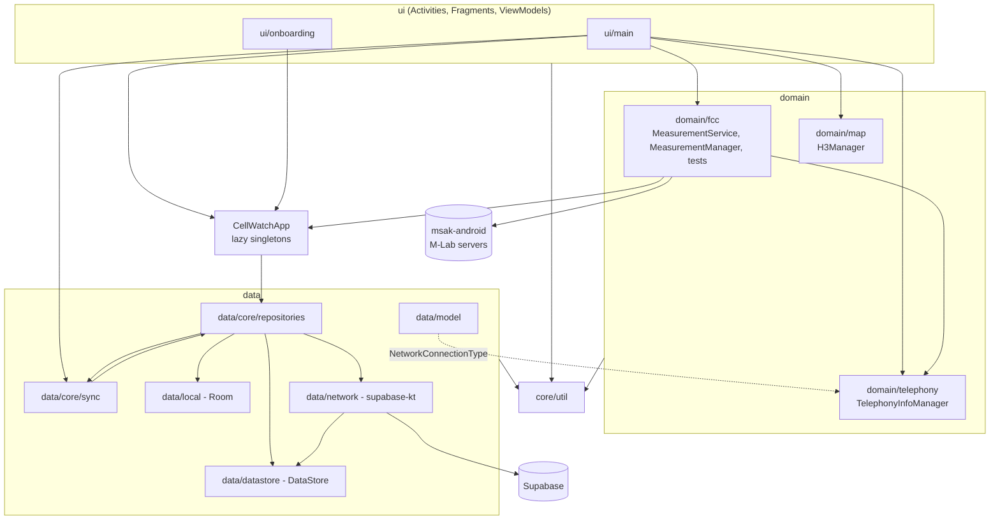

# Android app: code layout

How the Android app's Kotlin source is organized, how the layers depend on each other, and how objects are created and shared.

Related: [measurement-engine](measurement-engine.md) · [local-storage](local-storage.md) · [sync-and-upload](sync-and-upload.md) · [ui-and-screens](ui-and-screens.md) · [build-and-config](build-and-config.md) · [architecture overview](../architecture/overview.md)

Package root: `app/src/main/java/edu/gatech/cc/cellwatch/` (namespace and applicationId `edu.gatech.cc.cellwatch`). All paths below are relative to this root unless they start with `../`.

## Packages at a glance

| Package | What lives there |
|---|---|
| `(root)` | [CellWatchApp.kt](../../app/src/main/java/edu/gatech/cc/cellwatch/CellWatchApp.kt): the `Application` subclass and the app's only "container" of shared objects. |
| `core/util` | Cross-cutting helpers: Crashlytics-backed logger with secret redaction, Android Keystore encryption, permission checks, contact-info validation, `SingletonHolder`. |
| `domain/fcc` | The measurement engine: foreground service, test sequence, latency and throughput tests on M-Lab MSAK servers, ICMP ping. See [measurement-engine.md](measurement-engine.md). |
| `domain/telephony/managers` | `TelephonyInfoManager`: cells, signal, MCC/MNC, connection type, roaming, network generation. Also defines the `NetworkConnectionType` enum. |
| `domain/map/managers` | `H3Manager`: Uber H3 hex math for the map overlay. |
| `data/model` | App-wide ("external") models: `Measurement`, `MeasurementGroup`, `FccSubmission`, `Cell`, `Location`, etc., plus mappers to Room entities and network DTOs, and the FCC JSON export format. |
| `data/local` | Room database, DAOs, entities, type converters. See [local-storage.md](local-storage.md). |
| `data/datastore` | `LocalDataStore`: Jetpack DataStore (Preferences) for device id/secret, settings and contact info. |
| `data/core/repositories` | `MeasurementRepository` (Room + upload), `SettingsRepository` (DataStore). |
| `data/core/sync` | `UploadWorker` (WorkManager) and `MeasurementUploader` (upload logic). See [sync-and-upload.md](sync-and-upload.md). |
| `data/network` | `NetworkMeasurementDatasource` (supabase-kt client), network DTOs in `data/network/model`. (`LocalPortHeaders` exists only as uncommitted work on the `client-port-header` branch.) |
| `ui/main` | Activities, ViewModels, custom views and the RecyclerView adapter. Also hosts `OnboardingActivity`. See [ui-and-screens.md](ui-and-screens.md). |
| `ui/onboarding` | Onboarding fragments hosted by `OnboardingActivity`. |

## Layers and dependency direction

The intended direction is `ui -> domain -> data`, with `core/util` usable from everywhere. In practice the code reaches shared objects through static accessors on `CellWatchApp`, and a few edges run "backwards":

- `data` depends on `domain.telephony` for the `NetworkConnectionType` enum (used by `Measurement`, `MeasurementEntity`, `NetworkMeasurement`).
- `domain/fcc` (`MeasurementManager`, `MeasurementTest`) writes to Room through `CellWatchApp.measurementRepository` and reads contact info through `CellWatchApp.settingsRepository`.
- `data/model/Measurement.kt` imports Android `Context` and `R` for `displayValue()`, so the model layer is not pure Kotlin.
- `core/util/Log` reads the device id from `CellWatchApp.settingsRepository` when it initializes.
- `data/core/repositories/MeasurementRepository` reads `BuildConfig.TCP_TUPLE_URL` and makes its own OkHttp call (the tuple request).

## Object wiring (no DI framework)

There is no Hilt/Dagger/Koin. Objects are wired by hand:

| Object | How it is created | Where |
|---|---|---|
| `CellWatchApp` | `Application`; `init` stores `instance` and installs Conscrypt as security provider #1 (needed for msak's byte-counting TLS sockets). | [CellWatchApp.kt](../../app/src/main/java/edu/gatech/cc/cellwatch/CellWatchApp.kt) |
| `CellWatchDatabase` | `SingletonHolder<CellWatchDatabase, Context>` companion -> `getInstance(context)`; created lazily by `CellWatchApp`. | [CellWatchDatabase.kt](../../app/src/main/java/edu/gatech/cc/cellwatch/data/local/CellWatchDatabase.kt), [SingletonHolder.kt](../../app/src/main/java/edu/gatech/cc/cellwatch/core/util/SingletonHolder.kt) |
| `LocalDataStore`, `NetworkMeasurementDatasource`, `MeasurementRepository`, `SettingsRepository` | `by lazy` properties in `CellWatchApp.companion`. Only the two repositories are public. | `CellWatchApp.kt` |
| `measurementNotificationChannel` | `by lazy` in `CellWatchApp`; creates channel `measurement_notifications` (IMPORTANCE_LOW) on first use. | `CellWatchApp.kt` |
| `userAgent` | `CellWatch/<versionName>` plus `-debug` in debug builds; sent to M-Lab and the tuple service. | `CellWatchApp.kt` |
| `MeasurementManager`, `TelephonyInfoManager`, `H3Manager`, `Encryptor`, `PermissionManager`, `ContactInfoValidator`, `Log`, `HttpUtil` | Kotlin `object`s (process-wide singletons). | various |
| ViewModels | `ViewModelProvider(activity)[...]`; no factories or constructor parameters. | `ui/main` |
| `MeasurementService` | Android `Service`, started with `startForegroundService` and bound by `MeasureActivity`. | [MeasurementService.kt](../../app/src/main/java/edu/gatech/cc/cellwatch/domain/fcc/MeasurementService.kt) |
| `UploadWorker` | WorkManager `CoroutineWorker`, default WorkManager initializer (no custom `Configuration.Provider`). | [UploadWorker.kt](../../app/src/main/java/edu/gatech/cc/cellwatch/data/core/sync/UploadWorker.kt) |

Wiring chain: `CellWatchApp.measurementRepository = MeasurementRepository(database.measurementDao(), database.fccSubmissionDao(), NetworkMeasurementDatasource(LocalDataStore(ctx)))`; `CellWatchApp.settingsRepository = SettingsRepository(LocalDataStore(ctx))` (the same lazy `LocalDataStore` instance).

## Every Kotlin file

The tables list the Kotlin files on `doc-audit-fixes`, the branch of open PR #136 (main plus #136's fixes). Status labels:

- **#136**: the labeled file or detail was added or changed in open PR #136. Not merged to main, not released.
- **client-port-header**: exists only as uncommitted work on the local `client-port-header` branch, not on main or in #136. Not in a PR, not merged, not released, and its migration `202610130001` is not pushed to Supabase prod.

Unlabeled files are on main. #136 also carries bug fixes in `MeasurementService`, `MeasurementManager`, `OnboardingActivity`, `SettingsSetupFragment` and `MeasureHistoryActivity`/`MeasureHistoryViewModel`; the topic pages describe each one. Being on main does not mean a change is released: an app change reaches users only in a Play Store release (see [build-and-config.md](build-and-config.md#android-settings-appbuildgradle)).

### `(root)`

| File | Description |
|---|---|
| [CellWatchApp.kt](../../app/src/main/java/edu/gatech/cc/cellwatch/CellWatchApp.kt) | Application class; Conscrypt provider; lazy DB, repositories, notification channel, user agent. |

### `core/util`

| File | Description |
|---|---|
| [ContactInfoValidator.kt](../../app/src/main/java/edu/gatech/cc/cellwatch/core/util/ContactInfoValidator.kt) | Normalizes US phone numbers to `NNN-NNN-NNNN`; validates email via commons-validator. |
| [Encryptor.kt](../../app/src/main/java/edu/gatech/cc/cellwatch/core/util/Encryptor.kt) | AES-256-GCM with an Android Keystore key (alias `cellwatch-device-key`); used for the device secret. |
| [HttpUtil.kt](../../app/src/main/java/edu/gatech/cc/cellwatch/core/util/HttpUtil.kt) | Extracts an HTTP status (`code=NNN`) from an exception string (used to detect M-Lab 429s). |
| [Log.kt](../../app/src/main/java/edu/gatech/cc/cellwatch/core/util/Log.kt) | Logger used app-wide and by msak; INFO+ to Crashlytics log, WARN+ as non-fatal, logcat only in debug; redacts device secret/API key headers and JWTs (redaction merged to main in #112, 2026-10-07; not known to be in a release). |
| [PermissionManager.kt](../../app/src/main/java/edu/gatech/cc/cellwatch/core/util/PermissionManager.kt) | Checks READ_PHONE_STATE and fine+coarse location grants. |
| [SingletonHolder.kt](../../app/src/main/java/edu/gatech/cc/cellwatch/core/util/SingletonHolder.kt) | Double-checked-locking singleton-with-argument helper (used by the Room DB). |
| [setCopyOnClick.kt](../../app/src/main/java/edu/gatech/cc/cellwatch/core/util/setCopyOnClick.kt) | `View.setCopyOnClick` extension: copy text to clipboard and toast. |

### `domain/fcc`

| File | Description |
|---|---|
| [MeasurementService.kt](../../app/src/main/java/edu/gatech/cc/cellwatch/domain/fcc/MeasurementService.kt) | Foreground service (type `location`) that runs one test sequence with a wake lock and exposes progress via a `Binder`. |
| [MeasurementManager.kt](../../app/src/main/java/edu/gatech/cc/cellwatch/domain/fcc/MeasurementManager.kt) | Runs locate -> latency -> download -> upload, stores each result, creates the FCC submission. |
| [MeasurementTest.kt](../../app/src/main/java/edu/gatech/cc/cellwatch/domain/fcc/MeasurementTest.kt) | Base class: captures locations, cells, device/network metadata around `measure()` and builds a `Measurement`. |
| [LatencyTest.kt](../../app/src/main/java/edu/gatech/cc/cellwatch/domain/fcc/LatencyTest.kt) | Wraps msak `LatencyTest`; computes mean RTT and jitter (std dev). |
| [ThroughputTest.kt](../../app/src/main/java/edu/gatech/cc/cellwatch/domain/fcc/ThroughputTest.kt) | Wraps msak `ThroughputTest` (3 streams); splits warmup/active periods and aggregates bytes/s. |
| [ThroughputMetrics.kt](../../app/src/main/java/edu/gatech/cc/cellwatch/domain/fcc/ThroughputMetrics.kt) | bytes / usecs / bytesPerSec triple. |
| [ThroughputResult.kt](../../app/src/main/java/edu/gatech/cc/cellwatch/domain/fcc/ThroughputResult.kt) | Result of a throughput test (host, success, start, warmup + active metrics). |
| [LatencyResult.kt](../../app/src/main/java/edu/gatech/cc/cellwatch/domain/fcc/LatencyResult.kt) | Result of a latency test (host, success, start, usecs, mean RTT, jitter, packets). |
| [UnreachableServer.kt](../../app/src/main/java/edu/gatech/cc/cellwatch/domain/fcc/UnreachableServer.kt) | Placeholder msak `Server` used when M-Lab locate fails with an IOException; tests against it record failure. |
| [ping.kt](../../app/src/main/java/edu/gatech/cc/cellwatch/domain/fcc/ping.kt) | ICMP ping (lib/AndroidPing.aar), prefers IPv4; average ms over `count` pings. |

### `domain/telephony/managers`, `domain/map/managers`

| File | Description |
|---|---|
| [TelephonyInfoManager.kt](../../app/src/main/java/edu/gatech/cc/cellwatch/domain/telephony/managers/TelephonyInfoManager.kt) | Reads cells, signal metrics, MCC/MNC, provider name, connection type, data-enabled, roaming; watches cell changes. Defines `NetworkConnectionType`. |
| [H3Manager.kt](../../app/src/main/java/edu/gatech/cc/cellwatch/domain/map/managers/H3Manager.kt) | H3 helpers: polyfill viewport, hex boundaries/centers, parent/child, point-in-hex. Parent res 8, child res 9. |

### `data/model`

| File | Description |
|---|---|
| [Measurement.kt](../../app/src/main/java/edu/gatech/cc/cellwatch/data/model/Measurement.kt) | One latency, download or upload test result with metadata; mappers to entity and network DTOs; `displayValue`, `centerLatLon`. |
| [MeasurementGroup.kt](../../app/src/main/java/edu/gatech/cc/cellwatch/data/model/MeasurementGroup.kt) | latency + download + upload (+ optional FCC submission) sharing one group id; validates consistency. |
| [FccSubmission.kt](../../app/src/main/java/edu/gatech/cc/cellwatch/data/model/FccSubmission.kt) | FCC challenge metadata for a group (id = group id); mappers. client-port-header adds `tupleLocalPort`. |
| [FccExportExtensions.kt](../../app/src/main/java/edu/gatech/cc/cellwatch/data/model/FccExportExtensions.kt) | Serializable FCC-style JSON export (`FccSubmissionExport`, `TestSet`, ...), used by History export. |
| [Cell.kt](../../app/src/main/java/edu/gatech/cc/cellwatch/data/model/Cell.kt) | One observed cell (ids, generation, subtype, RSRP/RSRQ/SINR, band, ARFCN...). |
| [Location.kt](../../app/src/main/java/edu/gatech/cc/cellwatch/data/model/Location.kt) | Lat/lon fix with accuracy, speed, heading; `fromAndroidLocation`. |
| [LatencyData.kt](../../app/src/main/java/edu/gatech/cc/cellwatch/data/model/LatencyData.kt) | RTT, jitter, packets sent/received, servers. |
| [UploadDownloadData.kt](../../app/src/main/java/edu/gatech/cc/cellwatch/data/model/UploadDownloadData.kt) | Warmup/active bytes and durations, bytes/s, servers. |
| [CollectionMode.kt](../../app/src/main/java/edu/gatech/cc/cellwatch/data/model/CollectionMode.kt) | `FCC_CHALLENGE` or `TESTING`. |
| [TcpTuple.kt](../../app/src/main/java/edu/gatech/cc/cellwatch/data/model/TcpTuple.kt) | Response of the tuple service (public IP, port, server timestamp). client-port-header adds `localPort`. |
| [ChallengeData.kt](../../app/src/main/java/edu/gatech/cc/cellwatch/data/model/ChallengeData.kt) | Unused: contact/category model; its entity is not registered in the Room DB. |
| [Device.kt](../../app/src/main/java/edu/gatech/cc/cellwatch/data/model/Device.kt) | Unused: device metadata model; its entity is not registered in the Room DB. |

### `data/local` (Room)

| File | Description |
|---|---|
| [CellWatchDatabase.kt](../../app/src/main/java/edu/gatech/cc/cellwatch/data/local/CellWatchDatabase.kt) | Room DB `cellwatch_database`, version 18, 6 entities, migrations. |
| [dao/MeasurementDao.kt](../../app/src/main/java/edu/gatech/cc/cellwatch/data/local/dao/MeasurementDao.kt) | Insert measurement with children in one transaction; unsynced query; flows. |
| [dao/FccSubmissionDao.kt](../../app/src/main/java/edu/gatech/cc/cellwatch/data/local/dao/FccSubmissionDao.kt) | CRUD and unsynced query for FCC submissions. |
| [dao/CellDao.kt](../../app/src/main/java/edu/gatech/cc/cellwatch/data/local/dao/CellDao.kt), [dao/LatencyDataDao.kt](../../app/src/main/java/edu/gatech/cc/cellwatch/data/local/dao/LatencyDataDao.kt), [dao/LocationDao.kt](../../app/src/main/java/edu/gatech/cc/cellwatch/data/local/dao/LocationDao.kt), [dao/UploadDownloadDataDao.kt](../../app/src/main/java/edu/gatech/cc/cellwatch/data/local/dao/UploadDownloadDataDao.kt) | Per-table DAOs; declared on the DB but only used by instrumented tests (app inserts go through `MeasurementDao`). |
| [model/MeasurementEntity.kt](../../app/src/main/java/edu/gatech/cc/cellwatch/data/local/model/MeasurementEntity.kt) | Measurement table. |
| [model/FccSubmissionEntity.kt](../../app/src/main/java/edu/gatech/cc/cellwatch/data/local/model/FccSubmissionEntity.kt) | FCC submission table (id = group id). |
| [model/UploadDownloadDataEntity.kt](../../app/src/main/java/edu/gatech/cc/cellwatch/data/local/model/UploadDownloadDataEntity.kt), [model/LatencyDataEntity.kt](../../app/src/main/java/edu/gatech/cc/cellwatch/data/local/model/LatencyDataEntity.kt), [model/LocationEntity.kt](../../app/src/main/java/edu/gatech/cc/cellwatch/data/local/model/LocationEntity.kt), [model/CellEntity.kt](../../app/src/main/java/edu/gatech/cc/cellwatch/data/local/model/CellEntity.kt) | Child tables of `MeasurementEntity` (FK `measurementId`, cascade). |
| [model/MeasurementWithData.kt](../../app/src/main/java/edu/gatech/cc/cellwatch/data/local/model/MeasurementWithData.kt) | `@Relation` POJO: measurement + its children. |
| [model/FccSubmissionWithMeasurements.kt](../../app/src/main/java/edu/gatech/cc/cellwatch/data/local/model/FccSubmissionWithMeasurements.kt) | `@Relation` POJO: submission + measurements in its group. |
| [model/ChallengeDataEntity.kt](../../app/src/main/java/edu/gatech/cc/cellwatch/data/local/model/ChallengeDataEntity.kt), [model/DeviceEntity.kt](../../app/src/main/java/edu/gatech/cc/cellwatch/data/local/model/DeviceEntity.kt) | `@Entity` classes not listed in `@Database`, so no tables exist. |
| [util/Converters.kt](../../app/src/main/java/edu/gatech/cc/cellwatch/data/local/util/Converters.kt) | `Instant` <-> epoch ms; `List<String>` <-> Gson JSON. |

### `data/datastore`, `data/core`

| File | Description |
|---|---|
| [datastore/LocalDataStore.kt](../../app/src/main/java/edu/gatech/cc/cellwatch/data/datastore/LocalDataStore.kt) | Preferences DataStore `data_store`: device id, encrypted device secret, collection mode, contact info, flags. |
| [core/repositories/SettingsRepository.kt](../../app/src/main/java/edu/gatech/cc/cellwatch/data/core/repositories/SettingsRepository.kt) | Settings API with FCC-mode invariants (no blank contact info in FCC mode). |
| [core/repositories/MeasurementRepository.kt](../../app/src/main/java/edu/gatech/cc/cellwatch/data/core/repositories/MeasurementRepository.kt) | Room reads/writes, measurement groups, upload-time flow, `uploadPending()`, tuple request. |
| [core/sync/MeasurementUploader.kt](../../app/src/main/java/edu/gatech/cc/cellwatch/data/core/sync/MeasurementUploader.kt) | Upload algorithm: measurements first, then submissions whose 3 tests are uploaded; parallelism 3. |
| [core/sync/UploadWorker.kt](../../app/src/main/java/edu/gatech/cc/cellwatch/data/core/sync/UploadWorker.kt) | Unique one-time WorkManager job `upload-pending`; retries on failures. |

### `data/network`

| File | Description |
|---|---|
| [NetworkMeasurementDatasource.kt](../../app/src/main/java/edu/gatech/cc/cellwatch/data/network/NetworkMeasurementDatasource.kt) | supabase-kt client; `register_device`, `insert_measurement`, insert into `fcc_submissions`; error mapping. |
| `LocalPortHeaders.kt` | client-port-header only (not on main or in #136): OkHttp network interceptor adding `X-Local-Port` and `X-Transport`. |
| [NetworkRestResult.kt](../../app/src/main/java/edu/gatech/cc/cellwatch/data/network/NetworkRestResult.kt) | Unused data class (measurement + optional `RestException`). |
| [model/NetworkMeasurement.kt](../../app/src/main/java/edu/gatech/cc/cellwatch/data/network/model/NetworkMeasurement.kt) | Snake-case DTO for `measurements`. |
| [model/NetworkMeasurementWithData.kt](../../app/src/main/java/edu/gatech/cc/cellwatch/data/network/model/NetworkMeasurementWithData.kt) | `insert_measurement` RPC body (`in_measurement`, `in_measurement_data`, `in_latency_data`, `in_locations`, `in_cells`). |
| [model/NetworkFccSubmission.kt](../../app/src/main/java/edu/gatech/cc/cellwatch/data/network/model/NetworkFccSubmission.kt) | DTO for `fcc_submissions`. client-port-header adds `tuple_local_port`. |
| [model/NetworkUploadDownloadData.kt](../../app/src/main/java/edu/gatech/cc/cellwatch/data/network/model/NetworkUploadDownloadData.kt), [model/NetworkLatencyData.kt](../../app/src/main/java/edu/gatech/cc/cellwatch/data/network/model/NetworkLatencyData.kt), [model/NetworkLocation.kt](../../app/src/main/java/edu/gatech/cc/cellwatch/data/network/model/NetworkLocation.kt), [model/NetworkCell.kt](../../app/src/main/java/edu/gatech/cc/cellwatch/data/network/model/NetworkCell.kt) | Child DTOs. |
| [model/NetworkChallengeData.kt](../../app/src/main/java/edu/gatech/cc/cellwatch/data/network/model/NetworkChallengeData.kt), [model/NetworkFccSubmissionWithMeasurements.kt](../../app/src/main/java/edu/gatech/cc/cellwatch/data/network/model/NetworkFccSubmissionWithMeasurements.kt) | DTOs not used by any upload path. |

### `ui/main`

| File | Description |
|---|---|
| [MapActivity.kt](../../app/src/main/java/edu/gatech/cc/cellwatch/ui/main/MapActivity.kt) | Launcher activity; Mapbox map of local measurements as pins or H3 hexes; search; bottom sheet; enqueues upload. |
| [MapViewModel.kt](../../app/src/main/java/edu/gatech/cc/cellwatch/ui/main/MapViewModel.kt) | Caches measurement groups and indexes them by res-9 H3 cell. |
| [MeasureActivity.kt](../../app/src/main/java/edu/gatech/cc/cellwatch/ui/main/MeasureActivity.kt) | Hosts Pre-measure / Measure fragments; binds to `MeasurementService`. |
| [MeasureViewModel.kt](../../app/src/main/java/edu/gatech/cc/cellwatch/ui/main/MeasureViewModel.kt) | Turns service state into UI progress; enqueues upload; watches upload time. |
| [PreMeasureFragment.kt](../../app/src/main/java/edu/gatech/cc/cellwatch/ui/main/PreMeasureFragment.kt) | Stationary/moving choice, permission and cellular checks, starts the service. |
| [MeasureFragment.kt](../../app/src/main/java/edu/gatech/cc/cellwatch/ui/main/MeasureFragment.kt) | In-progress and result view. |
| [MeasureHistoryActivity.kt](../../app/src/main/java/edu/gatech/cc/cellwatch/ui/main/MeasureHistoryActivity.kt) | List of past groups; JSON export via SAF. |
| [MeasureHistoryViewModel.kt](../../app/src/main/java/edu/gatech/cc/cellwatch/ui/main/MeasureHistoryViewModel.kt) | Loads groups; writes the FCC-style export bundle. #136 makes `exportData` a suspend function that writes to an `OutputStream` the activity keeps open. |
| [MeasurementAdapter.kt](../../app/src/main/java/edu/gatech/cc/cellwatch/ui/main/MeasurementAdapter.kt) | RecyclerView adapter of `MeasurementGroupItem`s (newest first). |
| [MeasurementGroupItem.kt](../../app/src/main/java/edu/gatech/cc/cellwatch/ui/main/MeasurementGroupItem.kt) | Custom view: one group (date, carrier, type, upload status, 3 results). |
| [MeasurementGroupItemViewModel.kt](../../app/src/main/java/edu/gatech/cc/cellwatch/ui/main/MeasurementGroupItemViewModel.kt) | Remembers which group items are expanded. |
| [MeasurementItem.kt](../../app/src/main/java/edu/gatech/cc/cellwatch/ui/main/MeasurementItem.kt) | Custom view: one test's details (time, location, technology, roaming). |
| [NavigationDrawer.kt](../../app/src/main/java/edu/gatech/cc/cellwatch/ui/main/NavigationDrawer.kt) | Side menu: Map, Measure, History, Settings, Help/About. |
| [SettingsActivity.kt](../../app/src/main/java/edu/gatech/cc/cellwatch/ui/main/SettingsActivity.kt) | Collection mode, contact info, device id, app version. |
| [AboutActivity.kt](../../app/src/main/java/edu/gatech/cc/cellwatch/ui/main/AboutActivity.kt) | Static about text and OSS licenses screen. |
| [OnboardingActivity.kt](../../app/src/main/java/edu/gatech/cc/cellwatch/ui/main/OnboardingActivity.kt) | Onboarding pager (fragment back stack, swipe, dots). |

### `ui/onboarding`

| File | Description |
|---|---|
| [HomeFragment.kt](../../app/src/main/java/edu/gatech/cc/cellwatch/ui/onboarding/HomeFragment.kt) | Welcome screen with "read more". |
| [ReadMoreFragment.kt](../../app/src/main/java/edu/gatech/cc/cellwatch/ui/onboarding/ReadMoreFragment.kt) | Longer explanation; close returns to welcome. |
| [DataUseFragment.kt](../../app/src/main/java/edu/gatech/cc/cellwatch/ui/onboarding/DataUseFragment.kt) | Data-use explanation and privacy-policy link. |
| [CollectionModeFragment.kt](../../app/src/main/java/edu/gatech/cc/cellwatch/ui/onboarding/CollectionModeFragment.kt) | Choose FCC Challenge or Testing mode. |
| [FCCInfoFragment.kt](../../app/src/main/java/edu/gatech/cc/cellwatch/ui/onboarding/FCCInfoFragment.kt) | Name/phone/email + FCC sharing acknowledgement (FCC mode only). |
| [SettingsSetupFragment.kt](../../app/src/main/java/edu/gatech/cc/cellwatch/ui/onboarding/SettingsSetupFragment.kt) | Requests location + phone-state permissions, then finishes onboarding. Note: this file has no `package` declaration, so the class is in the default package (imported as `import SettingsSetupFragment`). |

## Tests

| Location | Contents |
|---|---|
| [app/src/test](../../app/src/test/java/edu/gatech/cc/cellwatch/) | JVM unit tests: `RedactSecretsTest`, `MeasurementUploaderTest`; `OnboardingScreenTest` (#136). `LocalPortHeadersTest` is client-port-header only. |
| [app/src/androidTest](../../app/src/androidTest/java/edu/gatech/cc/cellwatch/) | Instrumented: DAO tests, serialization, cells, latency/throughput tests. |

See [../dev/testing.md](../dev/testing.md) for how to run them.
