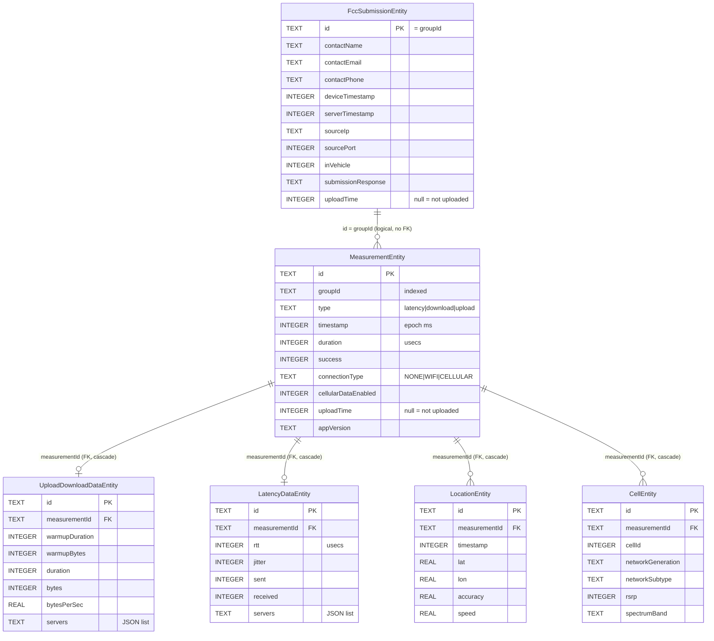

# Android app: local storage

What the app keeps on the phone: the Room database of measurements and FCC submissions, the DataStore of settings and identity, and how the device secret is encrypted.

Related: [layout](layout.md) · [measurement-engine](measurement-engine.md) · [sync-and-upload](sync-and-upload.md) · [identity and security](../architecture/identity-and-security.md) · [Supabase schema](../supabase/schema.md)

## Room database

[CellWatchDatabase.kt](../../app/src/main/java/edu/gatech/cc/cellwatch/data/local/CellWatchDatabase.kt)

| Property | Value |
|---|---|
| File name | `cellwatch_database` |
| Version | **18** |
| Exported schemas | [app/schemas/.../CellWatchDatabase/](../../app/schemas/edu.gatech.cc.cellwatch.data.local.CellWatchDatabase/) (15-18; `room.schemaLocation` set in `app/build.gradle`) |
| Entities | `FccSubmissionEntity`, `MeasurementEntity`, `UploadDownloadDataEntity`, `LatencyDataEntity`, `LocationEntity`, `CellEntity` |
| Type converters | `InstantConverter`, `ListConverter` |
| Instance | `companion object : SingletonHolder<CellWatchDatabase, Context>`; created lazily from `CellWatchApp` |
| Room version | 2.5.2 (kapt) |

`ChallengeDataEntity` and `DeviceEntity` are annotated `@Entity` but are **not** in the `@Database` list, so there are no such tables.

### Entities and relations

The diagram shows key columns only; see the entity files or `18.json` for all of them.

| Table | Columns (v18) | Notes |
|---|---|---|
| `MeasurementEntity` | 31 | Indexes on `groupId`, `campaignId`, `sessionId`, `deviceId`. `campaignId`, `sessionId`, `extraData` are never set by the app. `connectionType` is the `NetworkConnectionType` enum stored by name. |
| `FccSubmissionEntity` | 32 | Index on `challengeDataId` (never set). `deviceImei`, `deviceTac`, `submitted`, `submittedOn`, `submission`, `submissionResponse` are not set when the row is created (they can be filled from the server's copy when the row is marked uploaded). Contains contact PII. |
| `UploadDownloadDataEntity` | 12 | One per throughput measurement. |
| `LatencyDataEntity` | 9 | One per latency measurement. |
| `LocationEntity` | 11 | 0-2 per measurement (start and end fix). |
| `CellEntity` | 22 | Every cell observed during the test, including repeats from cell-change callbacks. |

Every table also has `createdOn` / `updatedOn` columns. The app does not set them when recording; after a successful upload the `MeasurementEntity` / `FccSubmissionEntity` row is overwritten with the copy the server returned (see [sync-and-upload.md](sync-and-upload.md#marking-rows-uploaded)), which may fill server-side values such as these.

The relation from a submission to its measurements is by convention only: `FccSubmissionEntity.id == MeasurementEntity.groupId` (used by `FccSubmissionWithMeasurements` and `MeasurementRepository.getMeasurementGroups`).

The `tupleLocalPort` field that uncommitted work on the `client-port-header` branch adds to `FccSubmission` is **not** stored in Room; it is set in memory just before upload.

### DAOs and key queries

| DAO | Method | Query / behavior | Used by |
|---|---|---|---|
| [MeasurementDao](../../app/src/main/java/edu/gatech/cc/cellwatch/data/local/dao/MeasurementDao.kt) | `insertMeasurementWithData` | `@Transaction`: inserts the measurement, sets `measurementId` on and inserts its upload/download or latency data, cells and locations | `MeasurementRepository.insertMeasurement` |
| | `getMeasurementsWithData` | `SELECT * FROM MeasurementEntity` + relations | groups for Map/History |
| | `getUnsynchronizedMeasurementsWithData` | `... WHERE uploadTime IS NULL` + relations | uploader |
| | `getMeasurementsInGroup(groupId)` | `... WHERE groupId = :groupId` | uploader (submission readiness) |
| | `getMeasurementById(id)` | `... WHERE id = :id` | upload-time lookup |
| | `getMeasurementsFlow` | Flow over the table | `uploadTimeFlow` |
| | `updateMeasurement` | `@Update` (whole row) | marks uploaded |
| [FccSubmissionDao](../../app/src/main/java/edu/gatech/cc/cellwatch/data/local/dao/FccSubmissionDao.kt) | `insertFccSubmission` | `@Insert` | `MeasurementRepository.insertFccSubmission` |
| | `getFccSubmissions` | `SELECT * FROM FccSubmissionEntity` | groups |
| | `getUnsynchronizedFccSubmissions` | `... WHERE uploadTime IS NULL` | uploader |
| | `getFccSubmissionById(id)` | `... WHERE id = :id` | upload-time lookup |
| | `getFccSubmissionsFlow` | Flow over the table | `uploadTimeFlow` |
| | `updateFccSubmission` | `@Update` | marks uploaded |
| | `getFccSubmissionsWithMeasurements` | `@Transaction ... ORDER BY id` | instrumented tests only |

`CellDao`, `LatencyDataDao`, `LocationDao`, `UploadDownloadDataDao` and the `delete*` methods are used only by instrumented tests. Nothing in the app deletes local rows; uploaded rows stay on the phone (they feed the Map and History screens).

### Converters

[Converters.kt](../../app/src/main/java/edu/gatech/cc/cellwatch/data/local/util/Converters.kt)

| Converter | Kotlin type | Stored as |
|---|---|---|
| `InstantConverter` | `kotlinx.datetime.Instant?` | `INTEGER` epoch milliseconds |
| `ListConverter` | `List<String>` | `TEXT` Gson JSON array; unparseable text reads back as an empty list |

### Migrations

| From -> To | Kind | Change |
|---|---|---|
| 15 -> 16 | `AutoMigration` | `FccSubmissionEntity.sourcePort` TEXT -> INTEGER |
| 16 -> 17 | `AutoMigration` **and** manual `MIGRATION_ADD_SUBMISSION_RESPONSE` | `ALTER TABLE FccSubmissionEntity ADD COLUMN submissionResponse TEXT` |
| 17 -> 18 | `AutoMigration` **and** manual `MIGRATION_ADD_BYTES_PER_SEC` | `ALTER TABLE UploadDownloadDataEntity ADD COLUMN bytesPerSec REAL` and `applicationBytesPerSec REAL` (old rows left null on purpose) |

When both an `AutoMigration` and a manual `Migration` cover the same range, the manual one runs: in Room 2.5.2, `RoomDatabase.init` adds an auto-migration only if no manual migration is registered for the same start and end versions (checked in the room-runtime 2.5.2 bytecode). So 16 -> 17 and 17 -> 18 use `MIGRATION_ADD_SUBMISSION_RESPONSE` and `MIGRATION_ADD_BYTES_PER_SEC`.

There is no migration path below version 15 and no `fallbackToDestructiveMigration()`, so an install with a DB older than 15 would fail to open. When adding a column: bump `version`, add an `AutoMigration` (or a manual `Migration` for anything Room cannot infer), and commit the new `NN.json` schema file.

## DataStore (`LocalDataStore`)

[LocalDataStore.kt](../../app/src/main/java/edu/gatech/cc/cellwatch/data/datastore/LocalDataStore.kt) uses Preferences DataStore named `data_store`.

| Key | Type | Meaning | Read/written by |
|---|---|---|---|
| `device_id` | String | Random UUID identifying this install; created on first `SettingsRepository.getDeviceId()`. Also set as Crashlytics custom key `device_id`. | `SettingsRepository`, `NetworkMeasurementDatasource`, `Log` |
| `device_secret` | String | The device secret, stored **encrypted** with `Encryptor` (Base64 of IV length + IV + AES-GCM ciphertext). Sent as `X-Device-Secret`. Since #148 the app makes it (32 random bytes as 64 hex digits) and saves it **before** calling `register_device(device_id, device_secret)`; in the released build the server made it and the app saved what `register_device(device_id)` returned. | `NetworkMeasurementDatasource` only |
| `device_registered` | Boolean | Added in #148: the server has confirmed `device_secret`. Until it is true, the next upload calls `register_device` again with the same secret. A phone registered by an older version has a secret but no flag, so it confirms its secret once. | `NetworkMeasurementDatasource` only |
| `collection_mode` | String | `CollectionMode` name. Invalid stored values throw. | `SettingsRepository` |
| `fcc_policy_agreed` | Boolean | User acknowledged FCC data sharing. | `SettingsRepository` |
| `user_name` | String | Contact name (PII). | `SettingsRepository` |
| `phone_number` | String | Contact phone (PII). | `SettingsRepository` |
| `email` | String | Contact email (PII). | `SettingsRepository` |
| `onboarding_complete` | Boolean | Set after onboarding permissions; `MapActivity` redirects to onboarding until true. | `SettingsRepository` |

Contact info is stored in plain text in DataStore; only the device secret is encrypted. The manifest sets `android:allowBackup="false"` and `android:fullBackupContent="false"`, with `dataExtractionRules` in `res/xml/data_extraction_rules.xml`.

## SettingsRepository

[SettingsRepository.kt](../../app/src/main/java/edu/gatech/cc/cellwatch/data/core/repositories/SettingsRepository.kt) wraps `LocalDataStore` with suspend getters/setters and enforces FCC-mode rules:

| Method | Rule |
|---|---|
| `getDeviceId()` | Generates and saves a UUID if missing or empty. |
| `getCollectionMode()` | If unset: `FCC_CHALLENGE` when name, phone, email and acknowledgement are all present, else `TESTING`; the choice is saved. |
| `setCollectionMode(FCC_CHALLENGE)` | Throws `MissingFccInfoException` unless name, phone, email are non-blank and acknowledgement is true. |
| `setName / setPhoneNumber / setEmail` | Throw `BlankInFccChallengeModeException` for blank values while in FCC mode. |
| `setFccSharingAcknowledged(false)` | Throws `IllegalStateException` while in FCC mode. |
| `get/setOnboardingComplete` | Plain flag. |

The device secret and `device_registered` have no accessor here; only `NetworkMeasurementDatasource` reads them (registration logic in [DeviceRegistration.kt](../../app/src/main/java/edu/gatech/cc/cellwatch/data/network/DeviceRegistration.kt)).

## Encryptor

[Encryptor.kt](../../app/src/main/java/edu/gatech/cc/cellwatch/core/util/Encryptor.kt)

- Key: AES-256 in `AndroidKeyStore`, alias `cellwatch-device-key`, GCM, no padding, randomized encryption required. Created on first use if the alias is missing.
- `encrypt(String)`: random IV from the cipher; output is Base64 (`NO_WRAP`) of `[ivLength][iv][ciphertext+tag]`.
- `decrypt(String)`: reverses it with a 128-bit GCM tag.
- Only used for `device_secret`. If the Keystore key is lost (for example after a restore to a new device; backups are disabled anyway), decryption fails and the stored secret cannot be recovered.
