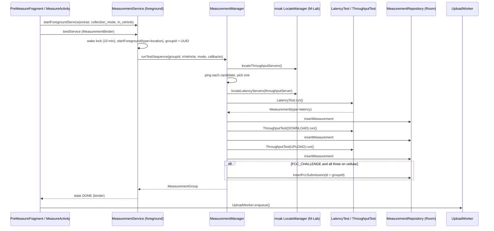

# Android app: measurement engine

How the app runs a speed test (latency, download, upload) against M-Lab MSAK servers, what it records alongside each test, and when a test becomes an FCC challenge submission.

Related: [layout](layout.md) · [local-storage](local-storage.md) · [sync-and-upload](sync-and-upload.md) · [ui-and-screens](ui-and-screens.md) · [build-and-config](build-and-config.md) · [FCC BDC spec mapping](../fcc/bdc-spec-mapping.md)

Code: [`domain/fcc/`](../../app/src/main/java/edu/gatech/cc/cellwatch/domain/fcc/), [`domain/telephony/managers/TelephonyInfoManager.kt`](../../app/src/main/java/edu/gatech/cc/cellwatch/domain/telephony/managers/TelephonyInfoManager.kt), [`data/model/CollectionMode.kt`](../../app/src/main/java/edu/gatech/cc/cellwatch/data/model/CollectionMode.kt).

## Vocabulary

| Term | Meaning in code |
|---|---|
| **Measurement** | One test of one `type`: `"latency"`, `"download"` or `"upload"`. A [`Measurement`](../../app/src/main/java/edu/gatech/cc/cellwatch/data/model/Measurement.kt) row plus children: `LatencyData` *or* `UploadDownloadData`, 0-2 `Location`s (start/end), and every `Cell` seen during the test. Own UUID `id`. |
| **Measurement group** | One press of "Go": the three measurements (latency, download, upload) that share a `groupId` (a random UUID made by `MeasurementService`). Modeled by [`MeasurementGroup`](../../app/src/main/java/edu/gatech/cc/cellwatch/data/model/MeasurementGroup.kt), which also carries the optional FCC submission. |
| **FCC submission** | [`FccSubmission`](../../app/src/main/java/edu/gatech/cc/cellwatch/data/model/FccSubmission.kt) whose `id` equals the group id. Created only in FCC Challenge mode when all three tests ran over cellular (see below). |
| **Collection mode** | `CollectionMode.FCC_CHALLENGE` or `CollectionMode.TESTING`, stored in DataStore. Decides whether a submission is created and what the pre-measure screen shows. |

## Flow of one test run

### `MeasurementService` (foreground service)

[MeasurementService.kt](../../app/src/main/java/edu/gatech/cc/cellwatch/domain/fcc/MeasurementService.kt)

- Declared in the manifest with `android:foregroundServiceType="location"`, not exported.
- `onStartCommand`: acquires a `PARTIAL_WAKE_LOCK` with a 10-minute timeout, calls `ServiceCompat.startForeground` (notification id `100`, channel `measurement_notifications`, type `FOREGROUND_SERVICE_TYPE_LOCATION`), then runs the test on a new thread with its own `Looper` inside `runBlocking`. Returns `START_NOT_STICKY`; calls `stopSelf()` when done.
- Requires extras `collection_mode` (enum name) and `in_vehicle` (Boolean); without them it logs an error and runs nothing.
- Only one run at a time: `state` must go from `null` or `DONE` to `STARTING`, otherwise "measurement already running".
- States exposed via `MeasurementBinder.state`: `STARTING, STARTED, LOCATE, LATENCY, DOWNLOAD, UPLOAD, DONE`. The binder also exposes `groupId`, `latency`, `download`, `upload`, `group`, `lastErrorCode`, `lastErrorMessage`.
- On exception the message is kept and `HttpUtil.code()` pulls an HTTP status from it; `MeasureViewModel` shows a special message for `429` (M-Lab rate limiting).

> Note: on main, on the error path `runTest` calls `releaseWakeLock()` in `catch` and then `wakeLock.release()` again in `finally`. The second release on an un-held lock likely throws ("under-locked"), which is caught and logged as "unexpected error running test" after `DONE` is already set. **Fixed in #136; reaches users with the next app release**: `runTest` no longer releases the lock; `onStartCommand` releases it once.

### `MeasurementManager.runTestSequence`

[MeasurementManager.kt](../../app/src/main/java/edu/gatech/cc/cellwatch/domain/fcc/MeasurementManager.kt)

1. **Measurement id for msak**: a random UUID only when `BuildConfig.MSAK_SERVER_ENV == "local"`, else `null`. The same id (or `null`) is passed to both msak tests.
2. **Server selection** (`chooseMsakServers`, below).
3. **Latency**, then **download**, then **upload**. Each result is written to Room via `CellWatchApp.measurementRepository.insertMeasurement` as soon as it finishes, so partially completed groups can exist if a later test throws.
4. **FCC submission** (see "When an FCC submission is created").
5. Returns `MeasurementGroup(latency, download, upload, submission)`.

Any exception from a test (other than the tolerated network errors described below) aborts the sequence; the service reports it to the UI as an error.

## Choosing MSAK / M-Lab servers

`chooseMsakServers` builds an msak `LocateManager` from BuildConfig:

| BuildConfig field | Debug build | Release build |
|---|---|---|
| `MSAK_SERVER_ENV` | from `cellwatch.properties` (`local`, `staging` or `prod`) | hard-coded `"prod"` |
| `MSAK_LOCAL_SERVER_HOST` | from properties (used only when env is `local`) | `""` |
| `MSAK_LOCAL_SERVER_SECURE` | from properties | `true` |
| `MSAK_LATENCY_PORT` | from `MSAK_LOCAL_LATENCY_PORT` | from `MSAK_LATENCY_PORT` |

`ServerEnv` values in msak-android 0.1.3: `PROD` (M-Lab locate v2 `nearest`), `STAGING` (M-Lab staging locate), `LOCAL` (talks directly to `MSAK_LOCAL_SERVER_HOST`). Services requested are `msak/throughput1` and `msak/latency1`. `MSAK_LATENCY_PORT` is defined in BuildConfig but not read by any app code.

Selection steps:

1. `locateThroughputServers()`; empty list -> exception "no throughput servers found" (run fails).
2. Ping every candidate's `machine` with [ping.kt](../../app/src/main/java/edu/gatech/cc/cellwatch/domain/fcc/ping.kt) (5 ICMP pings, 5 ms apart, IPv4 preferred; uses `com.spectrum.android.ping.Ping` from `lib/AndroidPing.aar`) and pick one with `maxBy { ping(...) }`. If any ping throws, the first server in locate's order is used.
3. `locateLatencyServers(throughputServer)`; prefer the entry on the same machine, else the first. Empty -> exception.
4. If locate throws an `IOException` (no connectivity), both servers become an [`UnreachableServer`](../../app/src/main/java/edu/gatech/cc/cellwatch/domain/fcc/UnreachableServer.kt) for the locate host. Tests against it return immediately with `success = false` and zero metrics, so a failed group is still recorded (the FCC counts failed tests).

> Note: `maxBy` selects the candidate with the *highest* latency (`ping()` returns the average RTT in ms, so this is the slowest server). This is the FCC-approved, released behaviour. A fix (`closestServer()`, lowest RTT; an unreachable server ranks last) was merged in #136 and then taken back out of main, because it changes which server a test runs against. It waits on the local branch `measurement-process-changes` for FCC review.

## What every test captures (`MeasurementTest.run`)

[MeasurementTest.kt](../../app/src/main/java/edu/gatech/cc/cellwatch/domain/fcc/MeasurementTest.kt) wraps the subclass's `measure()`:

| When | What |
|---|---|
| Before | Fused location (`GRANULARITY_FINE`, max age 3 s); `TelephonyInfoManager.getConnectionType()`; `isCellularDataEnabled()`; current cells; current network generation. |
| During | `TelephonyInfoManager.watchCells` (TelephonyCallback on API 31+, PhoneStateListener before) appends every new cell list and the generation at that moment. |
| After | Second fused location. |

If location permission is missing or the location request fails, `getLocation` throws and the whole run fails.

The resulting `Measurement` gets: `groupId`, `deviceId` (from `SettingsRepository`), manufacturer (`EasyDeviceMod`), `Build.MODEL`, `deviceOsName="Android"`, OS version, app name (`EasyAppMod`), `appVersion = BuildConfig.VERSION_NAME`, provider, sim/net MCC/MNC, `carrierAggregation`, `networkAvailable`, `networkConnected`, `networkRoaming`, `scheduled = false`, `timestamp` = test start, `duration` (µs; throughput = warmup + active), `connectionType`, `cellularDataEnabled`, start/end `locations`, all `cells`, and either `latencyData` or `uploadDownloadData`.

**Success rule**: `success` is the test's own result, forced to `false` if the network generation (2G/3G/4G/5G) changed during the test ("The FCC requires the test to stay on the same technology generation").

### Telephony details (`TelephonyInfoManager`)

- Cells come from `TelephonyManager.allCellInfo` (requires READ_PHONE_STATE; returns `null` without it). For each cell: cell id, PCI, connection status (primary/secondary serving), generation from the `CellInfo` class, FCC subtype (`1X, EVDO, WCDMA, GSM, HSPA, HSPA+, LTE, NRSA, NRNSA`), dBm, RSSI, RSRP, RSRQ, SINR, CSI-RSRP/RSRQ/SINR (NR), CQI, bands (API 30+), LTE bandwidth (MHz), ARFCN. `UNAVAILABLE` values become `null`. Cell timestamps are converted from elapsed-realtime to wall clock.
- NR is `NRNSA` when the primary serving cell is LTE and a secondary serving cell is NR.
- `isUsingCarrierAggregation`: more than one primary/secondary serving cell.
- `getProviderName`: `networkOperatorName`, else `simOperatorName`, else `"unknown"`, lower-cased.
- `getConnectionType`: `WIFI`, `CELLULAR` or `NONE` from the (deprecated) `activeNetworkInfo`.

`lib/DeviceInformation-release.aar` (package `com.oseamiya.deviceinformation`) is on the classpath but no app code imports it; device info comes from `easydeviceinfo` and `android.os.Build`.

## Latency test

[LatencyTest.kt](../../app/src/main/java/edu/gatech/cc/cellwatch/domain/fcc/LatencyTest.kt) wraps msak `LatencyTest(server, client, measurementId, userAgent)`.

- Streams each `LastRTT` to `rttChan` (only logged by `MeasurementManager`).
- Tolerated (network) errors: `AuthorizeFailureExecption`, `ResultFailureException`, `NoAddrException`, `InitialPacketTimeoutException` -> uses whatever result exists. Any other error is rethrown.
- `rtt` = mean RTT of non-lost round trips; `jitter` = population standard deviation of those RTTs. Units are microseconds (the UI divides by 1000 to show ms).
- `success = PacketsReceived > 0`.
- Stored as `LatencyData(rtt, jitter, sent, received, servers=[targetHost])`.

## Throughput tests (download, upload)

[ThroughputTest.kt](../../app/src/main/java/edu/gatech/cc/cellwatch/domain/fcc/ThroughputTest.kt) wraps msak `ThroughputTest` with **3 streams**, `maxWarmupTime = 10 s`, `maxActiveTime = 10 s` (msak duration = 20 s).

- Only updates from the **receiver** are used: client-side for download, server-side for upload.
- **Warmup -> active** switch happens at the first of: every stream's latest bytes/s is > 0 and not higher than its previous update ("plateau"), or the 10 s warmup timer. At the switch, each stream's last warmup update is saved as the baseline; if a stream has none, the test stops with success = false.
- **Active** phase ends at the 10 s active timer, or when active bytes reach 10e9.
- Bytes come from the TCP-level counters (`measurement.Network`) when present, else application-level.
- Aggregates ([ThroughputMetrics.kt](../../app/src/main/java/edu/gatech/cc/cellwatch/domain/fcc/ThroughputMetrics.kt)): `bytes` = sum over streams; `usecs` = wall time of the phase; `bytesPerSec` = **sum of each stream's own bytes/s** over its update interval (so it is not exactly `bytes / usecs`).
- `success` = no unexpected error, stream errors only of the network kinds (`UploadDataException`, `UnexpectedCloseException`, `FailureException`), and active `bytesPerSec > 0`. Other errors are rethrown and abort the run.
- Stored as `UploadDownloadData(warmupDuration, warmupBytes, duration, bytes, bytesPerSec, servers=[targetHost])`. `applicationBytes` / `applicationBytesPerSec` columns exist but are never set.
- Live per-update metrics go to `metricsChan`; `MeasurementManager` copies them into a private `_bytesPerSecState` that nothing reads (no live speedometer in the current UI).

## When an FCC submission is created

In `runTestSequence`, only if **all** of:

- mode is `FCC_CHALLENGE`;
- none of the three measurements has `connectionType == WIFI`;
- none has `cellularDataEnabled == false`.

Otherwise it logs "skipping fcc submission insertion". `PreMeasureFragment` warns before starting an FCC-mode test when `MeasurementManager.checkCellular()` is false (on Wi-Fi or mobile data off), and the user may proceed anyway (the group is then stored without a submission).

> Not on main: the team decided on 2026-10-22 to require at least two locations per test. The app-side rule (`isFccSubmittable` requiring two) is an unpushed local commit on `app-fcc-data-fixes`, the branch of open PR #130: not in the PR yet, not merged, not released. See [bdc-spec-mapping.md](../fcc/bdc-spec-mapping.md).

Submission fields set on the device: `id = groupId`, `deviceId`, `deviceTimestamp = now`, `inVehicle` (from the stationary/moving choice), `externalAntenna = false`, `deviceType = "Android"`, manufacturer, model, `deviceOsName = "Android <version>"`, app name, `appVersion` (`EasyAppMod.appVersion`, i.e. versionName), provider, SIM/network MCC/MNC, and contact name/email/phone from `SettingsRepository`. `sourceIp`, `sourcePort`, `serverTimestamp` (and `tupleLocalPort`, in uncommitted work on the `client-port-header` branch) are filled in at upload time; see [sync-and-upload.md](sync-and-upload.md).

## Collection modes

| | `FCC_CHALLENGE` | `TESTING` |
|---|---|---|
| Requires | name, phone, email, FCC sharing acknowledgement (`SettingsRepository.setCollectionMode` throws `MissingFccInfoException` otherwise) | nothing |
| Pre-measure screen | stationary/moving choice, certifications text | testing warning |
| FCC submission | yes, if on cellular | never |
| Default when unset | chosen if all FCC info is present | otherwise |

Contact fields cannot be blanked while in FCC mode (`BlankInFccChallengeModeException`). See [local-storage.md](local-storage.md#settingsrepository).
