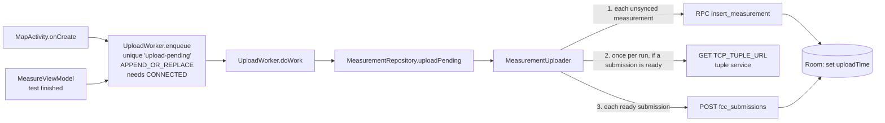

# Android app: sync and upload

How locally stored measurements and FCC submissions get to Supabase: what triggers an upload, how retries work, which RPCs and tables are called, and how rows are marked as uploaded.

Related: [layout](layout.md) · [local-storage](local-storage.md) · [measurement-engine](measurement-engine.md) · [data flow](../architecture/data-flow.md) · [identity and security](../architecture/identity-and-security.md) · [RPC reference](../supabase/rpc-reference.md) · [FCC submission pipeline](../supabase/fcc-submission-pipeline.md) · [performance notes](../supabase/performance-notes.md)

Code: [`data/core/sync/`](../../app/src/main/java/edu/gatech/cc/cellwatch/data/core/sync/), [`MeasurementRepository.kt`](../../app/src/main/java/edu/gatech/cc/cellwatch/data/core/repositories/MeasurementRepository.kt), [`data/network/`](../../app/src/main/java/edu/gatech/cc/cellwatch/data/network/).

## Overview

## When uploads trigger

| Trigger | Code |
|---|---|
| App opens the map (launcher activity), after the onboarding check | `UploadWorker.enqueue(this)` in [MapActivity.kt](../../app/src/main/java/edu/gatech/cc/cellwatch/ui/main/MapActivity.kt) `onCreate` |
| A test sequence finishes successfully | `UploadWorker.enqueue(...)` in [MeasureViewModel.kt](../../app/src/main/java/edu/gatech/cc/cellwatch/ui/main/MeasureViewModel.kt) `handleMeasurementComplete` |

There is no periodic or connectivity-change trigger in this checkout. Rows recorded while offline wait until the next map open or the next completed test (the enqueued work itself waits for a network).

> Not in this checkout: hourly/foreground upload triggers and a 60 s upload timeout exist on a separate unmerged local branch. TODO: update this page when that work lands.

## `UploadWorker` (WorkManager)

[UploadWorker.kt](../../app/src/main/java/edu/gatech/cc/cellwatch/data/core/sync/UploadWorker.kt)

| Setting | Value |
|---|---|
| Request type | `OneTimeWorkRequest`, `CoroutineWorker` |
| Unique name | `upload-pending` |
| Existing-work policy | `APPEND_OR_REPLACE`: a new request queues behind a running one instead of cancelling it (replaces the chain only if the previous one failed or was cancelled) |
| Constraints | `NetworkType.CONNECTED` |
| Backoff | not set, so WorkManager's default applies (exponential, 30 s initial) |
| Retry rule | `Result.retry()` if `summary.failed > 0 && runAttemptCount < 5`, else `Result.success()` (so at most 6 runs per request) |

Submissions that are only *waiting* for their measurements do not cause a retry. The worker always ends in `success` once attempts are exhausted; the rows simply stay unsynced until the next trigger.

## `MeasurementUploader` (the algorithm)

[MeasurementUploader.kt](../../app/src/main/java/edu/gatech/cc/cellwatch/data/core/sync/MeasurementUploader.kt) is plain Kotlin with `Local` / `Remote` / `Log` interfaces (implemented inside `MeasurementRepository`), which makes it unit-testable ([MeasurementUploaderTest.kt](../../app/src/test/java/edu/gatech/cc/cellwatch/data/core/sync/MeasurementUploaderTest.kt)).

`uploadPending()` holds a `Mutex`, so only one upload runs per process. It returns `Summary(uploaded, failed, waiting)`.

1. **Measurements.** `local.unsyncedMeasurements()` (all rows with `uploadTime IS NULL`, with children). Each is sent with `remote.insertMeasurement`; at most `maxParallelUploads = 3` requests in flight (`Semaphore`).
2. **Submissions.** `local.unsyncedSubmissions()` are split into:
   - *ready*: the group has a `latency`, `download` and `upload` measurement that all have `uploadTime` set;
   - *waiting*: everything else (counted in `Summary.waiting`, logged).
3. If any are ready, **one** tuple request (`remote.getTcpTuple()`) is made for the whole batch. On failure every ready submission counts as failed for this run.
4. Each ready submission gets `sourceIp = tuple.remoteAddress`, `sourcePort = tuple.remotePort`, `serverTimestamp = tuple.timestamp` (epoch ms) and, pending, `tupleLocalPort = tuple.localPort`; then `remote.insertFccSubmission` (again max 3 in parallel).

Consequences worth knowing:

- `sourceIp` / `sourcePort` / `serverTimestamp` describe the phone's connection **at upload time**, not at test time, and all submissions in one run share the same tuple.
- A submission never reaches the server before all three of its measurements, so server-side processing of a submission can rely on them existing.

### Error handling

| Exception | Where | Effect |
|---|---|---|
| `CancellationException` | any | rethrown (worker stopped) |
| `DuplicateKeyError` | insert measurement / submission | treated as success: the id is already on the server (an earlier attempt succeeded but the response was lost); the local copy is marked uploaded |
| `IOException` (incl. `NetworkError`) | any request | logged at INFO, item counted as failed -> worker retries |
| any other `Exception` | any request | logged at ERROR (Crashlytics non-fatal), counted as failed -> worker retries |

## Marking rows uploaded

`MeasurementRepository` implements `Local`:

- `markMeasurementUploaded(measurement, now)`: `measurement.asEntity()` with `uploadTime = now`, then `MeasurementDao.updateMeasurement` (`@Update` of the whole `MeasurementEntity` row; child tables are untouched).
- `markSubmissionUploaded(submission, now)`: same pattern with `FccSubmissionDao.updateFccSubmission`.

The object passed in is the **server's returned copy** (decoded response) on success, or the local copy after a `DuplicateKeyError`. So after a normal upload, the local parent row reflects what the server returned (for example server-filled `createdOn`), and any field the server returns as null overwrites the local value.

`uploadTime` is the only sync flag. `MeasurementRepository.uploadTimeFlow(group)` re-evaluates on every change to either table and emits `null` until every record in the group is uploaded; the measure screen and history items show "Pending" until then.

## Network layer (`NetworkMeasurementDatasource`)

[NetworkMeasurementDatasource.kt](../../app/src/main/java/edu/gatech/cc/cellwatch/data/network/NetworkMeasurementDatasource.kt)

### Client and identity

- One `SupabaseClient` (supabase-kt `postgrest-kt` 1.0.3), created on first use under a `Mutex` so concurrent uploads don't double-register.
- URL and key: `BuildConfig.SUPABASE_URL` / `BuildConfig.SUPABASE_API_KEY` (local Supabase in debug, cloud in release; see [build-and-config.md](build-and-config.md)).
- Device identity: `device_id` from DataStore; `device_secret` from DataStore, or, if absent, from RPC **`register_device`** `{ "device_id": <id> }` on a separate throwaway client; the returned string is saved encrypted.
- A Ktor client plugin adds `X-Device-ID` and `X-Device-Secret` to every request of the main client. The server-side checks are described in [identity-and-security.md](../architecture/identity-and-security.md).
- The device id and secret are read once when the client is created and cached for the process lifetime.

### Calls

| App method | Supabase call | Body / result |
|---|---|---|
| `registerDevice(id)` | `rpc("register_device", {device_id})` | returns the secret as a JSON string |
| `insertMeasurement(m)` | `rpc("insert_measurement", NetworkMeasurementWithData)` | body keys `in_measurement`, `in_measurement_data`, `in_latency_data`, `in_locations`, `in_cells`; decoded as `NetworkMeasurement` |
| `insertFccSubmission(s)` | `postgrest["fcc_submissions"].insert(NetworkFccSubmission)` | `decodeSingle<NetworkFccSubmission>()` |
| `getMeasurementById(id)` | `select` on `measurements` with embedded `upload_download_data, latency_data, locations, cells` | not called anywhere |

DTOs live in [`data/network/model/`](../../app/src/main/java/edu/gatech/cc/cellwatch/data/network/model/) and map camelCase fields to snake_case with `@SerialName` (for example `simMcc` -> `sim_mobile_country_code` on measurements, but `simCountryCode` -> `sim_country_code` on submissions; `deviceOsName` -> `device_os` on submissions).

### Error mapping (`withErrorHandling`)

| Caught | Rethrown as |
|---|---|
| `IOException`, supabase `HttpRequestException` (includes Ktor request timeouts) | `NetworkError` (an `IOException`) |
| `RestException` whose `error` starts with `duplicate key value violates unique constraint` | `DuplicateKeyError` |
| anything else | unchanged |

`NotFoundError` is only thrown by the unused `getMeasurementById`. [`NetworkRestResult`](../../app/src/main/java/edu/gatech/cc/cellwatch/data/network/NetworkRestResult.kt) is an unused leftover data class.

### Timeouts

| Request | Timeout |
|---|---|
| Supabase calls | supabase-kt 1.0.3 default `requestTimeout` of 10 s (not overridden). With the pending OkHttp engine, OkHttp's own defaults (10 s connect/read/write) also apply. |
| Tuple request | default `OkHttpClient` (10 s connect/read/write). |
| Whole upload run | no explicit limit; WorkManager stops a worker after its 10-minute execution window. |

### Serialization rule (important when adding fields)

supabase-kt's JSON is configured with `ignoreUnknownKeys = true` and `encodeDefaults = false`:

- **Responses**: extra columns from the server are ignored, so the server can add columns without breaking old apps.
- **Requests**: a property equal to its default (`null` for nearly every DTO field) is **omitted** from the body. Fields without a default (`type`, `connection_type`, `cellular_data_enabled` on `NetworkMeasurement`) are always sent.
- Therefore a new request-body field is invisible to the server while it is null, but as soon as the app sends a non-null value the server must already know the column/argument. **Deploy the server migration before shipping an app version that sends a new field.** See [migrations-and-deploy.md](../supabase/migrations-and-deploy.md).

## Tuple request (`getPubicTCPTuple`)

In `MeasurementRepository`. A `GET` to `BuildConfig.TCP_TUPLE_URL` (an HTTP service outside Supabase, the "tuple service") with the app's `User-Agent`. A 200 response is parsed with Gson into [`TcpTuple`](../../app/src/main/java/edu/gatech/cc/cellwatch/data/model/TcpTuple.kt) `{remoteAddress, remotePort, timestamp}`: the public IP and port the service saw, and its clock. Non-200 or a parse error fails the batch (logged as an unexpected error); transport failures are `IOException`s.

## Pending: local port and transport reporting (pending: not yet merged/deployed)

Uncommitted on branch `client-port-header`. Goal: find out whether the phone's own source port can replace the tuple service's view (the service sees the port after carrier NAT).

| Change | File |
|---|---|
| New OkHttp network interceptor `LocalPortHeaders` adds `X-Local-Port` (this phone's socket port for the request) and `X-Transport` (`vpn`, `cellular`, `wifi`, `ethernet`, `other`; VPN checked first) to every Supabase request. | `LocalPortHeaders.kt` |
| Supabase client uses `httpEngine = OkHttp.create { addNetworkInterceptor(LocalPortHeaders { currentTransport() }) }`; dependency switched from `ktor-client-cio` to `ktor-client-okhttp` 2.3.0. | `NetworkMeasurementDatasource.kt`, [app/build.gradle](../../app/build.gradle) |
| Tuple request records its own local port via a network interceptor: `TcpTuple.localPort`. | `MeasurementRepository.kt`, `TcpTuple.kt` |
| `FccSubmission.tupleLocalPort` is set from it before upload and sent as `tuple_local_port` (not stored in Room). | `FccSubmission.kt`, `NetworkFccSubmission.kt`, `MeasurementUploader.kt` |
| Tests: `LocalPortHeadersTest`, updated `MeasurementUploaderTest`. | `app/src/test/...` |
| Server side: `202610130001_record_local_ports.sql` adds `tuple_local_port`, `upload_local_port`, `upload_transport`, `upload_ip` to `fcc_submissions` plus a before-insert trigger reading the headers. | see [triggers-and-cron.md](../supabase/triggers-and-cron.md) |

Per the serialization rule, `tuple_local_port` is sent whenever the tuple request saw a port, so **that migration must be deployed before an app build with this change ships**. The headers themselves are harmless to an older server.

## Other paths that touch Supabase data

- History export (`MeasureHistoryViewModel.exportData`) writes a local JSON file only; it does not call Supabase. See [ui-and-screens.md](ui-and-screens.md#history).
- The map reads only the local Room database; it does not call any RPC.
