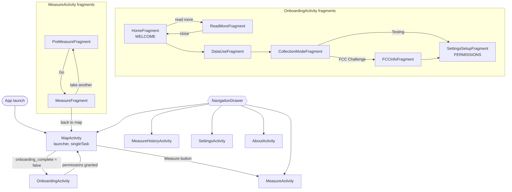

# Android app: UI and screens

Every Activity, Fragment, ViewModel and custom view in `ui/`, how users move between them, which permissions are requested, and what each screen reads.

Related: [layout](layout.md) · [measurement-engine](measurement-engine.md) · [local-storage](local-storage.md) · [sync-and-upload](sync-and-upload.md) · [build-and-config](build-and-config.md)

UI toolkit: XML layouts with View Binding (no Compose, no Navigation graph). Screens switch with explicit `Intent`s and `FragmentManager` transactions. Strings exist in English (`values/`) and Spanish (`values-es/`). All activities are portrait-only.

## Navigation

The `NavigationDrawer` (side menu) is in the Map, Measure, History, Settings and About layouts. Its buttons start the target activity unless it is the current one; they do not finish the current activity, so the back stack grows as the user navigates.

## Activities

| Activity | Purpose | Reads / writes |
|---|---|---|
| [MapActivity](../../app/src/main/java/edu/gatech/cc/cellwatch/ui/main/MapActivity.kt) | Launcher. Redirects to onboarding until `onboarding_complete`. Mapbox map of this phone's own measurements, search, bottom sheet of results. Enqueues `UploadWorker`. | `MapViewModel` -> `MeasurementRepository.getMeasurementGroups()` (local Room only) |
| [OnboardingActivity](../../app/src/main/java/edu/gatech/cc/cellwatch/ui/main/OnboardingActivity.kt) | First-run flow (fragments below), dot indicator, back/forward arrows and horizontal swipe. | `SettingsRepository` (collection mode, contact info, onboarding flag) |
| [MeasureActivity](../../app/src/main/java/edu/gatech/cc/cellwatch/ui/main/MeasureActivity.kt) | Hosts `PreMeasureFragment` (state `PRE`) or `MeasureFragment` (all other states). Binds to `MeasurementService` while a test is running; unbinds in `onStop`. Disables Back while `MeasureFragment` is shown. | `MeasureViewModel` |
| [MeasureHistoryActivity](../../app/src/main/java/edu/gatech/cc/cellwatch/ui/main/MeasureHistoryActivity.kt) | List of all local measurement groups; Export menu item. | `MeasureHistoryViewModel` |
| [SettingsActivity](../../app/src/main/java/edu/gatech/cc/cellwatch/ui/main/SettingsActivity.kt) | Collection mode dropdown; edit name/email/phone; shows device id and app version (tap to copy); privacy-policy link. | `SettingsRepository` |
| [AboutActivity](../../app/src/main/java/edu/gatech/cc/cellwatch/ui/main/AboutActivity.kt) | Static about/help text with links; opens Google's `OssLicensesMenuActivity`. | none |

## Onboarding

[OnboardingActivity](../../app/src/main/java/edu/gatech/cc/cellwatch/ui/main/OnboardingActivity.kt) keeps a `Screen` enum and a fragment back stack (Back arrow or swipe right = `popBackStack`).

| # | Screen / fragment | Dot | What happens on "next" |
|---|---|---|---|
| 1 | `WELCOME` - [HomeFragment](../../app/src/main/java/edu/gatech/cc/cellwatch/ui/onboarding/HomeFragment.kt) | 1 | -> Data use. "Read more" opens `READ_MORE` ([ReadMoreFragment](../../app/src/main/java/edu/gatech/cc/cellwatch/ui/onboarding/ReadMoreFragment.kt), nav hidden, close pops back). |
| 2 | `DATA_USE` - [DataUseFragment](../../app/src/main/java/edu/gatech/cc/cellwatch/ui/onboarding/DataUseFragment.kt) | 2 | -> Collection mode. |
| 3 | `COLLECTION_MODE` - [CollectionModeFragment](../../app/src/main/java/edu/gatech/cc/cellwatch/ui/onboarding/CollectionModeFragment.kt) | 3 | FCC Challenge is preselected. Testing: saves `TESTING` and goes to permissions. FCC: goes to FCC info. |
| 4 | `FCC_INFO` - [FCCInfoFragment](../../app/src/main/java/edu/gatech/cc/cellwatch/ui/onboarding/FCCInfoFragment.kt) | 3 | Validates non-blank name, phone (`NNN-NNN-NNNN` or 10 digits), email, and the sharing checkbox; saves them and sets `FCC_CHALLENGE`. |
| 5 | `PERMISSIONS` - [SettingsSetupFragment](../../app/src/main/java/edu/gatech/cc/cellwatch/ui/onboarding/SettingsSetupFragment.kt) | 4 | "Ready" requests missing permissions; when all are granted, `onPermissionsHandled()` sets `onboarding_complete = true` and opens `MapActivity`. |

> Notes from the code:
> - If the user denies a permission, nothing happens (`// TODO: Handle the case where permissions are denied`); onboarding cannot finish until both are granted.
> - A left swipe calls `goNext()` even on `PERMISSIONS` and `READ_MORE`, where `Screen.next()` throws `RuntimeException` and crashes onboarding. **Fixed in #136**: `next()` returns null there and the swipe does nothing.
> - `SettingsSetupFragment.kt` has no `package` line (default package).

## Measure flow

| Class | Role |
|---|---|
| [PreMeasureFragment](../../app/src/main/java/edu/gatech/cc/cellwatch/ui/main/PreMeasureFragment.kt) | FCC mode: stationary/moving choice and certifications text. Testing mode: a testing warning. "Go" checks the foreground-service location permission (API 34+, plus fine or coarse location), warns if not on cellular in FCC mode (user may proceed), then `startForegroundService(MeasurementService)` with extras `collection_mode`, `in_vehicle` and binds. |
| [MeasureFragment](../../app/src/main/java/edu/gatech/cc/cellwatch/ui/main/MeasureFragment.kt) | Header text per phase (finding server, latency, download, upload, complete, failed + message), progress bar, a `MeasurementGroupItem` that fills in as each test completes, upload status, and "take another" / "back to map" buttons when done. |
| [MeasureViewModel](../../app/src/main/java/edu/gatech/cc/cellwatch/ui/main/MeasureViewModel.kt) | Holds `State(progress, results, uploadTime, inVehicle, errorMessage)`. Its `ServiceConnection` collects `MeasurementBinder.state` and maps `STARTED/LOCATE/LATENCY/DOWNLOAD/UPLOAD/DONE` to `MeasureProgress` (`PRE, START, LOCATE, LATENCY, DOWNLOAD, UPLOAD, END, ERROR`). On success it enqueues `UploadWorker` and follows `uploadTimeFlow(group)`. A `429` in the error shows a rate-limit message. |

Engine details: [measurement-engine.md](measurement-engine.md).

## Map screen

[MapActivity](../../app/src/main/java/edu/gatech/cc/cellwatch/ui/main/MapActivity.kt), [MapViewModel](../../app/src/main/java/edu/gatech/cc/cellwatch/ui/main/MapViewModel.kt), [H3Manager](../../app/src/main/java/edu/gatech/cc/cellwatch/domain/map/managers/H3Manager.kt)

- **Data source**: only this phone's Room database (`MeasurementRepository.getMeasurementGroups()`). The map calls **no Supabase RPCs**; network traffic is Mapbox tiles/search only (token resource `mapbox_access_token` in `res/values/strings.xml`).
- **Map**: Mapbox Maps SDK 11, `Style.LIGHT`, location puck, camera centered on the last known location (zoom 14) when location permission is granted.
- **Points mode**: one pin per measurement group at the average of its tests' center points, clustered. Tapping a pin or cluster opens the bottom sheet with those groups.
- **Hex mode** (switch, on by default): active when the switch is on and camera zoom >= 12; otherwise points are shown.
  - `MapViewModel` indexes each group under the **resolution 9** H3 cell of each test's center (start/end location midpoint), so a group can fall in more than one hex.
  - Visible **resolution 8** parent hexes come from `H3Manager.getH3OverlayAddressesFromBounds` on the camera bounds (computed at zoom - 0.5 to preload). Parents with data are filled light green with a count label.
  - Tapping a parent selects it and draws its res-9 children; tapping a child with data opens the bottom sheet titled with the hex index. Test rows outside the displayed hex show "not in this hexagon".
- **Search**: Mapbox Search SDK (`SearchEngine` with `ApiType.SEARCH_BOX` plus `OfflineSearchEngine`) in a `SearchResultsView`; choosing a result moves the camera.
- `onBackPressed` is overridden to hide search results and does not call `super`, so Back never leaves the map.

## History

[MeasureHistoryActivity](../../app/src/main/java/edu/gatech/cc/cellwatch/ui/main/MeasureHistoryActivity.kt), [MeasureHistoryViewModel](../../app/src/main/java/edu/gatech/cc/cellwatch/ui/main/MeasureHistoryViewModel.kt)

- Loads all groups once in `onCreate` (not a live flow) into a `MeasurementAdapter`, newest first. Groups with an FCC submission are labeled "Challenge", others "Test".
- **Export** (toolbar): confirmation dialog, then the Storage Access Framework `CreateDocument` with suggested name `cellwatch-measurements.json`. `exportData` writes pretty-printed JSON (`explicitNulls = true`):
  - `contact` {name, email, phone} from settings;
  - `submission_category`: the first submission's `submission` value, else `"Consumer Challenge"`;
  - `submissions`: one [`FccSubmissionExport`](../../app/src/main/java/edu/gatech/cc/cellwatch/data/model/FccExportExtensions.kt) per group **that has an FCC submission**, with `test_id` = the latency (else download, else upload) measurement's id, `environment_code` 1 if in vehicle else 0, and download/upload/latency test objects with locations and cells.
- The export is local only; it is not uploaded.

> Known bug: the activity opens the file descriptor in a `use { model.exportData(fd) }` block, but `exportData` launches a coroutine and returns immediately, so the descriptor is closed before the write; the write error escapes `viewModelScope`. **Fixed in #136**: `exportData` is a suspend function and the activity keeps the stream open until it returns.

## Custom views, adapter and small ViewModels

| Class | Role |
|---|---|
| [MeasurementAdapter](../../app/src/main/java/edu/gatech/cc/cellwatch/ui/main/MeasurementAdapter.kt) | RecyclerView adapter (History and the map bottom sheet); inflates `item_measurement_history`; sorts by first test timestamp, descending. |
| [MeasurementGroupItem](../../app/src/main/java/edu/gatech/cc/cellwatch/ui/main/MeasurementGroupItem.kt) | Group card: date/time, carrier, type (Testing / FCC stationary / FCC vehicle), upload time or `Pending`, summary of the three results; optionally expandable (`app:expandable`, `app:summaryLabels`). |
| [MeasurementItem](../../app/src/main/java/edu/gatech/cc/cellwatch/ui/main/MeasurementItem.kt) | One test: value (`N ms` or `N Mbps`, or `failed`), time, location (tap to copy), technology (`WiFi` or display generation like `5G`, `4G/5G`), roaming. |
| [MeasurementGroupItemViewModel](../../app/src/main/java/edu/gatech/cc/cellwatch/ui/main/MeasurementGroupItemViewModel.kt) | Set of expanded group ids, shared through the view tree's `ViewModelStoreOwner`. |
| [NavigationDrawer](../../app/src/main/java/edu/gatech/cc/cellwatch/ui/main/NavigationDrawer.kt) | `NavigationView` subclass; highlights the current screen. |

## Settings

[SettingsActivity](../../app/src/main/java/edu/gatech/cc/cellwatch/ui/main/SettingsActivity.kt)

- **Collection mode**: switching to FCC Challenge shows the FCC acknowledgement dialog if not yet acknowledged, then calls `setCollectionMode(FCC_CHALLENGE)`; missing contact info shows an error and reverts the dropdown to Testing.
- **Contact info**: Edit -> validate (phone normalized to `NNN-NNN-NNNN`, email via commons-validator; empty fields allowed here) -> save. Blank values in FCC mode are rejected by `SettingsRepository`.
- **Device id** and **app version** (`BuildConfig.VERSION_NAME`): tap to copy.

## Permissions

Declared in [AndroidManifest.xml](../../app/src/main/AndroidManifest.xml):

| Permission | Kind | Requested at runtime? | Used for |
|---|---|---|---|
| `INTERNET`, `ACCESS_NETWORK_STATE`, `ACCESS_WIFI_STATE` | normal | no | tests, uploads, connection type |
| `ACCESS_FINE_LOCATION` | dangerous | yes, onboarding permissions step | location at test start/end, map centering, cell info |
| `ACCESS_COARSE_LOCATION` | dangerous | yes, with fine location in the onboarding permissions step (since #136) | `PermissionManager.checkLocationPermission()` requires both fine and coarse |
| `READ_PHONE_STATE` | dangerous | yes, onboarding permissions step | cells, data-enabled, network type |
| `FOREGROUND_SERVICE`, `FOREGROUND_SERVICE_LOCATION` | normal | no (checked on API 34+; if missing, user is sent to app settings) | `MeasurementService` |
| `WAKE_LOCK` | normal | no | keep CPU on during a test |

Not declared: background location, `POST_NOTIFICATIONS` (so on Android 13+ the foreground-service notification may not be shown; the service still runs).

> Known bug: platform docs say a request for `ACCESS_FINE_LOCATION` without `ACCESS_COARSE_LOCATION` is ignored when targeting API 31+. **Fixed in #136**: onboarding requests both.

Other manifest settings: `usesCleartextTraffic="true"` (the tuple service and local dev servers use plain HTTP), `allowBackup="false"`.
