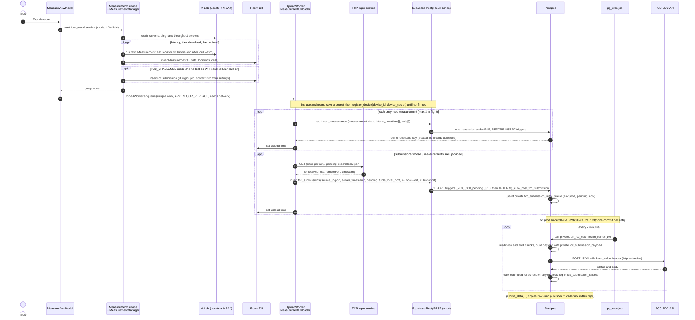

# Data flow: one measurement end to end

How one test group travels from the phone to the FCC and to the public `published` schema.

**Related:** [overview](overview.md) · [identity-and-security](identity-and-security.md) · [app/measurement-engine](../app/measurement-engine.md) · [app/sync-and-upload](../app/sync-and-upload.md) · [supabase/triggers-and-cron](../supabase/triggers-and-cron.md) · [supabase/fcc-submission-pipeline](../supabase/fcc-submission-pipeline.md)

A **group** is one run of the three tests (latency, download, upload). Each test is one `measurements` row. All three share a `group_id`, and in FCC challenge mode the FCC submission's `id` is that same group ID. This page follows the code on `main`. Items marked **pending** are uncommitted work on the `client-port-header` branch: not merged, and its migration `202610130001` is not pushed to prod.

## Sequence

## Steps in detail

### 1. Test run (phone)

- [MeasureViewModel.kt](../../app/src/main/java/edu/gatech/cc/cellwatch/ui/main/MeasureViewModel.kt) starts [MeasurementService.kt](../../app/src/main/java/edu/gatech/cc/cellwatch/domain/fcc/MeasurementService.kt), a foreground service of type location that holds a 10-minute partial wake lock. The service creates a random group UUID.
- [MeasurementManager.runTestSequence](../../app/src/main/java/edu/gatech/cc/cellwatch/domain/fcc/MeasurementManager.kt):
  1. Asks the M-Lab Locate API for throughput servers through msak `LocateManager`. It pings each candidate with [ping.kt](../../app/src/main/java/edu/gatech/cc/cellwatch/domain/fcc/ping.kt) (AndroidPing.aar) and picks a latency server on the same machine when one exists. If Locate is unreachable, it falls back to `UnreachableServer`, so the tests still run and record their failure.
  2. Runs the latency test, then download, then upload (3 streams each for download and upload). Each result is written to Room straight away (`MeasurementRepository.insertMeasurement`).
  3. Each test ([MeasurementTest.kt](../../app/src/main/java/edu/gatech/cc/cellwatch/domain/fcc/MeasurementTest.kt)) takes a fused location fix before and after the test, giving 0–2 locations. It also records serving and neighbouring cells, MCC/MNC, carrier aggregation, and roaming and connection flags.
  4. If the collection mode is `FCC_CHALLENGE`, no test ran on Wi-Fi, and cellular data was enabled, the manager builds an `FccSubmission` with `id = groupId` and stores it in Room. The submission includes contact name, email, and phone from settings, the device model and OS, the provider, MCC/MNC, and `inVehicle`. `deviceImei` and `deviceTac` exist on the model but are never set.

### 2. Upload (phone)

This upload path came in #111 (merged to `main` 2026-10-07; not known to be in a release, check Play Console), and #148 (merged 2026-10-27; not released) added the hourly and foreground triggers and 60 s timeouts. `versionCode` is still 13. The released app may still upload the older way, sending submissions before their measurements, only after a test or a cold start.

- Triggers: `MeasureViewModel.handleMeasurementComplete` calls [UploadWorker.enqueue](../../app/src/main/java/edu/gatech/cc/cellwatch/data/core/sync/UploadWorker.kt), and so does [CellWatchApp](../../app/src/main/java/edu/gatech/cc/cellwatch/CellWatchApp.kt) whenever the app comes to the foreground. That work is unique (`upload-pending`) and requires a connected network. `CellWatchApp` also schedules an hourly periodic upload (`upload-pending-periodic`). A run retries while `failed > 0`, up to 5 retries. See [sync-and-upload](../app/sync-and-upload.md#when-uploads-trigger).
- [MeasurementUploader.uploadPending](../../app/src/main/java/edu/gatech/cc/cellwatch/data/core/sync/MeasurementUploader.kt) runs under a mutex:
  1. **Measurements first.** Each unsynced measurement goes to `rpc("insert_measurement", …)`, with at most 3 requests in flight. A `DuplicateKeyError` counts as success, because `insert_measurement` is a single transaction: if the ID is on the server, everything for it is. Each success sets `uploadTime` in Room.
  2. **Submissions second.** A submission is sent only when all three of its group's measurements have an `uploadTime`; the rest are counted as `waiting`. One TCP tuple is fetched per run and copied onto every ready submission: `sourceIp`, `sourcePort`, `serverTimestamp`, and (**pending**) `tupleLocalPort`. If the tuple request fails, no submission uploads in that run.
  3. Each submission is inserted into `fcc_submissions` through PostgREST. Duplicate key counts as success.
- Every request carries `apikey`, `X-Device-ID`, and `X-Device-Secret` ([NetworkMeasurementDatasource.kt](../../app/src/main/java/edu/gatech/cc/cellwatch/data/network/NetworkMeasurementDatasource.kt)). **Pending:** `LocalPortHeaders.kt` adds `X-Local-Port` and `X-Transport`.

### 3. Server writes and triggers

`public.insert_measurement` is `SECURITY INVOKER`, so the `anon` INSERT policies apply to every row it writes. It inserts the measurement, then its `upload_download_data` or `latency_data`, `locations[]`, and `cells[]`, each linked to the new measurement ID.

| Trigger | Table | When | Effect |
|---|---|---|---|
| `_200_*_force_created_on` → `force_created_on()` | measurements, upload_download_data, latency_data, locations, cells, fcc_submissions | BEFORE INSERT, only if `created_on IS NULL` | Sets `created_on` and `updated_on` to server `now()`. |
| `fix_jitter_pre_100alpha5` → `fix_jitter()` | latency_data | BEFORE INSERT | Replaces `jitter` with `sqrt(jitter)` when the parent measurement's `app_version` is null or `1.0.0-alpha.2`–`.4`. Those versions reported variance (see commit 5cdeba6). |
| `_100_*_set_updated_on` | most tables | BEFORE UPDATE | Bumps `updated_on`. |
| `_300_fcc_submission_update_source_ip` | fcc_submissions | BEFORE INSERT, only if `source_ip IS NULL` | Fallback that takes the first `x-forwarded-for` entry. A client can spoof that value; see [identity-and-security](identity-and-security.md#header-trust). |
| `_310_fcc_submission_record_local_ports` (**pending**, `202610130001`) | fcc_submissions | BEFORE INSERT | Stores `upload_local_port`, `upload_transport`, and `upload_ip` (from `cf-connecting-ip`), and range-checks `tuple_local_port`. Malformed values become null. |
| `trg_auto_post_fcc_submission` → `private.auto_post_fcc_submission()` | fcc_submissions | AFTER INSERT | If `submitted` is not true, upserts the row into `private.fcc_submission_retry_queue` (`fcc_env='prod'`, `state='pending'`, `next_attempt_at=now()`). The function is `SECURITY DEFINER`. |

The queue entry is created as soon as the submission row arrives. Normally the measurements are already there, because the uploader waits for them. Older app versions sent submissions first, and the retry job waits for those groups to fill in.

### 4. FCC post and retry queue

Cron job `fcc-submission-retries` runs every 2 minutes ([cron_jobs.sql](../../supabase/cron_jobs.sql)). On prod since 2026-10-29 its command is `call private.run_fcc_submission_retries(10);`, from [202610210103](../../supabase/migrations/202610210103_fcc_retry_queue_processing.sql) (#133). The procedure handles up to 10 due entries, stops taking new ones once the run has lasted 60 s, and **commits after each entry**, so a later timeout can't undo the record of an earlier post.

1. At the start of a run it deletes queue rows whose submission is already `submitted`, and puts `expired` entries whose measurements have since arrived back to `pending`.
2. For each due `pending` entry (`private.process_next_fcc_submission_retry()`, oldest first):
   - **Not ready** (`private.fcc_submission_is_ready` needs exactly one latency row with `latency_data` and one download and one upload row with `upload_download_data`): re-checked in 5 minutes, or hourly once it has waited more than a day. This doesn't count as an attempt. An entry still not ready 30 days after it was queued becomes `expired`.
   - **Held** (`private.fcc_payload_hold_reason`): a complete submission the FCC is known to reject, or that falls short of the spec: no network codes, no locations, one location, or a blank provider ("Missing provider"; blank carrier names are never filled in). It isn't posted. Held entries are checked again once a day and go back in line when no reason applies any more.
   - Otherwise `private.post_fcc_submission(id, env)` reads the URL and Vault secret for `env` from `private.fcc_submission_info`, builds the payload with `private.fcc_submission_payload(id)` from that submission's rows only (`submission_category: "Consumer Challenge"`, `contact`, one `submissions[0]` with `tests.latency`, `tests.download`, `tests.upload`), and POSTs it with `http()` and a `hash_value` header. On 2xx it sets `submitted=true`, `submission` (the payload), `submitted_on`, and `submission_response`.
3. Every attempt, successful or not, adds a row to `private.fcc_submission_failures` (`succeeded` flag, error, 500-character response snippet).
4. On failure:
   - A 4xx whose body says `duplicate_test_id` means the FCC already has the test: the submission is marked sent and leaves the queue.
   - 400, 409, 413 and 422 reject the test itself, so the entry becomes `blocked` at once.
   - Anything else (other 4xx, 5xx, transport errors) waits `60 × 2^(attempts−1)` s, capped at 1 h, is `blocked` after 6 attempts, and ends the run.

Before the 2026-10-29 push, prod ran `select private.process_fcc_submission_retries(10);` ([202610070001](../../supabase/migrations/202610070001_unclog_fcc_retry_queue.sql)): the whole batch in one transaction, a blank provider and every 4xx other than 408 and 429 `blocked` at once, no `held` or `expired` states, and the payload built from `private.fcc_submissions_view`, which aggregated every location and cell in the database. That function still exists for manual runs, and still runs a batch in one transaction.

Full details: [supabase/fcc-submission-pipeline](../supabase/fcc-submission-pipeline.md).

### 5. Publishing (`published.*`)

`public.publish_data(publishable_measurement[], publishable_cell[])` copies selected rows into `published.measurements`, `published.cells`, `published.latency_data`, and `published.throughput_data`. Rows that already exist are skipped (`ON CONFLICT DO NOTHING`).

- The caller supplies the derived fields: `group_offset`, `cell_tech`, H3 res-9 `center/start/end_hex9`, and PostGIS points.
- For rows where the stored rate is null, the function computes `bytes_per_sec` from bytes over duration (µs).
- `published.*` is readable by everyone (`GRANT SELECT … TO PUBLIC`, RLS `USING (true)`). Helpers `published.measurements_in_hex(...)`, `published.measurement_groups`, and `published.providers` query it.
- `publish_data` is not `SECURITY DEFINER`, and `INSERT` on `published.*` is granted only to `service_role`. So although `EXECUTE` is granted to `anon`, only a service-role caller can actually publish.

> TODO: verify what calls `publish_data` and computes the hex and location fields. Nothing in this repo or in `cron_jobs.sql` does.

## Where a group can get stuck

| Symptom | Where | Cause in code |
|---|---|---|
| Group never leaves the phone | `MeasurementUploader` | Network or registration failure; after 5 failed retries the work ends until the next trigger. The released build retries only after a new test or when the map is opened; main also uploads hourly and when the app comes to the foreground (#148). |
| Submission held on phone (`waiting`) | `measurementsUploaded()` | One of the 3 measurements has not uploaded. |
| No submission uploads at all | `getTcpTuple()` | The tuple service is unreachable or returned a non-200 response. |
| Queue row `pending` for weeks, then `expired` | `fcc_submission_is_ready` | Server never received all 3 measurements (e.g., from older app versions). Since 2026-10-29 such a row becomes `expired` 30 days after queueing, and goes back to `pending` if the measurements arrive. |
| Queue row `blocked` | `process_next_fcc_submission_retry` | FCC rejection (400, 409, 413, 422) or 6 failed attempts. Rows blocked before 2026-10-29 also include "Missing provider" and other 4xx answers. |
| Queue row `held` | `private.fcc_payload_hold_reason` | No network codes, no locations, only one location, or a blank provider; waits for FCC guidance or an app decision. |
