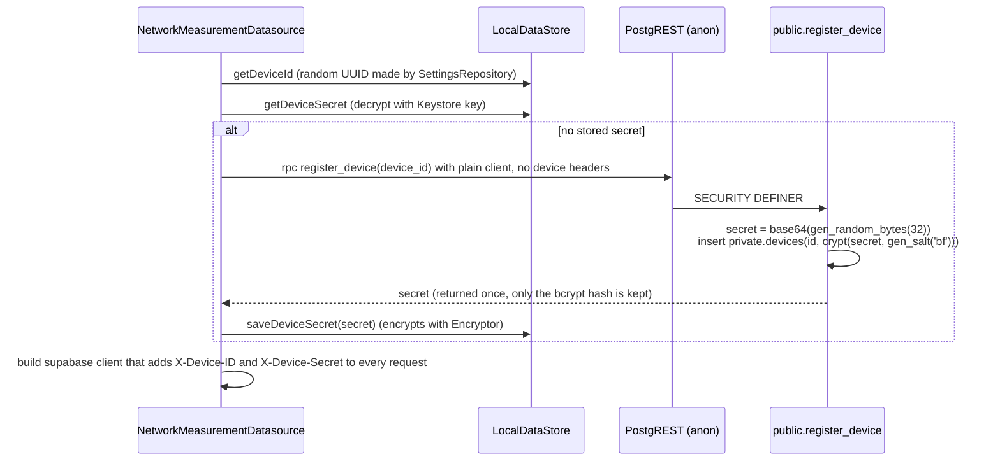

# Identity and security

How a phone proves who it is, what the database lets it do, which request headers can be trusted, and what personal data is stored where.

**Related:** [overview](overview.md) · [data-flow](data-flow.md) · [decisions](decisions.md) · [supabase/schema](../supabase/schema.md) · [supabase/rpc-reference](../supabase/rpc-reference.md) · [app/local-storage](../app/local-storage.md)

There are no user accounts. Supabase Auth is not used. Every app request runs as the Postgres role `anon`, using the anon API key built into the APK. Identity is per **device** (per install), established with a device ID and secret. This scheme was introduced in commit 12c442c (2024-05); see [ADR-001](decisions.md#adr-001-device-id-and-secret-instead-of-user-accounts).

## Device registration

- The device ID is a random UUID created on first use by [SettingsRepository.getDeviceId](../../app/src/main/java/edu/gatech/cc/cellwatch/data/core/repositories/SettingsRepository.kt). It is not a hardware ID.
- `register_device` raises `device id … already registered` if the ID already exists. A phone that loses the response, or loses its stored secret, can never register again and cannot upload. Client creation is serialized with a mutex in [NetworkMeasurementDatasource.kt](../../app/src/main/java/edu/gatech/cc/cellwatch/data/network/NetworkMeasurementDatasource.kt) so two threads in one process don't race.
  > A fix (retry-safe registration with a client-made secret) is on the unpushed local branch `register-device-retry`; there is no PR yet. Its migration `202610220001` is not pushed to prod, and it must be pushed before any app build with the fix is released. TODO: link the PR once one is opened.
  >
  > `202610220001` also lets a device that has never uploaded anything register again with a new secret, which rescues phones that lost the first response, the released app included (an owner decision). The cost: anyone who knows such a device's id can take it over, and that phone can then no longer upload, since neither app version registers again once it holds a secret. The id is random but not secret: the app reports it to Crashlytics and shows it in Settings. Replacing a secret waits for that device's uploads in progress, through a per-device advisory lock that `register_device` takes exclusively and `private.verified_device_id()` takes in shared mode before it reads the secret. Without the lock, a replacement during the phone's first upload would leave the device counted as uploaded under the other secret, and the server's rescue could never apply to it again.
- Anyone with the anon key can register new device IDs and insert data under them. That data is limited to IDs the caller registered (commit 12c442c accepts this risk).

## How the secret is stored and sent

| Item | Where | Protection |
|---|---|---|
| Device ID | DataStore `device_id` | Plain text. Also sent to Crashlytics as custom key `device_id` ([Log.kt](../../app/src/main/java/edu/gatech/cc/cellwatch/core/util/Log.kt), [LocalDataStore.kt](../../app/src/main/java/edu/gatech/cc/cellwatch/data/datastore/LocalDataStore.kt)). |
| Device secret | DataStore `device_secret` | Encrypted by [Encryptor.kt](../../app/src/main/java/edu/gatech/cc/cellwatch/core/util/Encryptor.kt): AES-256-GCM with a 128-bit tag, key alias `cellwatch-device-key` in `AndroidKeyStore`, randomized IV. Stored as base64 of `[ivLen][iv][ciphertext]`. The key cannot be exported. |
| Secret in transit | HTTP headers `X-Device-ID`, `X-Device-Secret` | Added to every Supabase request by a Ktor client plugin (`DeviceHeaderPlugin`) and protected by HTTPS. supabase-kt also sends the anon key as `apikey`. It sends no `Authorization` header: 1.0.3's Postgrest plugin adds `Authorization: Bearer` only for a configured JWT or a GoTrue session, and the app has neither. |
| Secret on server | `private.devices.hashed_secret` | bcrypt (`crypt(..., gen_salt('bf'))`, pgcrypto). |

`android:allowBackup="false"` and `fullBackupContent="false"` are set in the [manifest](../../app/src/main/AndroidManifest.xml). [data_extraction_rules.xml](../../app/src/main/res/xml/data_extraction_rules.xml) is still the empty template.

> TODO: verify device-to-device transfer behaviour on Android 12+. If DataStore is transferred, the Keystore key is not, so the copied secret could not be decrypted on the new phone.

## Verifying the device in Postgres

Both functions read `current_setting('request.headers')`, which PostgREST fills from the HTTP request. Both are `SECURITY DEFINER`, so they can read `private.devices`.

| Function | Missing or invalid headers | Valid headers | Used by |
|---|---|---|---|
| `private.verified_device_id()` | **Raises** (`missing x-device-id header`, `device id … is not registered`, `incorrect device secret`) | device UUID | INSERT policies, and the SELECT policy on `fcc_submissions` |
| `private.verified_device_id_or_null()` | returns `NULL` | device UUID | `measurements` SELECT policy (so dashboard requests without device headers don't error) |

Every call runs a bcrypt comparison, and policies can call it once per row.

> The per-row cost is described in [supabase/performance-notes](../supabase/performance-notes.md). Its fix is in open PR #132 (migration `202610210001`): not merged, not pushed to prod.

### Dashboard access

`private.is_dashboard_request()` returns true when the `x-dashboard-secret` header equals `private.dashboard_settings.shared_secret`. Several SELECT policies OR this in, giving the external dashboard read access to all raw rows. The dashboard is not in this repo.

## RLS policies

RLS is enabled on all six `public` tables and all four `published` tables in [full_schema.sql](../../supabase/full_schema.sql). Every policy is `TO anon`. `private` tables have no RLS, but `anon` has no `USAGE` on schema `private` (only `readonly_user` does).

| Table | INSERT (anon) | SELECT (anon) |
|---|---|---|
| `public.measurements` | `verified_device_id() = device_id` | `is_dashboard_request() OR verified_device_id_or_null() = device_id` |
| `public.fcc_submissions` | `verified_device_id() = device_id` | `verified_device_id() = device_id` (no dashboard access) |
| `public.upload_download_data`, `latency_data`, `locations`, `cells` | `measurement_id IN (own measurements)` | own rows via parent measurement, **or** `is_dashboard_request()` (cells, locations, and latency_data also have a separate `dashboard can select …` policy) |
| `published.*` (4 tables) | none (only `service_role` has INSERT) | `USING (true)` (public) |

There are no UPDATE or DELETE policies, so `anon` cannot change or delete rows through RLS even though table grants include `UPDATE` and `DELETE`.

> Note: the grants to `anon` on `public` tables also include `TRUNCATE`, which RLS does not cover. PostgREST has no TRUNCATE operation, so this is not reachable through the API, but the grant is broader than needed. **Fixed in #136**: migration `202610220102` revokes it from `anon` and `authenticated`. Live once `202610220102` is pushed to prod; prod still grants it (2026-10-22).

### SECURITY DEFINER functions

These run with the owner's (`postgres`) rights and bypass RLS:

| Function | Callable by anon | Exposure |
|---|---|---|
| `public.register_device(uuid)` | yes | Inserts into `private.devices`. |
| `public.rpc_map_points`, `rpc_group_summaries`, `rpc_group_detail` | yes | Return per-group average lat/lon, accuracy, provider, timestamp, and results for **all** devices. They have **no** `is_dashboard_request()` check, so anyone with the anon key can call them. They don't return contact info or device IDs. |
| `private.verified_device_id*`, `private.is_dashboard_request` | through policies | Read-only checks. |
| `private.auto_post_fcc_submission` (trigger), `private.process_fcc_submission_retries` (cron; `EXECUTE` revoked from `PUBLIC`) | no | FCC pipeline. |

> Decided 2026-10-22: the dashboard RPCs are dashboard-only. **Fixed in #136**: migration `202610220101` makes all three raise `42501` unless the request carries the correct `x-dashboard-secret`. Live once `202610220101` is pushed to prod. Before it is pushed, the dashboard backend (the CellWatch/demo-dashboard Flask app on Render) must send `x-dashboard-secret`, from its `DASHBOARD_SECRET` env var, on these calls.
>
> `register_device`, `verified_device_id`, `verified_device_id_or_null` and `is_dashboard_request` have no fixed `search_path` on prod. #136 (`202610220102`) pins one; live once pushed.
>
> Every SECURITY DEFINER function the 2026-10 migrations add or replace lists `pg_temp` **last** in its `search_path`. If `pg_temp` isn't listed, Postgres searches the caller's temporary schema *first* for table and type names, so any database login that may call the function (`readonly_user`, or any role for `register_device`) could create a temporary domain named `text` or `jsonb` and have its own code run as the function's owner. The db tests reproduce that attack for each function (`db_tests/lib/shadow_types.sql`).

## Header trust

PostgREST exposes request headers as JSON in `request.headers`. Helpers: `public.get_header(item)`, which returns one header; `public.get_raw_header()`, which returns all headers as JSON and is callable by `anon`; and an overload `get_raw_header(item)` that ignores its argument and also returns everything. #136 (`202610220102`) makes the overload return only the named header; live once pushed to prod.

| Header | Trust | Why |
|---|---|---|
| `x-device-id`, `x-device-secret` | Verified | Checked against bcrypt hash. |
| `x-dashboard-secret` | Verified | Compared with `private.dashboard_settings`. |
| `cf-connecting-ip` | **Trusted** | Cloudflare sets it and rejects client attempts to send it. Used by the pending `_310_fcc_submission_record_local_ports` trigger (`upload_ip`). |
| `x-forwarded-for` | **Spoofable** | Supabase keeps a client-sent value and appends the real address after it. `fcc_submission_update_source_ip()` takes the **first** entry, so when the app leaves `source_ip` null, the stored value is client-chosen. The current app always sends `source_ip` from the tuple service. |
| `x-local-port`, `x-transport` (pending) | Self-reported | Format-checked only. The port is the phone's pre-NAT port. |
| client source port | **Not available** | Supabase's edge (Cloudflare plus gateway) does not pass the client's port, which is why the FCC `server_source_port` still comes from the EC2 tuple service. See [ADR-013](decisions.md#adr-013-app-reports-its-own-tcp-local-port-pending). |

The API host has only IPv4 addresses, so phones on cellular reach it through carrier NAT, and the address the server sees is the NAT's.

The tuple service itself is unauthenticated plain HTTP. Its answer (IP, port, timestamp) is accepted as-is and becomes FCC payload fields.

## Personal data

| Data | On the phone | On the server | Sent to FCC | Public (`published`) |
|---|---|---|---|---|
| Contact name, email, phone | DataStore (plain) and every `FccSubmissionEntity` in Room | `public.fcc_submissions.contact_*` | yes (`contact`) | no |
| Precise location (lat/lon, accuracy, speed, heading) | Room `locations` | `public.locations` | yes (per test) | yes, as start/center/end points and H3 hexes |
| Device ID (random UUID) | DataStore | `measurements.device_id`, `fcc_submissions.device_id` | yes (`device_id`) | yes (`published.measurements.device_id`) |
| Public IP and port | — | `fcc_submissions.source_ip`, `source_port` (pending: `upload_ip`, ports) | yes | no |
| Device make, model, OS; SIM and network MCC/MNC; provider | Room | `measurements`, `fcc_submissions` | yes | yes (including measurement MCC/MNC) |
| IMEI / TAC | model fields exist, never set | columns exist, null | sent as null | no |
| Cell identifiers (cell ID, PCI, ARFCN, signal) | Room `cells` | `public.cells` | yes | yes |

- Room is not encrypted (plain `Room.databaseBuilder`, no SQLCipher). Only the device secret is encrypted on the device.
- `post_fcc_submission` avoids logging the payload ("contains contact, device, and location data"). The full submitted payload is still stored in `fcc_submissions.submission`.
- The bulk JSON export in [MeasureHistoryViewModel.kt](../../app/src/main/java/edu/gatech/cc/cellwatch/ui/main/MeasureHistoryViewModel.kt) writes contact info and locations to a file the user picks.

## Crashlytics log scrubbing

[core/util/Log.kt](../../app/src/main/java/edu/gatech/cc/cellwatch/core/util/Log.kt) is the app's only logger. It is also installed as msak's logger.

- INFO and above go to `Firebase.crashlytics.log`. WARN and above are also recorded as non-fatal exceptions. Logcat output happens in debug builds only.
- Before anything is emitted, `redactSecrets` replaces:
  - `x-device-secret`, `authorization`, and `apikey` header values (`name: value` or `name=[…]` forms, case-insensitive), replaced with `[REDACTED]`;
  - any JWT-shaped string (`eyJ….….…`).
- If any message in an exception's cause chain (up to 10 deep) contains a secret, the exception is rebuilt as `RedactedException`s with scrubbed messages and the original stack traces. Exceptions with nothing to redact pass through unchanged. Tests: [RedactSecretsTest.kt](../../app/src/test/java/edu/gatech/cc/cellwatch/core/util/RedactSecretsTest.kt).
- Not scrubbed: the device ID (deliberately a custom key), measurement and submission IDs, hostnames, IP addresses inside messages.

This was merged to `main` in #112 (commit d795dad, 2026-10-07) because Supabase client errors include every request header in their message. It is not known to be in a release (versionCode is still 13; check Play Console), so the released build may still send secrets to Crashlytics.
