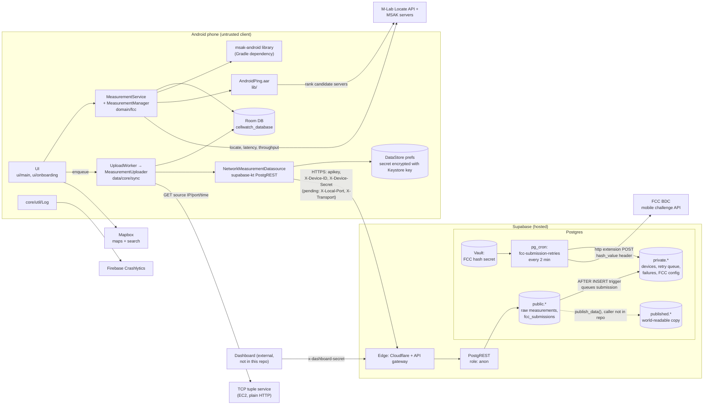

# Architecture overview

What the parts of CellWatch are, how they connect, and where the trust boundaries are.

**Related:** [data-flow](data-flow.md) · [identity-and-security](identity-and-security.md) · [decisions](decisions.md) · [app/layout](../app/layout.md) · [supabase/schema](../supabase/schema.md) · [supabase/fcc-submission-pipeline](../supabase/fcc-submission-pipeline.md)

This page describes `main` as of 2026-11-01 (after the 2026-10-27 merges of #132, #133, #134, #136 and #148, and #150–#158). Every migration on `main` is pushed to prod, but no app build has been released since those merges, so rows say what the released build does where it differs. Anything marked **pending** is uncommitted work on the `client-port-header` branch: not in a PR or merged, and its migration `202610130001` is not pushed to prod.

## System diagram

## Components

| Component | Where | What it does |
|---|---|---|
| Android app | [app/](../../app/) | Runs latency, download, and upload tests; stores results locally; uploads them; builds an FCC submission per test group in FCC challenge mode; shows a map and history. Kotlin, minSdk 29, targetSdk 36 since #148 ([build.gradle](../../app/build.gradle)). The Play Store build is versionCode 13; app changes merged after #109 (2025-10-13) are not known to be in it, and those merged on 2026-10-27 (#136, #148) are not. The next release needs a versionCode bump. |
| Measurement engine | [domain/fcc/](../../app/src/main/java/edu/gatech/cc/cellwatch/domain/fcc/) | [MeasurementService.kt](../../app/src/main/java/edu/gatech/cc/cellwatch/domain/fcc/MeasurementService.kt) is a foreground service (location type, 10-minute wake lock) that calls [MeasurementManager.kt](../../app/src/main/java/edu/gatech/cc/cellwatch/domain/fcc/MeasurementManager.kt). See [app/measurement-engine](../app/measurement-engine.md). |
| msak-android | `com.github.CellWatch:msak-android:0.1.3` (JitPack) | M-Lab MSAK client: Locate API lookup, multi-stream throughput, and the latency test. (`MSAK_LATENCY_PORT` is defined as a build config field, but nothing in `app/src` reads it.) Split out of this repo in commit d0fc127. |
| AndroidPing.aar | [lib/AndroidPing.aar](../../lib/) | `com.spectrum.android.ping.Ping`, used by [ping.kt](../../app/src/main/java/edu/gatech/cc/cellwatch/domain/fcc/ping.kt) to ping the throughput servers the Locate API returns before one is picked (see [app/measurement-engine](../app/measurement-engine.md#choosing-msak--m-lab-servers)). |
| DeviceInformation-release.aar | [lib/](../../lib/) | Linked in `build.gradle` (`com.oseamiya.deviceinformation`), but nothing in `app/src/main` imports it. |
| Local storage | [data/local/](../../app/src/main/java/edu/gatech/cc/cellwatch/data/local/), [data/datastore/](../../app/src/main/java/edu/gatech/cc/cellwatch/data/datastore/LocalDataStore.kt) | Room database `cellwatch_database` (schema version 18) for measurements, cells, locations, and FCC submissions. Preferences DataStore holds the device ID, the encrypted device secret, contact details, and settings. See [app/local-storage](../app/local-storage.md). |
| Sync | [data/core/sync/](../../app/src/main/java/edu/gatech/cc/cellwatch/data/core/sync/) | WorkManager `UploadWorker` runs `MeasurementUploader`, which sends measurements and then FCC submissions, after each test, when the app comes to the foreground, and hourly (the last two since #148). See [app/sync-and-upload](../app/sync-and-upload.md). |
| Network datasource | [NetworkMeasurementDatasource.kt](../../app/src/main/java/edu/gatech/cc/cellwatch/data/network/NetworkMeasurementDatasource.kt) | supabase-kt 1.0.3 (Postgrest module only). Registers the device, adds identity headers, calls `insert_measurement` and inserts into `fcc_submissions`. **Pending:** OkHttp engine instead of Ktor CIO, plus `LocalPortHeaders.kt`. |
| TCP tuple service | `TCP_TUPLE_URL` build config field | An echo service on EC2, outside this repo. It returns the public IP and port it saw and its clock, which fill the FCC `server_source_ip_address`, `server_source_port`, and `server_timestamp` fields. The URL is plain HTTP, and the manifest sets `usesCleartextTraffic="true"`. See [decisions](decisions.md#adr-002-tcp-tuple-service-for-the-fcc-server-fields). |
| Mapbox | `com.mapbox.maps`, `mapbox-search-android` | Map tiles and place search in [MapActivity.kt](../../app/src/main/java/edu/gatech/cc/cellwatch/ui/main/MapActivity.kt). The map shows only this phone's measurements from Room ([MapViewModel.kt](../../app/src/main/java/edu/gatech/cc/cellwatch/ui/main/MapViewModel.kt)). It does not read `published.*`. |
| Firebase Crashlytics | `firebase-crashlytics` (BOM 32.7.0) | Crash and log collection through [Log.kt](../../app/src/main/java/edu/gatech/cc/cellwatch/core/util/Log.kt), which scrubs secrets first (merged to `main` in #112; not known to be in a release). Firebase Analytics was removed in 8021174. |
| Supabase API | hosted project; local config in [supabase/config.toml](../../supabase/config.toml) | PostgREST. The app makes every call as the `anon` role. Supabase Auth, Storage, and Edge Functions are not used by the app, and there is no `supabase/functions/` directory. |
| Postgres `public` | [full_schema.sql](../../supabase/full_schema.sql) | Raw data: `measurements`, `upload_download_data`, `latency_data`, `locations`, `cells`, `fcc_submissions`. RLS limits `anon` to its own device's rows. |
| Postgres `private` | same | Not granted to `anon`. Holds `devices` (hashed secrets), `fcc_submission_info` (FCC URL plus a Vault secret id per env), `fcc_submission_retry_queue`, `fcc_submission_failures`, `dashboard_settings`, and the payload view `fcc_submissions_view`. Also the queue health views `fcc_queue_health` and `fcc_queue_attention` (#133, on prod since 2026-10-29), `fcc_queue_ignored` (old blocked entries the digest skips) and `fcc_digest_runs` (#154, #156). **Pending:** `source_port_comparison`. |
| Postgres `published` | same | Public copy of the measurement data with H3 hex indexes. `SELECT` is granted to `PUBLIC`, and its RLS policies are `USING (true)`. It is filled by `public.publish_data`, and nothing in this repo calls that function. |
| pg_cron | [cron_jobs.sql](../../supabase/cron_jobs.sql) | Job `fcc-submission-retries`, `*/2 * * * *`. On prod since 2026-10-29 it runs `call private.run_fcc_submission_retries(10);` ([202610210103](../../supabase/migrations/202610210103_fcc_retry_queue_processing.sql)), which commits after each entry. Job `fcc-queue-digest`, `1 13 * * *`, runs `select private.send_fcc_queue_digest();` since 2026-10-31 (#154): it emails the queue digest through Resend when something is new. `cron_jobs.sql` was pulled from prod on 2026-11-01. |
| FCC posting | `private.post_fcc_submission` | Builds the BDC JSON with `private.fcc_submission_payload`, from one submission's rows only (#133, on prod since 2026-10-29), and POSTs it with the **`http` (pgsql-http) extension**, which is synchronous, sending the Vault secret as a `hash_value` header. `pg_net` is not installed (schema dump, and prod's extension list on 2026-10-22). See [supabase/fcc-submission-pipeline](../supabase/fcc-submission-pipeline.md). |
| Dashboard | not in repo (CellWatch/demo-dashboard, a Flask app on Render) | Reads raw data through `rpc_map_points`, `rpc_group_summaries`, and `rpc_group_detail`, and through RLS policies gated by `private.is_dashboard_request()` (an `x-dashboard-secret` header). Since 2026-11-01 (`202610220101`, #136) the three RPCs also require the header and refuse calls without it. The Flask app's own API has no authentication. |

## Trust boundaries

| # | Boundary | What crosses it | Who is trusted | Notes |
|---|---|---|---|---|
| 1 | Phone → Supabase edge | Measurements, FCC submissions with contact info, identity headers | Nobody on the client side. The anon key ships in the APK and is not treated as a secret. | The server establishes identity by checking `X-Device-ID` and `X-Device-Secret` against `private.devices`. See [identity-and-security](identity-and-security.md). |
| 2 | Supabase edge → Postgres | `request.headers` JSON | Cloudflare-set `cf-connecting-ip` is trusted. `x-forwarded-for` is not: a client can prepend its own value, and Supabase appends the real address after it. | The edge does not pass the client's source port. The API host is IPv4-only, so cellular phones always connect through carrier NAT. |
| 3 | `anon` → `public` tables | Row access | RLS on all six `public` tables | `private` is not granted to `anon`. Several `SECURITY DEFINER` RPCs run with owner rights; see [identity-and-security](identity-and-security.md#security-definer-functions). |
| 4 | Postgres → FCC | Full submission payload, including contact details | FCC endpoint, authenticated by the `hash_value` secret from Vault | The secret never leaves the database. `post_fcc_submission` does not log the payload. |
| 5 | Phone → TCP tuple service | Plain HTTP GET | Nothing. The service is unauthenticated and the connection is unencrypted. | An on-path proxy could answer or alter the response, and the response becomes the FCC server fields. |
| 6 | Phone → M-Lab | Test traffic and the `CellWatch/<version>` user agent. The app passes its own measurement ID to msak only in `local` server mode. | M-Lab | Commit 1964281 allows non-US servers. |
| 7 | Phone → Crashlytics | Log lines, exceptions, `device_id` custom key | Google Firebase | `main` redacts header secrets and JWT-shaped strings (#112, d795dad); not known to be in a release, so the released build may still send them. The device ID is sent on purpose. |
| 8 | `published.*` → public | Measurement copies, including `device_id`, device model, and exact start/center/end points | Anyone with API access | Contact info is not copied. |
| 9 | Postgres → Resend (email) | The FCC queue digest: queue counts, submission ids, the first 8 characters of device ids, and error text; no contact details | Resend, authenticated by an API key in Vault (`fcc_digest_resend_api_key`); the recipient is also a Vault secret | Since 2026-10-31 (`202610310001`, #154). Neither secret is in the repo. |

> TODO: verify whether the hosted project exposes `published` through PostgREST. Local `config.toml` lists only `public`, `storage`, and `graphql_public` in `[api].schemas`.
