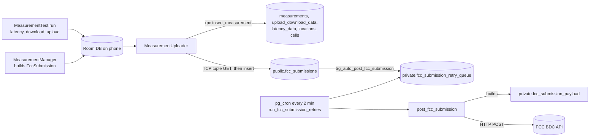

# FCC BDC spec mapping

Purpose: trace every field of the FCC BDC mobile speed test JSON from the spec to the app model, the database column, and the payload the server posts to the BDC.

Related: [Inquiries and reconciliation](inquiries-and-reconciliation.md) · [FCC submission pipeline](../supabase/fcc-submission-pipeline.md) · [Schema](../supabase/schema.md) · [Measurement engine](../app/measurement-engine.md) · [Sync and upload](../app/sync-and-upload.md) · [Runbooks](../ops/runbooks.md)

**Spec version:** *Broadband Data Collection: Data Specifications for Mobile Speed Test Data*, revision 2.2 (2025-07-28), kept locally as `bdc-mobile-speed-test-data-specifications.pdf` at the repo root (not in git). Section numbers below are the spec's; page numbers are PDF pages. CellWatch submits the **Consumer Challenge** category, so "Required?" means required for that category.

**Code described:** `main` as of 2026-11-01. Of the 2026-10-27 merges, #148 reverts c51980e's `provider_name` fallback (#150 then took #148's export `test_id` change back out), and #133 changes how the server builds and holds payloads. Work that isn't on main is labelled with its stage: on a local branch, or uncommitted on the `client-port-header` branch. Being on main doesn't mean being in prod. A migration is in prod only once it is pushed: [full_schema.sql][schema] was pulled from prod on 2026-11-01 and includes every migration on `main`: #132's, #133's and #134's, pushed on 2026-10-29, and the later ones, pushed on 2026-10-31 and 2026-11-01. None of the later ones changes the BDC field mappings on this page. App code reaches phones only with a Play release: app changes merged since #109 (2025-10-13) are not known to be released, and those merged on 2026-10-27 are not released (see [Release checklist](../ops/release-checklist.md)).

## How a test becomes a BDC payload

Sources:

| Layer | Files |
|---|---|
| App model | [FccSubmission.kt][fs], [Measurement.kt][m], [Location.kt][loc], [Cell.kt][cell], [LatencyData.kt][ld], [UploadDownloadData.kt][udd], [TcpTuple.kt][tt] |
| App capture | [MeasurementTest.kt][mt] (per-test fields), [MeasurementManager.kt][mm] (submission fields), [TelephonyInfoManager.kt][tim] (cells, carrier), [MeasurementUploader.kt][mu] (tuple fields) |
| Wire format | [NetworkFccSubmission.kt][nfs], `network/model/Network*.kt` (snake_case column names) |
| DB + payload | [full_schema.sql][schema] (live snapshot, 2026-10-31: tables, `private.fcc_submission_payload`, `private.fcc_submissions_view`, `private.post_fcc_submission`), [`202610210101`][pay] (the payload function), [post_fcc_submission_func.sql][pfs] (older standalone copy of the view and functions) |
| In-app export | [FccExportExtensions.kt][fee] (the "Export" JSON written on the phone; **not** what is posted to the BDC) |

The payload posted to the BDC is built **entirely on the server** from the database rows, by `private.fcc_submission_payload(sub_id)` from that submission's rows only. It comes from #133's `202610210101`, pushed to prod on 2026-10-29; before that, `private.fcc_submissions_view` built the same JSON by aggregating the whole database, and the view now reads through the function. "The view" below means either: the JSON is the same. The app never sends BDC JSON itself. The in-app export is a separate code path with some differences, noted below.

## Top level and contact (§5.1, §5.1.1; PDF p. 13)

| Spec field | § | Required? | Type / units | App source | DB column | Notes |
|---|---|---|---|---|---|---|
| `submission_category` | 5.1 | Yes | enum string | none | none | View hard-codes `'Consumer Challenge'`. |
| `contact.name` | 5.1.1 | Yes | string | `SettingsRepository.getName()` → `FccSubmission.contactName` | `fcc_submissions.contact_name` | PII. |
| `contact.email` | 5.1.1 | Yes | string, valid email | `getEmail()`; validated on entry by [ContactInfoValidator][civ] (`asValidEmail`) | `contact_email` | PII. |
| `contact.phone` | 5.1.1 | Yes for Consumer Challenge | string, `000-000-0000` | `getPhoneNumber()`; `asValidPhoneNumber` accepts `ddd-ddd-dddd` or 10 digits and normalizes to dashes | `contact_phone` | PII. |
| `submissions` | 5.1 | Yes | array | none | none | The view always emits a one-element array (one submission per POST). |

## Submission object (§5.1.2; PDF p. 14–18)

All submission-level values are copied onto `FccSubmission` in `MeasurementManager.runTestSequence`. Where three measurements could supply a value, the first non-null of latency → download → upload wins.

| Spec field | § | Required? | Type / units | App source | DB column | Notes |
|---|---|---|---|---|---|---|
| `test_id` | 5.1.2 | Yes, unique per app vendor | string | `FccSubmission.id` = the group id (UUID) | `fcc_submissions.id` | The in-app export uses the latency **measurement** id instead, so the two don't match (#126). A fix is on the local branch `measurement-process-changes` (#148 merged it, and #150 took it back off `main` because it changes FCC data). |
| `device_timestamp` | 5.1.2 | Yes | ISO-8601 with seconds and offset | `Clock.System.now()` when the test sequence finishes | `device_timestamp` | The spec defines it as the moment the data was sent to the app's servers. The app stamps it when the test ends, which can be hours or weeks before the upload. |
| `server_timestamp` | 5.1.2 | Yes for Consumer Challenge | ISO-8601 | TCP tuple service clock (epoch ms) from `getPubicTCPTuple()`, set by `MeasurementUploader` just before upload | `server_timestamp` (default `now()`) | Measured on the tuple service's own GET, not on the upload request. |
| `server_source_ip_address` | 5.1.2 | Yes for Consumer Challenge | IPv4/IPv6 string | `TcpTuple.remoteAddress` | `source_ip` | If the app sends null, trigger `_300_fcc_submission_update_source_ip` fills it from the first `x-forwarded-for` entry, which a client can spoof. |
| `server_source_port` | 5.1.2 | Yes for Consumer Challenge | integer | `TcpTuple.remotePort` | `source_port` | The port of the tuple GET's connection, not the upload's. Uncommitted on the `client-port-header` branch: migration `202610130001_record_local_ports.sql` adds `tuple_local_port`, `upload_local_port`, `upload_transport` and `upload_ip` to compare ports. None of these are sent to the FCC. |
| `device_imei` | 5.1.2 | No (null allowed for Consumer Challenge) | 15-digit string | never set | `device_imei` (always null) | |
| `device_type` | 5.1.2 | Yes; `iOS` or `Android` for consumers | enum | constant `"Android"` | `device_type` | |
| `manufacturer` | 5.1.2 | Yes | string | `EasyDeviceMod.manufacturer` (via `Measurement.deviceManufacturer`) | `device_manufacturer` | |
| `model` | 5.1.2 | Yes | string | `Build.MODEL` | `device_model` | |
| `operating_system` | 5.1.2 | Yes | string, name and version | `"Android " + deviceOsVersion` | `device_os` | |
| `device_tac` | 5.1.2 | No (null allowed without permission) | 8-digit string | never set | `device_tac` (always null) | |
| `device_id` | 5.1.2 | Yes | string | install UUID from `SettingsRepository.getDeviceId()` | `device_id` (uuid) | Also the RLS identity (`X-Device-ID` header). |
| `app_name` | 5.1.2 | Yes; must match the FCC-approved name | string | `EasyAppMod.appName` | `app_name` | > TODO: verify the string sent matches the FCC-approved app name. |
| `app_version` | 5.1.2 | Yes; must match an approved version | string | `EasyAppMod.appVersion` (= `versionName`) | `app_version` | `versionName` is still `"1.0.0"` ([app/build.gradle][bg]), so every build reports the same version. |
| `provider_name` | 5.1.2 | Yes | string | `TelephonyInfoManager.getProviderName()`: network operator name, lowercased and trimmed; `"unknown"` only if it is null | `provider` | An empty network operator name is sent blank, and the retry queue holds it as `Missing provider` (blocked before 2026-10-29); the server never fills it in. c51980e (2026-07-14) added a SIM-name fallback, but #148 (merged 2026-10-27) reverted it so main records the carrier as the released build does. The fallback is on the local branch `measurement-process-changes`. |
| `sim_mobile_country_code` / `sim_mobile_network_code` | 5.1.2 | Yes; null allowed when not connected | numeric string | `getSimMobileCountryCode()` / `…NetworkCode()` | `sim_country_code` / `sim_network_code` | |
| `net_mobile_country_code` / `net_mobile_network_code` | 5.1.2 | Yes on Android (null allowed on iOS only) | numeric string | `getNetworkMobileCountryCode()` / `…NetworkCode()` | `net_country_code` / `net_network_code` | The BDC has rejected tests with null network codes (`null_net_mobile_country_code`). |
| `in_vehicle_flag` | 5.1.2 | Yes | boolean | user's choice on the pre-measure screen (`MeasurementService` extra) | `in_vehicle` | |
| `environment_code` | 5.1.2 | Must be null when `in_vehicle_flag` is set | int 0/1/2 | none | none | Not in the server payload, which is correct. The in-app export sets both fields, which the spec disallows. |
| `external_antenna_flag` | 5.1.2 | No for Consumer Challenge; must be false when not in a vehicle | boolean | constant `false` | `external_antenna` | |
| `scheduled_test_flag` | 5.1.2 | Only for crowdsourced | boolean | `Measurement.scheduled = false` | none | View hard-codes `false`. |
| `tests` | 5.1.3 | Yes | Test Object | built from the group's three measurements | none | `post_fcc_submission` refuses to post unless `latency`, `download` and `upload` are all present. |

## Download and upload test objects (§5.1.4, §5.1.5; PDF p. 19–22)

| Spec field | Required? | Type / units | App source | DB column | Notes |
|---|---|---|---|---|---|
| `timestamp` | Yes | ISO-8601; when the connection was initialized, before warmup | `ThroughputResult.start` | `measurements.timestamp` | |
| `warmup_duration` | Yes | integer, µs | `warmupMetrics.usecs` | `upload_download_data.warmup_duration` | |
| `warmup_bytes_transferred` | Yes | integer, bytes | `warmupMetrics.bytes` | `warmup_bytes` | |
| `duration` | Yes | integer, µs | `activeMetrics.usecs` | `upload_download_data.duration` | `measurements.duration` holds warmup plus active and is not used here. |
| `bytes_transferred` | Yes | integer, bytes | `activeMetrics.bytes` | `bytes` | |
| `bytes_sec` | Yes | integer, bytes/s | none (app stores `bytesPerSec`) | computed | The view computes `bytes / (duration / 1e6)` as an integer: 0 when both are 0, null when only the duration is 0. The stored `bytes_per_sec` column (the sum of per-stream rates) is not used. |
| `locations` | Yes; ≥ 2 per §5.1 | array of Location | start and end fix from `MeasurementTest.getLocation()` | `locations` rows by `measurement_id` | `listOfNotNull(begin, end)`, so a test can carry 0, 1 or 2 locations. See [Validation](#validation-rules). |
| `cells` | Yes; may be null/empty if the test failed | array of Cell | `getCells()` at start, plus `watchCells` updates during the test | `cells` rows | |
| `targets` | Yes when `success_flag` and `network_connected_flag` are true | array of host strings | `listOf(result.targetHost)` | `upload_download_data.servers` | |
| `connection_type` | No; null is treated as `cell` | `cell`/`wifi`/`other` | `measurements.connection_type` (`NONE`/`WIFI`/`CELLULAR`) | `connection_type` | **Not emitted by the view.** Submissions are only created when no test ran on Wi-Fi. |
| `success_flag` | Yes | boolean | `result.success`, forced `false` if the network generation changed during the test | `measurements.success` | The view also emits a non-spec `success` key with the same value. |
| `carrier_aggregation_flag` | Yes on Android; must be null for 3G | boolean | `isUsingCarrierAggregation(cells)`: more than one primary/secondary serving cell | `carrier_aggregation` | Never null, including on 3G. |
| `network_connected_flag` | Yes on Android | boolean | `TelephonyManager.dataState == DATA_CONNECTED` | `network_connected` | |
| `network_available_flag` | Yes on Android | boolean | `availableNetworks` not empty | `network_available` | |
| `network_roaming_flag` | Yes on Android | boolean | `TelephonyManager.isNetworkRoaming` | `network_roaming` | |

## Latency test object (§5.1.6; PDF p. 23–24)

| Spec field | Required? | Type / units | App source | DB column | Notes |
|---|---|---|---|---|---|
| `timestamp` | Yes | ISO-8601; test start | `LatencyResult.start` | `measurements.timestamp` | |
| `duration` | Yes | integer, µs | `LatencyResult.usecs` | `measurements.duration` | |
| `round_trip_time` | Yes | integer, µs | mean RTT of non-lost MSAK round trips | `latency_data.rtt` | The app's UI divides by 1000 to show ms. |
| `jitter` | Yes | integer, µs | standard deviation of those RTTs | `latency_data.jitter` | Trigger `fix_jitter_pre_100alpha5` takes the square root for rows whose measurement has a null or early-alpha `app_version`. |
| `packets_sent` / `packets_received` | Yes | integer | MSAK result counts | `latency_data.sent` / `received` | `success_flag` is true when more than 0 packets were received. |
| `locations`, `cells`, `targets`, `connection_type`, flags | as for download | | same as download | same | `targets` comes from `latency_data.servers`. `connection_type` is not emitted. |

## Location objects (§5.1.7; PDF p. 24–25)

| Spec field | Required? | Type / units | App source | DB column | Notes |
|---|---|---|---|---|---|
| `timestamp` | Yes | ISO-8601; time of the fix | `android.location.Location.time` | `locations.timestamp` | |
| `latitude` / `longitude` | Yes | WGS-84 decimal degrees, at least 6 decimal digits; may be a numeric string | `Location.lat` / `lon` (double) | `lat` / `lon` (double precision) | The view emits JSON numbers, so a value with trailing zeros carries fewer than 6 digits. The in-app export formats `"%.6f"` strings. |
| `horizontal_accuracy` | Yes; null if unknown | metres | `accuracy` if `hasAccuracy()` | `accuracy` | |
| `speed` | Yes for Consumer Challenge; null if unknown | m/s | `speed` if `hasSpeed()` | `speed` | |
| `speed_accuracy` | Yes; null if unknown | m/s | `speedAccuracyMetersPerSecond` if available | `speed_accuracy` | |
| (none) | | | `heading` | `heading` | Stored but not sent. |

Fixes come from the fused provider with `GRANULARITY_FINE` and a maximum age of 3 s. The same cached fix can therefore be returned for both start and end.

## Cell objects, standard flavour (§5.1.8.1; PDF p. 26–30)

The USF flavour (§5.1.8.2) is not produced.

| Spec field | Required? | Type / units | App source ([TelephonyInfoManager][tim] `getCells`) | DB column | Notes |
|---|---|---|---|---|---|
| `timestamp` | Yes | ISO-8601 | `CellInfo` timestamp converted to wall-clock time | `cells.timestamp` | |
| `cell_id` | Yes; null if unknown | numeric | CI / NCI / CID by RAT | `cell_id` | |
| `physical_cell_id` | Yes; null for 3G | integer | PCI for LTE/NR only | `physical_cell_id` | The "unavailable" check tests `cellId`, not the PCI. |
| `cell_connection` | Yes; null if unknown | 0 not serving, 1 primary, 2 secondary | `cellConnectionStatus`, null when UNKNOWN | `cell_connection` | Android's constants match the spec's codes. |
| `network_generation` | Yes | `2G`/`3G`/`4G`/`5G`/`Other` | by `CellInfo` class (CDMA/GSM = 2G, WCDMA/TD-SCDMA = 3G, LTE = 4G, NR = 5G) | `network_generation` | |
| `network_subtype` | Yes if known | `1X`…`NRSA`/`NRNSA` | active data subtype for the primary serving cell; otherwise by class (NR → `NRNSA`/`NRSA`) | `network_subtype` | TD-SCDMA is mapped to `GSM`. |
| `signal_strength` | Yes; null if unknown | dBm | `CellSignalStrength.dbm` | `signal_strength` | |
| `rssi` | null allowed for 5G | dBm | LTE `rssi`, GSM `rssi` (API 30+), CDMA `evdoDbm` | `rssi` | |
| `rsrp` / `rsrq` / `sinr` | null for 3G | dBm / dB | LTE `rsrp`/`rsrq`/`rssnr`; NR `ssRsrp`/`ssRsrq`/`ssSinr` | `rsrp` / `rsrq` / `sinr` | |
| `csi_rsrp` / `csi_rsrq` / `csi_sinr` | null for 3G/4G | dBm / dB | NR only | `csi_*` | |
| `cqi` | null for 3G | integer | LTE `cqi`; NR min of `csiCqiReport` (API 31+) | `cqi` | |
| `spectrum_band` | Yes; null if unknown | string such as `n2` | LTE/NR `bands` (API 30+) joined with `,` | `spectrum_band` | Bands are bare numbers (`"2"`, `"2,66"`), not the spec's example format. The view sends blank strings as they are; the in-app export drops them. |
| `spectrum_bandwidth` | Yes; null if unknown | MHz | LTE `bandwidth` (kHz) / 1000, integer division | `spectrum_bandwidth` | The unavailable check runs after the division, so the sentinel survives as `2147483`. The in-app export filters it; the server view does not. |
| `arfcn` | Yes; null if unknown | integer | `arfcn` / `earfcn` / `nrarfcn` / `uarfcn` | `arfcn` | |

## Formatting notes

- **Timestamps:** the view serializes `timestamptz` through `jsonb`, so values carry fractional seconds and a `+00:00` offset. The spec's examples have neither fractional seconds nor UTC, but the BDC has accepted such payloads.
- **Nulls:** `jsonb_build_object` emits keys with JSON `null` rather than omitting them.
- **Numbers:** `numeric` columns (for example `cell_id`, `rtt`) are emitted as JSON numbers.

## Validation rules

### App side (on main)

| Rule | Where |
|---|---|
| A submission is only created in `FCC_CHALLENGE` collection mode, when none of the three tests ran on Wi-Fi and cellular data wasn't reported disabled. | [MeasurementManager.kt][mm] |
| Contact email and phone are validated when entered. | [ContactInfoValidator][civ], onboarding `FCCInfoFragment`, `SettingsActivity` |
| A submission uploads only after all three of its measurements have uploaded. | [MeasurementUploader.kt][mu] (`measurementsUploaded`) |
| If the TCP tuple request fails, no submission uploads in that run. | `MeasurementUploader.uploadSubmissions` |
| The FCC fails a test that switches generation, so the app marks it unsuccessful. | [MeasurementTest.kt][mt] |

There is no app-side location-count or completeness check on main. An `isFccSubmittable` check that requires two locations is on the local branch `measurement-process-changes`; #130, which first carried it, is closed (see the decision below).

### Server side (on prod since 2026-10-29: [full_schema.sql][schema], with [`202610210101`][pay] and [`202610210103`][rq])

| Step | Rule | Outcome |
|---|---|---|
| Insert | RLS: `device_id` must equal `private.verified_device_id()` (from `X-Device-ID` / `X-Device-Secret`). | Insert rejected |
| Insert trigger | `private.auto_post_fcc_submission`: every row with `submitted` false is queued with `fcc_env = 'prod'`. | Queue row `pending` |
| Retry job | `private.fcc_submission_is_ready`: exactly 3 measurements of distinct types, each with its data row. Success is not required. | Not ready: re-check in 5 min (hourly once older than a day). Still not ready 30 days after queueing: `expired`, back to `pending` if the data arrives |
| Retry job | `private.fcc_payload_hold_reason`: no network codes, no locations, one location, or a blank provider (`Missing provider`; never filled in). | `held`; re-checked daily and released when no reason applies any more |
| Post | `post_fcc_submission`: env row exists in `private.fcc_submission_info`; the group is complete; the payload has `latency`, `download` and `upload` objects; for the prod env, nothing the queue would hold. | Exception, which counts as a failed attempt |
| Post | BDC HTTP status: 2xx means success. A 4xx body with `duplicate_test_id` means the BDC already has the test. 400, 409, 413 and 422 reject the test. Anything else is retried with backoff `60 s × 2^(n−1)`, capped at 1 h, and ends the run. | Sent; `blocked` on a rejection or after 6 attempts |
| Success | `fcc_submissions.submitted = true`; `submission` (the payload) and `submission_response` (the BDC body) are stored; a `succeeded` row goes into `private.fcc_submission_failures`. | Queue row deleted |

There is still no field-format check, so a row with, for example, a sentinel value is posted as it is. Before the 2026-10-29 push, prod ran only [`202610070001`][unclog]'s rules: a blank provider was `blocked` before the readiness check, every 4xx other than 408/429 was permanent, and tests without network codes or locations were posted and rejected. See [fcc-submission-pipeline](../supabase/fcc-submission-pipeline.md).

### Decision 2026-10-22: two locations per test

Spec §5.1 (PDF p. 13) says each download, upload and latency object "contains at least two Location Objects". §5.1.7 says these are the fixes at the start and end of the test. On 2026-10-22 the team decided to **require at least two locations per test object**. The server part is pushed to prod; the app part is not merged:

- **Server** (#133, merged 2026-10-27, pushed to prod 2026-10-29): `private.fcc_payload_hold_reason` in [`202610210103`][rq] holds complete submissions with a "No locations" or a separate "One location" reason, so one-fix entries can be released on their own if the FCC accepts one fix.
- **App** (local branch `measurement-process-changes`, not in a PR): `isFccSubmittable` requires two locations, and the app retries for a fresh fix when the start and end fixes are the same one (falling back to listing the repeated fix twice). It changes what a test records, so it is held back while the measurement process stays as approved.

Both count the same fix listed twice as two locations, which follows the spec's wording. The BDC intake itself has only been **observed to reject empty location lists** (response code `null_properties`); a posted one-location test was accepted. If the FCC confirms one location is enough, the "One location" hold should be reverted and the held entries released.

> TODO: update this page if the app rule is merged, or if the FCC answers on one-location tests.

## Known gaps vs the spec (on main; server parts also on prod)

| Gap | Impact | Status |
|---|---|---|
| `connection_type` not sent | BDC treats null as `cell`, so null network codes are rejected | Open question for the FCC. Since 2026-10-29 prod holds such tests instead of posting them (#133) |
| `device_timestamp` set at test end, not upload | Diverges from the spec's definition | Open |
| `server_*` tuple from a separate GET to the tuple service | Port doesn't match the upload connection | A port comparison (`202610130001` plus app changes) is uncommitted on the `client-port-header` branch; nothing is being collected yet |
| `spectrum_bandwidth` sentinel `2147483` | Bogus value posted | Open |
| `carrier_aggregation_flag` not null on 3G | Spec says null for 3G | Open |
| Locations may be < 2 | Spec wants ≥ 2 | Decided. Server hold pushed 2026-10-29 (#133); app rule on a local branch (see above) |
| Lat/lon sent as numbers | Trailing zeros dropped | Open |

[fs]: ../../app/src/main/java/edu/gatech/cc/cellwatch/data/model/FccSubmission.kt
[m]: ../../app/src/main/java/edu/gatech/cc/cellwatch/data/model/Measurement.kt
[loc]: ../../app/src/main/java/edu/gatech/cc/cellwatch/data/model/Location.kt
[cell]: ../../app/src/main/java/edu/gatech/cc/cellwatch/data/model/Cell.kt
[ld]: ../../app/src/main/java/edu/gatech/cc/cellwatch/data/model/LatencyData.kt
[udd]: ../../app/src/main/java/edu/gatech/cc/cellwatch/data/model/UploadDownloadData.kt
[tt]: ../../app/src/main/java/edu/gatech/cc/cellwatch/data/model/TcpTuple.kt
[fee]: ../../app/src/main/java/edu/gatech/cc/cellwatch/data/model/FccExportExtensions.kt
[nfs]: ../../app/src/main/java/edu/gatech/cc/cellwatch/data/network/model/NetworkFccSubmission.kt
[mt]: ../../app/src/main/java/edu/gatech/cc/cellwatch/domain/fcc/MeasurementTest.kt
[mm]: ../../app/src/main/java/edu/gatech/cc/cellwatch/domain/fcc/MeasurementManager.kt
[tim]: ../../app/src/main/java/edu/gatech/cc/cellwatch/domain/telephony/managers/TelephonyInfoManager.kt
[mu]: ../../app/src/main/java/edu/gatech/cc/cellwatch/data/core/sync/MeasurementUploader.kt
[civ]: ../../app/src/main/java/edu/gatech/cc/cellwatch/core/util/ContactInfoValidator.kt
[bg]: ../../app/build.gradle
[schema]: ../../supabase/full_schema.sql
[pfs]: ../../supabase/post_fcc_submission_func.sql
[unclog]: ../../supabase/migrations/202610070001_unclog_fcc_retry_queue.sql
[rq]: ../../supabase/migrations/202610210103_fcc_retry_queue_processing.sql
[pay]: ../../supabase/migrations/202610210101_build_fcc_payload_per_submission.sql
