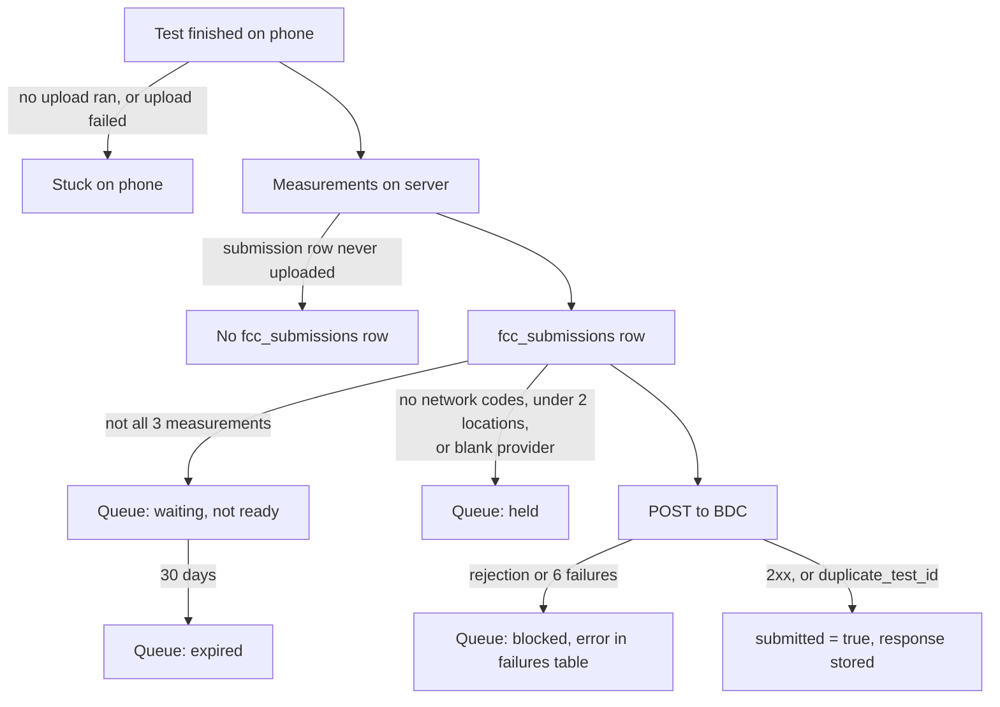

# FCC inquiries and reconciliation

Purpose: a repeatable playbook for answering "did this user's tests reach the BDC, and if not, why?"

Related: [BDC spec mapping](bdc-spec-mapping.md) · [FCC submission pipeline](../supabase/fcc-submission-pipeline.md) · [Runbooks](../ops/runbooks.md) · [Sync and upload](../app/sync-and-upload.md) · [Performance notes](../supabase/performance-notes.md)

A past inquiry write-up is at `bdc-inquiry-issues.md` in the repo root. **It contains PII and is kept out of git** (#136 gitignores root-level `.md` files other than `README.md`): don't commit it, and don't quote it in issues or PRs.

## Ground rules

- Query prod **read-only** (see [Runbooks → read-only prod SQL](../ops/runbooks.md#read-only-prod-sql)).
- `fcc_submissions` holds the contact's name, email and phone. **Never `select *`** from it. Print IDs, counts, timestamps and response text only.
- Keep per-test reconciliation files (CSV and similar) **outside the repo**.
- Don't filter on `app_version`: every build so far reports `'1.0.0'`.
- Times in the DB are `timestamptz`. The pooler session runs in UTC, so convert to the user's local time when you compare with dates they give.

## Where a test can stop



| Stop | Where you see it |
|---|---|
| Stuck on phone | Nothing on the server for that period. Check device registration and the last `measurements.created_on`. |
| No submission row | Measurements exist for a `group_id`, but there is no `fcc_submissions` row with that id. |
| Waiting | Queue row `pending`, `last_error` "Waiting for complete latency/download/upload data". |
| Held | Queue row `held`, with the reason in `last_error` (since 2026-10-29). Re-checked daily. |
| Expired | Queue row `expired`: still waiting for measurements 30 days after queueing (since 2026-10-29). |
| Blocked | Queue row `blocked`, with the reason in `last_error`. |
| Rejected | `private.fcc_submission_failures` rows with `succeeded = false`; the BDC body is in `error_message` / `response_snippet`. |
| Accepted | `fcc_submissions.submitted = true`, `submitted_on`, and `submission_response` (the BDC response body). Since `202610210103` was pushed (2026-10-29), a test the BDC already had (`duplicate_test_id`) is recorded the same way, but with `submitted_on` null and `submission_response` starting `Not posted again:`. |

## Tables

| Table | What it tells you |
|---|---|
| `public.fcc_submissions` | One row per test group (`id` = BDC `test_id` = measurement `group_id`). `submitted`, `submitted_on`, `submission` (the exact payload sent), `submission_response` (the BDC body on success). |
| `public.measurements` (+ `latency_data`, `upload_download_data`, `locations`, `cells`) | Whether the three results reached the server. `created_on` is the server receive time; `timestamp` is when the test ran. |
| `private.fcc_submission_retry_queue` | Posting state for unsent submissions: `state` (`pending`/`blocked`, and since 2026-10-29 `held`/`expired`), `attempt_count`, `next_attempt_at`, `last_error`. The row is deleted once posted. |
| `private.fcc_submission_failures` | An append-only log of every posting attempt, failed **and** succeeded (`succeeded`, `error_message`, `response_snippet`, `fcc_env`, `occurred_on`). `response_status` is never filled. |
| `private.fcc_submission_info` | Which BDC endpoint each `fcc_env` posts to. The hash secret lives in Vault; never select `vault.decrypted_secrets`. |
| `private.devices` | Whether a device id is registered. Select `id` only, never `hashed_secret`. |
| `cron.job`, `cron.job_run_details` | Whether the retry job is active and succeeding. |

## Step-by-step

Set psql variables first. Use real values only in your session, never in files you commit:

```sql
\set contact_email 'user@example.com'
\set device_id '00000000-0000-0000-0000-000000000000'
\set submission_id '00000000-0000-0000-0000-000000000000'
\set from_ts '2026-01-01 00:00:00+00'
\set to_ts   '2026-02-01 00:00:00+00'
```

### 1. Identify the device

Usually the FCC gives a contact email or a date range and place. Map the contact to device ids, printing ids and counts only:

```sql
select device_id, count(*) as submissions, min(created_on), max(created_on)
from public.fcc_submissions
where lower(contact_email) = lower(:'contact_email')
group by device_id;
```

A phone that was reinstalled gets a new device id, so expect more than one.

### 2. Is the device registered, and when did it last upload?

```sql
select exists (select 1 from private.devices where id = :'device_id') as registered;

select type, count(*) as tests, min(timestamp) as first_test, max(timestamp) as last_test,
       max(created_on) as last_received
from public.measurements
where device_id = :'device_id'
group by type;
```

A large gap between `last_test` and `last_received`, or tests the user remembers that are missing entirely, means the results were stuck on the phone.

> Before 2026-10-29 `measurements` had no index on `device_id` on prod, so these scans were slow. Migration `202610210001` (#132) added it and was pushed that day.

### 3. Bucket every submission by outcome

```sql
with s as (
  select s.id,
         s.submitted,
         private.fcc_submission_is_ready(s.id) as ready,
         q.state as queue_state,
         left(q.last_error, 70) as last_error
  from public.fcc_submissions s
  left join private.fcc_submission_retry_queue q on q.submission_id = s.id
  where s.device_id = :'device_id'
    and s.created_on between :'from_ts' and :'to_ts'
)
select case when submitted then 'sent'
            when queue_state is null then 'not queued'
            else queue_state end as outcome,
       ready, last_error, count(*)
from s
group by 1, 2, 3
order by 4 desc;
```

`not queued` with `submitted = false` usually means the row was inserted before automatic posting existed. The insert trigger only queues new rows.

### 4. Check the completeness of unsent tests

```sql
select s.id,
       count(m.id) filter (where m.type = 'latency')  as latency,
       count(m.id) filter (where m.type = 'download') as download,
       count(m.id) filter (where m.type = 'upload')   as upload
from public.fcc_submissions s
left join public.measurements m on m.group_id = s.id
where s.device_id = :'device_id' and not coalesce(s.submitted, false)
group by s.id
having count(m.id) < 3;
```

Locations per test object (the spec wants at least two; see the [decision](bdc-spec-mapping.md#decision-2026-10-22-two-locations-per-test)):

```sql
select l_count as locations, count(*) as test_objects
from (
  select m.id, count(l.id) as l_count
  from public.measurements m
  left join public.locations l on l.measurement_id = m.id
  where m.device_id = :'device_id'
  group by m.id
) x
group by 1 order by 1;
```

Null network codes and blank carriers:

```sql
select count(*) filter (where nullif(btrim(provider), '') is null) as blank_provider,
       count(*) filter (where net_country_code is null or net_network_code is null) as null_net_codes
from public.fcc_submissions
where device_id = :'device_id' and not coalesce(submitted, false);
```

### 5. Read the posting history

```sql
select f.occurred_on, f.succeeded, f.fcc_env, left(f.response_snippet, 120) as snippet
from private.fcc_submission_failures f
join public.fcc_submissions s on s.id = f.submission_id
where s.device_id = :'device_id'
order by f.occurred_on;
```

Rejection reasons, tallied:

```sql
select left(f.error_message, 90) as reason, count(*)
from private.fcc_submission_failures f
join public.fcc_submissions s on s.id = f.submission_id
where s.device_id = :'device_id' and not f.succeeded
group by 1 order by 2 desc;
```

For one test, check what the BDC answered and when:

```sql
select submitted, submitted_on, left(submission_response, 200)
from public.fcc_submissions where id = :'submission_id';
```

### 6. Reconcile against the FCC's count

Build a per-test list (test id, test time, carrier, outcome) with the queries above, and save it **outside the repo**. Classify by `provider` **and** by SIM/network codes: the BDC appears to attribute tests by network code, so a carrier count can differ from ours when the network code differs from the SIM's carrier. Account for every test in one bucket: accepted, rejected (and why), held, waiting for data, never uploaded.

## Common failure causes

| Cause | Symptom | Notes |
|---|---|---|
| **Uploads never ran** | Tests missing on the server, or arriving weeks late | The Play build (versionCode 13) uploads only after a finished test or on a cold start, sends every unsynced row at once, and uses supabase-kt's default 10 s timeout. Slow RLS checks on large histories make each attempt time out. Main limits uploads to 3 in flight (#111, merged 2026-10-07; not known to be released) and, since #148 (merged 2026-10-27; not released), also uploads hourly and when the app comes to the foreground, with 60 s timeouts. The RLS fix `202610210001` (#132) was pushed to prod on 2026-10-29, so uploads from long histories no longer time out on the server's side. |
| **Device registration failed** | `registered = false`; nothing ever uploaded | `register_device` raised "already registered" when the phone had lost the first response, which locked the phone out permanently. A retry-safe fix is in #148 (merged 2026-10-27): migration `202610220001`, pushed to prod on 2026-10-31, and the app change, not released. Since the push, a phone on the Play build that never uploaded registers again on its next attempt. |
| **Submission without results** | `fcc_submissions` row but fewer than 3 measurements | App builds without #111 uploaded submissions before their measurements. #111 is merged to main but not known to be released, so the Play build may still do this. The queue keeps waiting (hourly after a day). |
| **Missing provider** | `held`, "Missing provider: no carrier name …" (`blocked`, "Missing provider" for entries blocked before 2026-10-29) | The app sends a blank carrier when the phone reports an empty network operator name. That is the Play build's behaviour and main's: #148 reverted c51980e's SIM-name fallback, which is now on the local branch `measurement-process-changes`. Blank carrier names are not filled in (decided 2026-10-27). Since 2026-10-29 (`202610210103`, #133) new ones are `held` and re-checked daily; entries blocked before that stay blocked and are never re-checked. |
| **Missing locations** | `held`, "No locations" or "One location"; earlier, BDC rejection `null_properties` | Seen for tests with zero locations. Holding tests with fewer than two was decided on 2026-10-22. The server hold (#133) is on prod since 2026-10-29; the app rule is on a local branch. See the [decision](bdc-spec-mapping.md#decision-2026-10-22-two-locations-per-test). |
| **Null network codes** | `held`, "No network registration"; earlier, BDC rejection `null_net_mobile_country_code` | The payload has no `connection_type`, so the BDC treats the test as cellular and requires the codes. Since 2026-10-29 (#133) prod holds such tests instead of posting them. |
| **Already accepted** | BDC answer `duplicate_test_id` | Happens when a post succeeded at the BDC but our transaction rolled back (for example on `statement_timeout`), and the job posted again. Before 2026-10-29 prod treated it as a permanent failure and blocked the entry. Since then `202610210103` records it as sent: `submitted = true`, the rebuilt payload in `submission`, `submitted_on` null (the earlier post's time is unknown), and a `submission_response` starting `Not posted again:`. It matches the code anywhere in a 4xx body, in any case. A submission someone recorded as sent in the meantime keeps that record. Entries blocked for it before the push stay blocked. |
| **Retry queue clog** | Many `pending` rows; new tests post hours late | Before `202610070001` the job took one entry every 2 min and re-checked waiting entries every 5 min. Since 2026-10-29 the job runs `call private.run_fcc_submission_retries(10)`: 10 entries, a 60 s cap, a commit per entry, and entries still waiting 30 days after queueing become `expired`. Building one payload took tens of seconds on prod until `202610210101` (#133) was pushed the same day. Check the job and recent runs with [Runbooks](../ops/runbooks.md#1-look-read-only). |
| **Expired** | `expired`, "Expired: measurements still incomplete 30 days after queueing" | Since 2026-10-29. The measurements never reached the server. Each run puts an expired entry back to `pending` once they arrive, so a phone that uploads late still gets its tests to the FCC. |
| **Manual hold** | `blocked` with an explanatory `last_error` and a far-future `next_attempt_at` | Set by hand during incident handling. Read `last_error` before re-queuing. |

**Caution on old success rows:** `fcc_submission_failures` rows marked `succeeded` with an empty response from before the July 2026 repair (`202607140001`) do not prove the BDC accepted the test.

## Fixing things

Every remedy (re-queue, backfill, re-post) is a **prod write that posts to the FCC**. Use [Runbooks → retry queue](../ops/runbooks.md#inspecting-and-draining-a-stuck-fcc-retry-queue), and get explicit sign-off for each step. Before you tell the FCC anything new, re-run steps 3 to 5, because the queue changes every two minutes.
