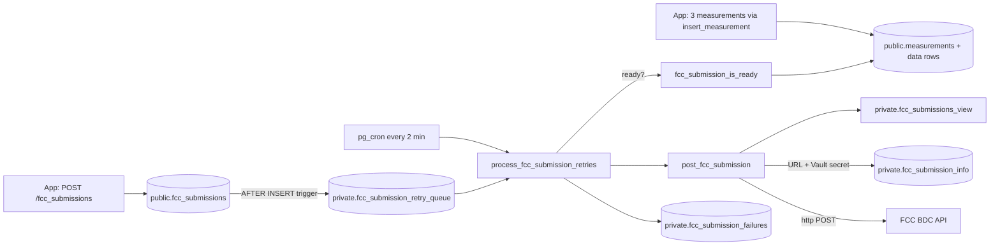
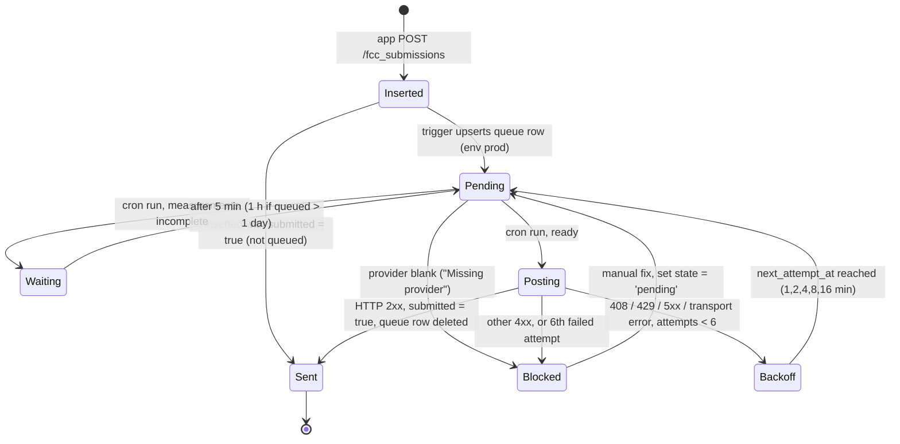

# FCC submission pipeline (server side)

How an FCC BDC Consumer Challenge submission goes from an app insert to an HTTP POST to the FCC, and how failures are retried.

**Related:** [schema](schema.md) · [rpc-reference](rpc-reference.md#fcc-functions-private) · [triggers-and-cron](triggers-and-cron.md) · [performance-notes](performance-notes.md#2-fcc-payload-view-scans-the-whole-database) · [bdc-spec-mapping](../fcc/bdc-spec-mapping.md) · [inquiries-and-reconciliation](../fcc/inquiries-and-reconciliation.md) · [sync-and-upload](../app/sync-and-upload.md)

Sources: [full_schema.sql](../../supabase/full_schema.sql) (prod snapshot committed 2026-10-07; a read-only catalog check on 2026-10-22 found prod matches it plus `202610070001`), [202607140001_repair_fcc_submission_functions.sql](../../supabase/migrations/202607140001_repair_fcc_submission_functions.sql), [202610070001_unclog_fcc_retry_queue.sql](../../supabase/migrations/202610070001_unclog_fcc_retry_queue.sql), [post_fcc_submission_func.sql](../../supabase/post_fcc_submission_func.sql) (original setup script, partly superseded), [cron_jobs.sql](../../supabase/cron_jobs.sql).

## Overview



The link between a submission and its measurements is `fcc_submissions.id = measurements.group_id`. There is no foreign key. The app uploads the three measurements first and holds the submission until all three are on the server (`MeasurementUploader.measurementsUploaded`). The server does its own readiness check and does not rely on the app.

## 1. Insert and queue

1. The app inserts a row into `public.fcc_submissions` as `anon` with device headers. RLS requires `device_id` to equal `private.verified_device_id()`.
2. BEFORE INSERT triggers fill `created_on` and `source_ip` (only when null). With `202610130001` (uncommitted on the `client-port-header` branch; not on main, not pushed to prod), a further trigger fills the local-port columns.
3. AFTER INSERT `trg_auto_post_fcc_submission` → `private.auto_post_fcc_submission()` (Definer). If `submitted` is false, it upserts into the queue:
   - `fcc_env = 'prod'` (hard-coded), `state = 'pending'`, `next_attempt_at = now()`.
   - If the entry already exists, it is reset to `pending` and its `next_attempt_at` becomes the earlier of the old value and `now()`.

The insert does no network I/O. Before the queue existed, the trigger posted to the FCC synchronously inside the app's request; see [history](#history).

## 2. Readiness

`private.fcc_submission_is_ready(sub_id)` is true when exactly **3** measurements with `group_id = sub_id` have their data row (`latency_data` or `upload_download_data`), and their types are `latency`, `download`, and `upload` (case-insensitive, all distinct). Measurements without a data row are not counted.

- Presence, not success: a failed test is still valid challenge data.
- A group with a duplicate measurement that also has its data row (4+ complete rows) never becomes ready.
- `measurements.group_id` has no index on prod, so each check scans `measurements` (open PR #133 adds one; not pushed).

## 3. Retry processing (the cron job)

pg_cron job `fcc-submission-retries` runs every 2 minutes as `postgres` and calls `private.process_fcc_submission_retries(n)`. The snapshot files predate `202610070001`, which is pushed to prod:

| | Before `202610070001` (`full_schema.sql`, `cron_jobs.sql`) | After `202610070001` (prod's function) |
|---|---|---|
| Job command | `process_fcc_submission_retries(1)` | `process_fcc_submission_retries(10)` |
| Batch cap in function | `greatest(1, least(p_batch_size, 10))` | same |
| Time limit per run | none | stops taking new entries after **60 s** |
| Recheck of not-ready entries | every 5 min | 5 min; **1 h** if queued more than a day ago |

> `202610070001` is pushed to prod: prod's `process_fcc_submission_retries` matches this migration's version (catalog hash match, 2026-10-22). The cron job's batch size of 10 was not checked; the read-only check in Step 0 of the prod deploy runbook (`prod-deploy-runbook.md`, a local file not in git) covers both. The snapshot files predate it.

Each run does this:

1. Deletes queue entries whose submission is already `submitted = true` (posted manually or elsewhere).
2. Selects due entries: `state = 'pending'`, `next_attempt_at <= clock_timestamp()`, not submitted. Ordered by `next_attempt_at` and limited to the batch size. Uses `FOR UPDATE OF q SKIP LOCKED`, so overlapping runs don't take the same entries.
3. For each entry:
   - **Blank provider** (`nullif(btrim(provider), '') is null`): `state = 'blocked'`, `last_error = 'Missing provider'`. It needs a manual fix.
   - **Not ready**: push `next_attempt_at` out (5 min, or 1 h after `202610070001` for entries older than a day) with `last_error = 'Waiting for complete latency/download/upload data'`. This is **not** a failed attempt (`attempt_count` stays the same).
   - **Otherwise** it calls `post_fcc_submission(submission_id, fcc_env)` in a sub-block:
     - Success: log a `succeeded = true` row in `fcc_submission_failures` (response snippet = first 500 chars), then delete the queue entry.
     - Error: log a `succeeded = false` row (with the error text) and increment `attempt_count`. Back off `min(3600, 60 × 2^min(attempts−1, 6))` seconds, i.e. 1, 2, 4, 8, 16 min. Set `state = 'blocked'` when the error is an HTTP 4xx other than 408/429 (validation error, not worth retrying), or when `attempt_count` reaches **6**. Otherwise it stays `pending`.
4. Returns how many entries were posted or failed (waiting and `Missing provider` entries are not counted).

Retried: HTTP 408, 429, 5xx, transport errors, and errors before the POST. Blocked right away: other 4xx.

## 4. Payload construction

`post_fcc_submission(sub_id, fcc_env)` (Invoker, `search_path = public, private, extensions`):

1. Raises if the submission does not exist, or if `fcc_submission_is_ready` is false.
2. Looks up `url` and the decrypted secret: `private.fcc_submission_info` joined to `vault.decrypted_secrets` on `hash_secret_id`, `where env = fcc_env`. Raises if there is no row for that env.
3. Reads `data` from `private.fcc_submissions_view` for this submission.
4. Checks that `data #> '{submissions,0,tests}'` is an object with `latency`, `download`, and `upload` keys.
5. Logs only `submission_id` and env (the payload holds contact, device, and location data and is never logged).

`private.fcc_submissions_view` builds this JSON:

```text
{
  "submission_category": "Consumer Challenge",
  "contact": { name, email, phone },                    -- fcc_submissions.contact_*
  "submissions": [ {
    "test_id": fcc_submissions.id,
    device_timestamp, server_timestamp,
    "server_source_ip_address": source_ip, "server_source_port": source_port,
    device_imei, device_type, "manufacturer", "model", "operating_system",
    device_tac, device_id, app_name, app_version, "provider_name",
    sim/net mobile country+network codes, in_vehicle_flag, external_antenna_flag,
    "scheduled_test_flag": false,
    "tests": {
      "latency":  { timestamp, duration, round_trip_time, jitter, packets_sent, packets_received,
                    targets, locations[], cells[], *_flag fields },
      "download": { timestamp, warmup_duration, warmup_bytes_transferred, bytes_transferred,
                    bytes_sec (int), duration, targets, locations[], cells[], success, *_flag fields },
      "upload":   { same as download }
    }
  } ]
}
```

- `tests` keys come from `measurements.type` (`jsonb_object_agg(m.type, ...)`).
- `bytes_sec = bytes / (duration / 1e6)` cast to integer, so `duration` is in microseconds. It is 0 when both are 0, and null when only `duration` is 0.
- `locations[]` and `cells[]` are every location and cell row of that measurement.
- The `tests` CTE starts from latency data and left-joins throughput, so a group without latency gives `tests = null` (caught by check 4).
- Field-by-field mapping to the BDC spec: [bdc-spec-mapping](../fcc/bdc-spec-mapping.md).

> The view aggregates **all** locations and cells in the database before filtering to one submission. That costs about 25 s per post on prod. A fix is in open PR #133 (`202610210101`), not pushed to prod; see [performance-notes](performance-notes.md#2-fcc-payload-view-scans-the-whole-database).

## 5. HTTP call and response handling

- Uses the **`http` extension** (`extensions.http`, synchronous, inside the transaction), not `pg_net`:
  `http(('POST', info.url, array[http_header('hash_value', <vault secret>)], 'application/json', payload::text))`.
- `response.status` null → raise `returned no HTTP status`.
- Status outside 200–299 → raise `FCC HTTP status <code> for submission <id>: <first 500 chars of body>`. The retry job's blocking regex matches this message, so keep the wording if you edit it.
- 2xx → `update fcc_submissions set submitted = true, submission = payload, submitted_on = now(), submission_response = response.content`.
- `202610070001` notes that one FCC request can take up to two minutes to fail.
- Everything in one cron run shares one transaction. A cancelled run (for example `statement_timeout`) rolls back the `submitted = true` updates and log rows, but the POSTs already went out. When the entry is retried, the BDC can answer `duplicate_test_id`. The runbook treats that answer as "already received".

## 6. Test vs prod FCC environment

- `private.fcc_submission_info` has one row per environment: `env` (PK), `url`, and `hash_secret_id`, which points at a `vault.secrets` entry holding the API hash value.
- The trigger always queues with `fcc_env = 'prod'`, and the queue column defaults to `'prod'`. Nothing in the app chooses the environment.
- To send to a test environment:
  1. Add a row for it (the setup comment in `post_fcc_submission_func.sql` shows a `demo` env pointing at the FCC BDC demo host, with the secret created by `vault.create_secret`).
  2. Then either set a queue entry's `fcc_env` to that env, or call `select private.post_fcc_submission('<id>', 'demo');` as a privileged role.
- Never put the hash value in a migration, a doc, or `cron_jobs.sql`. Keep it in Vault only.
- The test Supabase project ("CellWatch Test Database", same org) is not an FCC sandbox. Its schema was brought up to match prod on 2026-10-22, except that `trg_auto_post_fcc_submission` is deliberately disabled and pg_cron and pg_graphql aren't installed, so nothing there posts to the FCC. Its `fcc_submission_info` still has a prod row: don't re-enable the trigger there, and don't run the retry function by hand.
- > TODO: verify which `env` rows exist on the live project (query `select env, url from private.fcc_submission_info`; it is safe because the secret stays in Vault).

## Tables

| Table | Role in the pipeline |
|---|---|
| `public.fcc_submissions` | The submission. `submitted`, `submitted_on`, `submission` (payload sent), and `submission_response` record the outcome |
| `private.fcc_submission_retry_queue` | Work queue. One row per unsent submission. `state` is `pending` or `blocked`; also `attempt_count`, `next_attempt_at`, `last_error`. Rows are deleted on success |
| `private.fcc_submission_failures` | Append-only log of **every** attempt, success or failure (despite the name). `response_snippet` holds the BDC response or error. `response_status` is never filled. Rows written before 2026-07-14 that say succeeded with an empty response do not prove the FCC accepted them |
| `private.fcc_submission_info` | Endpoint URL and Vault secret id per env |
| `private.fcc_submissions_view` | Payload builder |

## Lifecycle



`Waiting` and `Backoff` are both stored as `state = 'pending'` with a future `next_attempt_at`. They are separate states in the diagram for clarity.

## Operating it

Read-only health checks (run in a read-only session; see [migrations-and-deploy](migrations-and-deploy.md#read-only-prod-access)):

```sql
select state, left(last_error, 60) as reason, count(*)
from private.fcc_submission_retry_queue group by 1, 2 order by 3 desc;

select occurred_on, succeeded, fcc_env, left(response_snippet, 120)
from private.fcc_submission_failures order by occurred_on desc limit 20;
```

To unblock an entry after fixing its data:

```sql
update private.fcc_submission_retry_queue
set state = 'pending', next_attempt_at = now(), updated_on = now()
where submission_id = '<id>';
```

Further queue changes (queue-health views, per-submission payload build, provider fill from SIM codes) are in open PR #133 (migrations `202610210101` to `202610210104`). They are not on main and not pushed to prod; the prod deploy runbook (`prod-deploy-runbook.md`, a local file not in git) describes pushing them.

## History

| Date | Change | Source |
|---|---|---|
| Original | View, `fcc_submission_info`, `post_fcc_submission`; the trigger posts synchronously during the app's insert | [post_fcc_submission_func.sql](../../supabase/post_fcc_submission_func.sql) |
| 2026-07-14 | Added `fcc_submission_is_ready`; `post_fcc_submission` checks readiness and the tests payload, raises on non-2xx, logs no payload; the trigger still posts synchronously and logs to `fcc_submission_failures` | [202607140001](../../supabase/migrations/202607140001_repair_fcc_submission_functions.sql) |
| Before 2026-09-30 | Queue table, `process_fcc_submission_retries`, and the cron job were added by hand on prod; the trigger now only queues. Not in any migration on main (`202610070001` later redefines the function and job; #134's `202609300001`, open and not pushed, records the queue table and trigger). > TODO: verify date (pg_cron run history goes back to 2026-07-14) | [full_schema.sql](../../supabase/full_schema.sql), [cron_jobs.sql](../../supabase/cron_jobs.sql) |
| 2026-10-07 | Batch 10 per run, 60 s cap per run, hourly recheck for entries waiting more than a day. Pushed to prod (function confirmed 2026-10-22; job batch size not checked) | [202610070001](../../supabase/migrations/202610070001_unclog_fcc_retry_queue.sql) |
| Not on main | `tuple_local_port` / `upload_*` columns, `_310` trigger, `private.source_port_comparison`. Not sent to the FCC. Uncommitted on the `client-port-header` branch; not pushed to prod | `202610130001` |
