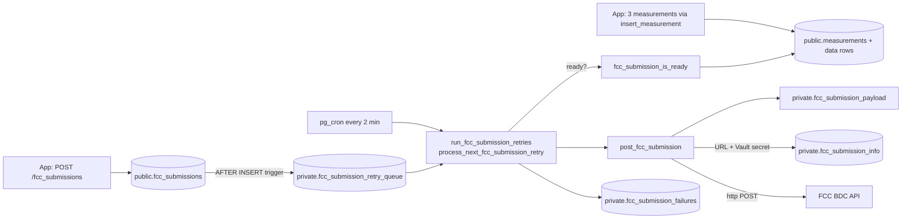
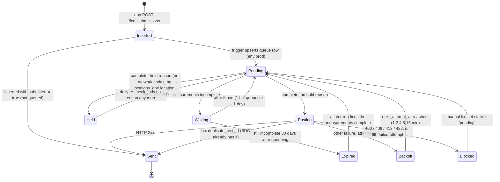

# FCC submission pipeline (server side)

How an FCC BDC Consumer Challenge submission goes from an app insert to an HTTP POST to the FCC, and how failures are retried.

**Related:** [schema](schema.md) · [rpc-reference](rpc-reference.md#fcc-functions-private) · [triggers-and-cron](triggers-and-cron.md) · [performance-notes](performance-notes.md#2-fcc-payload-view-scans-the-whole-database) · [bdc-spec-mapping](../fcc/bdc-spec-mapping.md) · [inquiries-and-reconciliation](../fcc/inquiries-and-reconciliation.md) · [sync-and-upload](../app/sync-and-upload.md)

Sources: [full_schema.sql](../../supabase/full_schema.sql) (prod snapshot, last refreshed on 2026-11-01), [202607140001_repair_fcc_submission_functions.sql](../../supabase/migrations/202607140001_repair_fcc_submission_functions.sql), [202610070001_unclog_fcc_retry_queue.sql](../../supabase/migrations/202610070001_unclog_fcc_retry_queue.sql), [202610210101](../../supabase/migrations/202610210101_build_fcc_payload_per_submission.sql), [202610210103](../../supabase/migrations/202610210103_fcc_retry_queue_processing.sql), [202610210104](../../supabase/migrations/202610210104_fcc_queue_health.sql), [post_fcc_submission_func.sql](../../supabase/post_fcc_submission_func.sql) (original setup script, partly superseded), [cron_jobs.sql](../../supabase/cron_jobs.sql).

This page describes prod as of 2026-11-01. #133's pipeline migrations, [202610210101](../../supabase/migrations/202610210101_build_fcc_payload_per_submission.sql) (payload per submission), [202610210103](../../supabase/migrations/202610210103_fcc_retry_queue_processing.sql) (per-entry commits, held and expired states, `duplicate_test_id`) and [202610210104](../../supabase/migrations/202610210104_fcc_queue_health.sql) (queue health), and #134's baseline [202609300001](../../supabase/migrations/202609300001_track_live_fcc_queue_and_role_settings.sql), were merged to `main` on 2026-10-27 and pushed to prod on 2026-10-29. Where prod worked differently before that push, the section says so.

## Overview



The link between a submission and its measurements is `fcc_submissions.id = measurements.group_id`. There is no foreign key. The app uploads the three measurements first and holds the submission until all three are on the server (`MeasurementUploader.measurementsUploaded`). The server does its own readiness check and does not rely on the app.

## 1. Insert and queue

1. The app inserts a row into `public.fcc_submissions` as `anon` with device headers. RLS requires `device_id` to equal `private.verified_device_id()`.
2. BEFORE INSERT triggers fill `created_on` and `source_ip` (only when null). With `202610130001` (uncommitted on the `client-port-header` branch; not on main, not pushed to prod), a further trigger fills the local-port columns.
3. AFTER INSERT `trg_auto_post_fcc_submission` → `private.auto_post_fcc_submission()` (Definer). If `submitted` is false, it upserts into the queue:
   - `fcc_env = 'prod'` (hard-coded), `state = 'pending'`, `next_attempt_at = now()`.
   - If the entry already exists, it is reset to `pending` and its `next_attempt_at` becomes the earlier of the old value and `now()`.

The insert does no network I/O. Before the queue existed, the trigger posted to the FCC synchronously inside the app's request; see [history](#history).

The queue table, this trigger and its queue-only function were made by hand on prod. #134's `202609300001` records them in a migration, written to change nothing where they already exist; when it was pushed on 2026-10-29, its only change on prod was stripping the CR line endings from `auto_post_fcc_submission`.

## 2. Readiness

`private.fcc_submission_is_ready(sub_id)` is true when exactly **3** measurements with `group_id = sub_id` have their data row (`latency_data` or `upload_download_data`), and their types are `latency`, `download`, and `upload` (case-insensitive, all distinct). Measurements without a data row are not counted.

- Presence, not success: a failed test is still valid challenge data.
- A group with a duplicate measurement that also has its data row (4+ complete rows) never becomes ready.
- `measurements_group_id_idx` (`202610210101`, on prod since 2026-10-29) serves the lookup. Before that, `measurements.group_id` had no index, so each check scanned `measurements`.

## 3. Retry processing (the cron job)

pg_cron job `fcc-submission-retries` runs every 2 minutes as `postgres`. Since 2026-10-29 its command is `call private.run_fcc_submission_retries(10);` (`202610210103`, #133).

| | Before `202610070001` | `202610070001` (prod until 2026-10-29) | `202610210103` (prod since 2026-10-29) |
|---|---|---|---|
| Job command | `select private.process_fcc_submission_retries(1);` | `select private.process_fcc_submission_retries(10);` | `call private.run_fcc_submission_retries(10);` |
| Batch cap in function | `greatest(1, least(p_batch_size, 10))` | same | same |
| Time limit per run | none | stops taking new entries after **60 s** | same |
| Recheck of not-ready entries | every 5 min | 5 min; **1 h** if queued more than a day ago | same, until 30 days after queueing; then `expired` |
| Commits | once per run | once per run | after **each** entry |
| Order of checks | provider, then readiness | same | readiness, then hold reasons (a blank provider is one) |
| Blocked at once on | any 4xx other than 408/429 | same | 400, 409, 413, 422 |

A run since 2026-10-29:

1. The procedure commits before it starts, so it refuses to run inside a transaction block ("invalid transaction termination") before posting anything. It deletes entries whose submission is already `submitted = true` (posted manually or elsewhere), puts back in line any `expired` entries whose measurements are now complete, checks the `held` entries that are due again (`recheck_held_fcc_submission_retries`, each once a day), and commits again.
2. It then calls `private.process_next_fcc_submission_retry()` for one due entry at a time (`state = 'pending'`, `next_attempt_at <= clock_timestamp()`, not submitted, earliest `next_attempt_at` first, `FOR UPDATE SKIP LOCKED` so overlapping runs don't take the same entry), at most 10, stopping after 60 s, and **commits after each entry**. A later timeout can no longer undo the record of an earlier post.
3. For each entry, in this order:
   - **Not ready**: push `next_attempt_at` out 5 min, or 1 h once queued more than a day, with `last_error = 'Waiting for complete latency/download/upload data'`. This is **not** a failed attempt (`attempt_count` stays the same). Once it has been queued for **30 days**, `state = 'expired'` instead; it is no longer checked until a later run finds its measurements complete.
   - **Hold reason** (`private.fcc_payload_hold_reason` on the built payload): `state = 'held'`, `last_error` = the reasons, checked again a day later. The reasons are `No network registration` (net MCC/MNC missing; the BDC rejects it), `No locations` (a test has none; the BDC rejects it), `One location` (a test has one fix; the spec asks for at least two, and the same fix listed twice counts as two) and `Missing provider` (a blank carrier name, which is never filled in).
   - **Otherwise** it calls `post_fcc_submission(submission_id, fcc_env)`:
     - Success: log a `succeeded = true` row in `fcc_submission_failures` (response snippet = first 500 chars), then delete the queue entry.
     - A 4xx whose body says `duplicate_test_id`: the BDC already has the test. The submission is marked `submitted = true`, with the payload as built now, `submitted_on` null and a `submission_response` starting `Not posted again:`; a `succeeded = true` row is logged and the queue entry is deleted.
     - A rejection of the test itself (HTTP 400, 409, 413, 422): log a `succeeded = false` row and set `state = 'blocked'`.
     - Any other error (other 4xx such as 401/403/404, 408, 429, 5xx, transport errors, errors before the POST): log a `succeeded = false` row, increment `attempt_count`, back off `min(3600, 60 × 2^min(attempts−1, 6))` seconds (1, 2, 4, 8, 16 min), and block at the **6th** attempt. The run then ends, so an outage or a bad key costs one request per run.
4. `private.process_fcc_submission_retries(n)` stays for manual runs, with the same checks, but runs the whole batch in the caller's transaction.

If `CALL` ever can't commit under pg_cron, the fallback is to set the job back to `select private.process_fcc_submission_retries(10);` (see [runbooks](../ops/runbooks.md#recreating-cron-jobs)).

Before 2026-10-29, prod ran `202610070001`'s `process_fcc_submission_retries(10)`, in one transaction per run. A blank provider was set to `blocked` (`Missing provider`) before the readiness check and never re-checked; a not-ready entry was re-checked for ever; any 4xx other than 408/429, `duplicate_test_id` included, blocked the entry at once; there were no `held` or `expired` states. Entries blocked that way are still `blocked`.

## 4. Payload construction

`post_fcc_submission(sub_id, fcc_env)` (Invoker, `search_path = public, private, extensions, pg_temp`; `202610210103`'s version, on prod since 2026-10-29):

1. Raises if the submission does not exist, or if `fcc_submission_is_ready` is false.
2. Looks up `url` and the decrypted secret: `private.fcc_submission_info` joined to `vault.decrypted_secrets` on `hash_secret_id`, `where env = fcc_env`. Raises if there is no row for that env.
3. Builds the payload with `private.fcc_submission_payload(sub_id)`, from that submission's rows only. For the `prod` env it raises `FCC submission <id> is held: <reason>` if `fcc_payload_hold_reason` gives one.
4. Checks that `data #> '{submissions,0,tests}'` is an object with `latency`, `download`, and `upload` keys.
5. Logs only `submission_id` and env (the payload holds contact, device, and location data and is never logged).

The POST goes through `private.fcc_http_post`, a wrapper around the `http()` call that the database tests replace with a stand-in. `private.fcc_submissions_view` stays, rebuilt on top of the function, so a lookup by `submission_id` builds just that payload. Before 2026-10-29, `post_fcc_submission` read `data` from the view, which built it from the whole database, and called `http()` itself; the error messages are unchanged.

`private.fcc_submission_payload` builds this JSON (the same JSON the view built before 2026-10-29):

```text
{
  "submission_category": "Consumer Challenge",
  "contact": { name, email, phone },                    -- fcc_submissions.contact_*
  "submissions": [ {
    "test_id": fcc_submissions.id,
    device_timestamp, server_timestamp,
    "server_source_ip_address": source_ip, "server_source_port": source_port,
    device_imei, device_type, "manufacturer", "model", "operating_system",
    device_tac, device_id, app_name, app_version, "provider_name",
    sim/net mobile country+network codes, in_vehicle_flag, external_antenna_flag,
    "scheduled_test_flag": false,
    "tests": {
      "latency":  { timestamp, duration, round_trip_time, jitter, packets_sent, packets_received,
                    targets, locations[], cells[], *_flag fields },
      "download": { timestamp, warmup_duration, warmup_bytes_transferred, bytes_transferred,
                    bytes_sec (int), duration, targets, locations[], cells[], success, *_flag fields },
      "upload":   { same as download }
    }
  } ]
}
```

- `tests` keys come from `measurements.type` (`jsonb_object_agg(m.type, ...)`).
- `bytes_sec = bytes / (duration / 1e6)` cast to integer, so `duration` is in microseconds. It is 0 when both are 0, and null when only `duration` is 0.
- `locations[]` and `cells[]` are every location and cell row of that measurement, in the order they are stored (the order they were inserted, as the phone recorded them). `fcc_submission_payload` orders them by `ctid`, which keeps the old view's order whatever plan Postgres picks; its output matched the view byte for byte on the test fixtures.
- The `tests` CTE starts from latency data and left-joins throughput, so a group without latency gives `tests = null` (caught by check 4).
- Field-by-field mapping to the BDC spec: [bdc-spec-mapping](../fcc/bdc-spec-mapping.md).

> Before 2026-10-29, the view aggregated **all** locations and cells in the database before filtering to one submission, which cost about 25 s per post on prod. `202610210101` fixed that when it was pushed; see [performance-notes](performance-notes.md#2-fcc-payload-view-scans-the-whole-database).

## 5. HTTP call and response handling

- Uses the **`http` extension** (`extensions.http`, synchronous, inside the transaction), not `pg_net`, through `private.fcc_http_post`:
  `http(('POST', info.url, array[http_header('hash_value', <vault secret>)], 'application/json', payload::text))`.
- `response.status` null → raise `returned no HTTP status`.
- Status outside 200–299 → raise `FCC HTTP status <code> for submission <id>: <first 500 chars of body>`. The retry job's blocking regex matches this message, so keep the wording if you edit it.
- 2xx → `update fcc_submissions set submitted = true, submission = payload, submitted_on = now(), submission_response = response.content`.
- `202610070001` notes that one FCC request can take up to two minutes to fail.
- Since 2026-10-29 the job commits after each entry, so a cancelled run loses only the entry in progress, and a `duplicate_test_id` answer is recorded as sent ([section 3](#3-retry-processing-the-cron-job)).
- Before that, everything in one cron run shared one transaction. A cancelled run (for example `statement_timeout`) rolled back the `submitted = true` updates and log rows, but the POSTs had already gone out. When the entry was retried, the BDC answered `duplicate_test_id`, and the job blocked it.

## 6. Test vs prod FCC environment

- `private.fcc_submission_info` has one row per environment: `env` (PK), `url`, and `hash_secret_id`, which points at a `vault.secrets` entry holding the API hash value.
- The trigger always queues with `fcc_env = 'prod'`, and the queue column defaults to `'prod'`. Nothing in the app chooses the environment.
- To send to a test environment:
  1. Add a row for it (the setup comment in `post_fcc_submission_func.sql` shows a `demo` env pointing at the FCC BDC demo host, with the secret created by `vault.create_secret`).
  2. Then either set a queue entry's `fcc_env` to that env, or call `select private.post_fcc_submission('<id>', 'demo');` as a privileged role.
- Since 2026-10-29 (`202610210103`), a direct `post_fcc_submission(<id>, 'prod')` refuses anything the queue would hold, a blank provider included: it raises `FCC submission <id> is held: <reason>` before sending. Other environments still take anything, so the FCC's answer to a held payload can be tried on `demo`.
- Never put the hash value in a migration, a doc, or `cron_jobs.sql`. Keep it in Vault only.
- The test Supabase project ("CellWatch Test Database", same org) is not an FCC sandbox. Its schema was brought up to match prod on 2026-10-22, before the 2026-10-29 push, except that `trg_auto_post_fcc_submission` is deliberately disabled and pg_cron and pg_graphql aren't installed, so nothing there posts to the FCC. Its `fcc_submission_info` still has a prod row: don't re-enable the trigger there, and don't run the retry function by hand.
- > TODO: verify which `env` rows exist on the live project (query `select env, url from private.fcc_submission_info`; it is safe because the secret stays in Vault).

## Tables

| Table | Role in the pipeline |
|---|---|
| `public.fcc_submissions` | The submission. `submitted`, `submitted_on`, `submission` (payload sent), and `submission_response` record the outcome |
| `private.fcc_submission_retry_queue` | Work queue. One row per unsent submission. `state` is `pending`, `blocked`, `held` or `expired` (the last two since 2026-10-29). Also `attempt_count`, `next_attempt_at`, `last_error`. Rows are deleted on success |
| `private.fcc_submission_failures` | Append-only log of **every** attempt, success or failure (despite the name). `response_snippet` holds the BDC response or error. `response_status` is never filled. Rows written before 2026-07-14 that say succeeded with an empty response do not prove the FCC accepted them |
| `private.fcc_submission_info` | Endpoint URL and Vault secret id per env |
| `private.fcc_submissions_view` | A wrapper over `private.fcc_submission_payload(id)` since 2026-10-29; before that, the payload builder |
| `private.fcc_queue_health`, `private.fcc_queue_attention` | On prod since 2026-10-29 (`202610210104`, #133). Entry counts by state, reason and device; and the entries a person should look at (every blocked entry, entries pending for more than 3 days, expired entries whose measurements are now complete). Since 2026-11-01 the attention view leaves out entries listed in `private.fcc_queue_ignored` |

## Lifecycle

On prod since 2026-10-29 (`202610210103`):



`Waiting` and `Backoff` are both stored as `state = 'pending'` with a future `next_attempt_at`; `Held` and `Expired` are `state = 'held'` and `state = 'expired'`. They are separate states in the diagram for clarity.

Before 2026-10-29 there were no `Held` or `Expired` states: a blank provider went straight to `Blocked` ("Missing provider") before the readiness check, a not-ready entry kept waiting, and any 4xx other than 408/429, `duplicate_test_id` included, went to `Blocked`.

## Operating it

Read-only health checks (run in a read-only session; see [migrations-and-deploy](migrations-and-deploy.md#read-only-prod-access)):

```sql
select state, left(last_error, 60) as reason, count(*)
from private.fcc_submission_retry_queue group by 1, 2 order by 3 desc;

select occurred_on, succeeded, fcc_env, left(response_snippet, 120)
from private.fcc_submission_failures order by occurred_on desc limit 20;
```

To unblock an entry after fixing its data:

```sql
update private.fcc_submission_retry_queue
set state = 'pending', next_attempt_at = now(), updated_on = now()
where submission_id = '<id>';
```

`held` entries don't need that. When the FCC says how to send them, change `private.fcc_payload_hold_reason` to match; the job checks each held entry again once a day and releases those no reason applies to any more, or all at once with `select private.recheck_held_fcc_submission_retries(true);`.

`202610210104` (on prod since 2026-10-29) gives the same overview (read-only):

```sql
select * from private.fcc_queue_health order by entries desc;
select attention, submission_id, last_error, queued_for from private.fcc_queue_attention;
select private.fcc_queue_digest();   -- the plain-text summary the email sends
select ran_at, sent, detail from private.fcc_digest_runs order by ran_at desc limit 10;
```

The digest is emailed (on prod since 2026-10-31, `202610310001`, #154). The daily pg_cron job `fcc-queue-digest` (13:01 UTC) runs `private.send_fcc_queue_digest()`, which sends `fcc_queue_digest` through Resend only when, since its last run, an entry was blocked or held, a post failed, or an entry passed 3 days pending; otherwise it sends a short email after 7 days without one. Blocked entries that haven't changed are one line. The Resend key and the recipient are the Vault secrets `fcc_digest_resend_api_key` and `fcc_digest_email_to`; never write either into the repo, which is public. Each run is logged in `private.fcc_digest_runs`.

The 89 entries blocked before the 2026-10-29 push are listed in `private.fcc_queue_ignored` (`202610310002`, #156, pushed 2026-11-01). `fcc_queue_attention`, the digest's counts and its check for something new skip them; the queue rows are unchanged, and `fcc_queue_health` still counts them. Delete a row from `fcc_queue_ignored` to report that entry again, or insert one to stop reporting another.

There is no `202610210102`: blank carrier names are not filled in. The prod deploy runbook (`prod-deploy-runbook.md`, a local file not in git) describes how the pipeline migrations were pushed.

## History

| Date | Change | Source |
|---|---|---|
| Original | View, `fcc_submission_info`, `post_fcc_submission`; the trigger posts synchronously during the app's insert | [post_fcc_submission_func.sql](../../supabase/post_fcc_submission_func.sql) |
| 2026-07-14 | Added `fcc_submission_is_ready`; `post_fcc_submission` checks readiness and the tests payload, raises on non-2xx, logs no payload; the trigger still posts synchronously and logs to `fcc_submission_failures` | [202607140001](../../supabase/migrations/202607140001_repair_fcc_submission_functions.sql) |
| Before 2026-09-30 | Queue table, `process_fcc_submission_retries`, and the cron job were added by hand on prod; the trigger now only queues. `202610070001` later redefines the function and job. #134's `202609300001` (pushed 2026-10-29) records the queue table and trigger. > TODO: verify date (pg_cron run history goes back to 2026-07-14) | [full_schema.sql](../../supabase/full_schema.sql), [cron_jobs.sql](../../supabase/cron_jobs.sql), [202609300001](../../supabase/migrations/202609300001_track_live_fcc_queue_and_role_settings.sql) |
| 2026-10-07 | Batch 10 per run, 60 s cap per run, hourly recheck for entries waiting more than a day. Pushed to prod by hand (function confirmed 2026-10-22; job batch 10 confirmed before the 2026-10-29 push) | [202610070001](../../supabase/migrations/202610070001_unclog_fcc_retry_queue.sql) |
| 2026-10-21 (merged 2026-10-27, pushed 2026-10-29) | Payload built per submission, and `measurements(group_id)` index (#133) | [202610210101](../../supabase/migrations/202610210101_build_fcc_payload_per_submission.sql) |
| 2026-10-21 (merged 2026-10-27, pushed 2026-10-29) | Per-entry commits through a procedure, readiness checked before the provider, `held` and `expired` states, `duplicate_test_id` recorded as sent (#133) | [202610210103](../../supabase/migrations/202610210103_fcc_retry_queue_processing.sql) |
| 2026-10-21 (merged 2026-10-27, pushed 2026-10-29) | `fcc_queue_health`, `fcc_queue_attention`, `fcc_queue_digest()` (#133) | [202610210104](../../supabase/migrations/202610210104_fcc_queue_health.sql) |
| 2026-10-31 (pushed 2026-10-31) | The digest is emailed through Resend by the daily job `fcc-queue-digest`, only when something is new and at least weekly; runs logged in `fcc_digest_runs` (#154) | [202610310001](../../supabase/migrations/202610310001_email_fcc_queue_digest.sql) |
| 2026-10-31 (pushed 2026-11-01) | The 89 entries blocked before the 2026-10-29 push are listed in `fcc_queue_ignored` and left out of `fcc_queue_attention` and the digest (#156) | [202610310002](../../supabase/migrations/202610310002_ignore_old_blocked_fcc_entries.sql) |
| Not on main | `tuple_local_port` / `upload_*` columns, `_310` trigger, `private.source_port_comparison`. Not sent to the FCC. Uncommitted on the `client-port-header` branch; not pushed to prod | `202610130001` |
