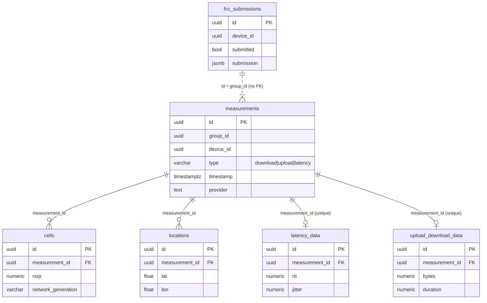
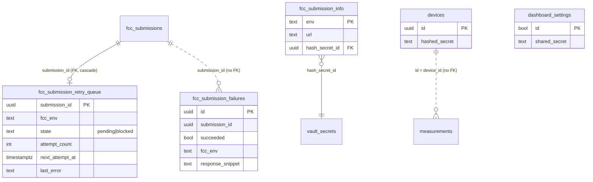
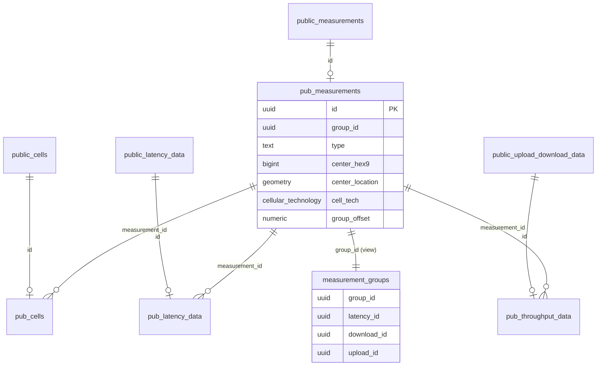

# Supabase schema reference

Every table, view, and custom type in the CellWatch Postgres database, grouped by schema, with keys, indexes, RLS, and grants.

**Related:** [rpc-reference](rpc-reference.md) · [triggers-and-cron](triggers-and-cron.md) · [fcc-submission-pipeline](fcc-submission-pipeline.md) · [performance-notes](performance-notes.md) · [migrations-and-deploy](migrations-and-deploy.md) · [identity-and-security](../architecture/identity-and-security.md)

Source of truth: [full_schema.sql](../../supabase/full_schema.sql), a `supabase db dump` of the live project (snapshot committed 2026-10-07). Changes made since then live in [migrations/](../../supabase/migrations/). Anything marked **pending** comes from the uncommitted `202610130001_record_local_ports.sql` and is **not yet deployed**.

## Schemas at a glance

| Schema | Holds | Exposed through the REST API? | Who reads/writes |
|---|---|---|---|
| `public` | Raw measurements uploaded by phones, FCC submissions | Yes (`[api].schemas` in [config.toml](../../supabase/config.toml)) | The app (role `anon` plus device headers), the dashboard (`anon` plus `x-dashboard-secret`) |
| `private` | Device secrets, FCC config, retry queue, attempt log, payload view | No | Triggers, `SECURITY DEFINER` functions, pg_cron, `readonly_user` |
| `published` | Copy of measurements prepared for public release (H3 cells, offsets) | Not in the local `config.toml`. > TODO: verify the live project's exposed-schemas setting. | Anyone with `SELECT` (granted to `PUBLIC`) |

Extensions used (from the dump): `pg_cron`, `http` (synchronous HTTP client used for FCC posts), `pgcrypto` (`crypt`, `gen_salt`, `gen_random_bytes`), `postgis` (`geometry` columns in `published`), `uuid-ossp`, `pg_stat_statements`, `supabase_vault` (FCC API secret), `pgsodium`, `pg_graphql`.

Roles that appear in grants: `anon` (the app and the dashboard both use the anon key), `authenticated` (granted but has no RLS policies, so it sees no rows in RLS tables), `service_role`, `readonly_user` (read-only analysis role: `SELECT` on `public` and `private` tables). > TODO: verify who uses `readonly_user`.

## Custom types

| Type | Kind | Values / fields | Used by |
|---|---|---|---|
| `public.cellular_technology` | enum | `2G`, `3G`, `4G`, `5G`, `4G/5G`, `unknown` | `published.measurements.cell_tech`, `publishable_measurement` |
| `public.connection_type` | enum | `NONE`, `WIFI`, `CELLULAR` | `measurements.connection_type`, `published.measurements.connection_type` |
| `public.publishable_measurement` | composite | `id`, `timestamp`, `group_offset`, `center_hex9`/`start_hex9`/`end_hex9` (bigint H3 cells), `center_location`/`start_location`/`end_location` (PostGIS `Point,4326`), `cell_tech` | Input to [`publish_data`](rpc-reference.md#publish_data) |
| `public.publishable_cell` | composite | `id`, `measurement_id`, `timestamp`, `group_offset` | Input to `publish_data` |

## `public` schema

All six tables have **RLS enabled**. `anon` and `authenticated` hold `SELECT, INSERT, UPDATE, DELETE, TRUNCATE, REFERENCES, TRIGGER`; `readonly_user` holds `SELECT`. With RLS on, only the policies below grant row access, and all of them are `TO anon`. There are no `UPDATE` or `DELETE` policies, so phones cannot change or remove rows through the API. (`TRUNCATE` bypasses RLS but PostgREST does not expose it.)

Every table has `created_on` / `updated_on` (`timestamptz`, default `now()`), maintained by the `_100_*` / `_200_*` triggers ([triggers-and-cron](triggers-and-cron.md)).

### `public.measurements`

One row per test (download, upload, or latency). Three rows with the same `group_id` make one FCC test group.

| Column | Type | Meaning |
|---|---|---|
| `id` | uuid PK | Generated by the app |
| `group_id` | uuid | Links the latency/download/upload rows of one run. For FCC runs it equals `fcc_submissions.id` |
| `campaign_id`, `session_id` | uuid | Grouping fields from the app |
| `device_id` | uuid | Must equal the caller's verified device (insert policy) |
| `type` | varchar NOT NULL | `CHECK type_in_scope`: `download`, `upload`, `latency` |
| `timestamp`, `duration` | timestamptz, numeric | When the test ran and how long it took |
| `provider` | text | Carrier name |
| `success`, `scheduled`, `carrier_aggregation`, `network_connected`, `network_available`, `network_roaming`, `cellular_data_enabled` | boolean | Test and network flags (most are copied into the FCC payload) |
| `sim_mobile_country_code`, `sim_mobile_network_code`, `net_mobile_country_code`, `net_mobile_network_code` | text | SIM and serving-network PLMN codes |
| `connection_type` | `connection_type` | `NONE` / `WIFI` / `CELLULAR` |
| `device_manufacturer`, `device_model`, `device_os_name`, `device_os_version`, `app_name`, `app_version` | text | Device and app metadata. `app_version` is always `1.0.0` in practice (versionName was never bumped), so it cannot tell builds apart |
| `extra_data` | jsonb | Free-form extras |

- **PK:** `measurements_pkey (id)`. **No index on `device_id` or `group_id`** in this snapshot; see [performance-notes](performance-notes.md).
- **Policies (anon):** `Allow inserting own measurements` (`WITH CHECK (SELECT private.verified_device_id()) = device_id`); `Allow viewing own measurements` (`USING private.is_dashboard_request() OR private.verified_device_id_or_null() = device_id`).

### `public.upload_download_data`

Throughput result for a `download` or `upload` measurement (at most one per measurement).

| Column | Type | Meaning |
|---|---|---|
| `id` | uuid PK | |
| `measurement_id` | uuid UNIQUE, FK → `measurements.id` `ON DELETE CASCADE` | |
| `warmup_duration`, `warmup_bytes` | numeric | Warm-up phase |
| `duration`, `bytes` | numeric | Measured phase. `duration` is in microseconds (throughput formulas divide by `duration / 1e6`) |
| `application_bytes` | numeric | Application-layer bytes |
| `bytes_per_sec`, `application_bytes_per_sec` | numeric | Pre-computed rates (may be null on old rows) |
| `servers` | text[] | Test targets |

Policies (anon): `Allow inserting own upload/download data` (insert only for measurements owned by the verified device); `Allow viewing own upload/download data` and `Allow viewing ud (dashboard or own)` (select).

### `public.latency_data`

Latency result for a `latency` measurement (at most one per measurement).

| Column | Type | Meaning |
|---|---|---|
| `id` | uuid PK | |
| `measurement_id` | uuid UNIQUE, FK → `measurements.id` `ON DELETE CASCADE` | |
| `rtt`, `jitter` | numeric | Round-trip time and jitter. `jitter` is square-rooted on insert for pre-alpha.5 builds (`fix_jitter` trigger). > TODO: verify units (`rpc_map_points` divides by 1000, the other dashboard RPCs do not) |
| `sent`, `received` | numeric | Packet counts (loss = (sent − received) / sent) |
| `servers` | text[] | Test targets |

Policies (anon): `Allow inserting own latency data`; select via `Allow viewing own latency data`, `Allow viewing latency (dashboard or own)`, `dashboard can select latency_data`.

### `public.locations`

GPS fixes recorded during a measurement (many per measurement).

| Column | Type | Meaning |
|---|---|---|
| `id` | uuid PK | |
| `measurement_id` | uuid FK → `measurements.id` `ON UPDATE/DELETE CASCADE` | Indexed: `locations_measurement_id_idx` |
| `timestamp` | timestamptz | Fix time |
| `lat`, `lon`, `accuracy`, `speed`, `speed_accuracy`, `heading` | double precision | Fix data |

Policies (anon): `Allow inserting own locations`; select via `Allow viewing own locations`, `Allow viewing locations (dashboard or own)`, `dashboard can select locations`.

### `public.cells`

Cell-signal snapshots recorded during a measurement (many per measurement).

| Column | Type | Meaning |
|---|---|---|
| `id` | uuid PK | |
| `measurement_id` | uuid FK → `measurements.id` `ON UPDATE/DELETE CASCADE` | Indexed: `cells_measurement_id_idx` |
| `timestamp` | timestamptz | Snapshot time |
| `cell_id`, `physical_cell_id`, `cell_connection`, `arfcn` | numeric | Cell identity |
| `network_generation`, `network_subtype` | varchar | e.g. LTE / NR |
| `signal_strength`, `rssi`, `rsrp`, `rsrq`, `sinr`, `csi_rsrp`, `csi_rsrq`, `csi_sinr`, `cqi` | numeric | Radio metrics |
| `spectrum_band` (text), `spectrum_bandwidth` (double) | | Band info |

Policies (anon): `Allow inserting own cells`; select via `Allow viewing own cells`, `dashboard can select cells`.

### `public.fcc_submissions`

One row per FCC BDC Consumer Challenge submission. **Contains contact PII** (name, email, phone) and the device IMEI.

| Column | Type | Meaning |
|---|---|---|
| `id` | uuid PK | Equals the `group_id` of the three measurements it covers; sent to the FCC as `test_id` |
| `device_id` | uuid | Must equal the caller's verified device |
| `contact_name`, `contact_email`, `contact_phone` | text | Challenger contact |
| `device_timestamp` | timestamptz | Device clock |
| `server_timestamp` | timestamptz, default `now()` | Currently supplied by the app from the EC2 tuple service |
| `source_ip` | varchar | From the tuple service; if null, the `_300` trigger fills it from `x-forwarded-for` |
| `source_port` | integer | From the tuple service |
| `device_imei`, `device_tac`, `device_type`, `device_manufacturer`, `device_model`, `device_os` | text/varchar | Device fields for the FCC payload |
| `app_name`, `app_version` | text | `app_version` is always `1.0.0` |
| `provider` | text | Carrier name. Blank → the retry job blocks the entry (`Missing provider`) |
| `sim_country_code`, `sim_network_code`, `net_country_code`, `net_network_code` | varchar | PLMN codes |
| `in_vehicle`, `external_antenna` | boolean | FCC flags |
| `submitted` | boolean, default false | Set true by `post_fcc_submission` after a 2xx |
| `submitted_on` | timestamptz | When it was posted |
| `submission` | jsonb | The exact payload posted |
| `submission_response` | text | FCC response body |
| `tuple_local_port` | integer | **Pending.** Local port the phone used for its tuple-service request |
| `upload_local_port`, `upload_transport`, `upload_ip` | integer, text, text | **Pending.** Filled by the `_310` trigger from `X-Local-Port`, `X-Transport`, and `cf-connecting-ip` |

- **PK:** `fcc_submissions_pkey (id)`. No FK to `measurements` (the link is `id = measurements.group_id`).
- **Policies (anon):** `Allow inserting own FCC submissions`, `Allow viewing own FCC submissions` (both `(SELECT private.verified_device_id()) = device_id`).
- **Triggers:** `_200` created_on, `_300` source_ip, (`_310` local ports, pending), and `trg_auto_post_fcc_submission`, which queues the submission for posting. See [fcc-submission-pipeline](fcc-submission-pipeline.md).

### ER diagram: `public`

## `private` schema

Not exposed through PostgREST, and `anon` has no `USAGE` grant on it. Reached only from triggers, RLS policies, `SECURITY DEFINER` functions, and pg_cron. **RLS is off** on all `private` tables. `readonly_user` has `SELECT` on all of them (and default privileges for future ones).

| Table | Purpose | Key columns | PK / FK |
|---|---|---|---|
| `devices` | One row per registered phone | `id` uuid, `hashed_secret` text (bcrypt of the device secret) | PK `id` |
| `dashboard_settings` | Single-row config for the web dashboard | `id` boolean (always true), `shared_secret` text (compared with the `x-dashboard-secret` header) | PK `id` |
| `fcc_submission_info` | FCC endpoint per environment | `env` text (e.g. `prod`, `demo`), `url` text, `hash_secret_id` uuid | PK `env`; FK `hash_secret_id` → `vault.secrets.id` |
| `fcc_submission_retry_queue` | Submissions waiting to be posted | `submission_id`, `fcc_env` (default `prod`), `state` (`CHECK pending\|blocked`), `attempt_count`, `next_attempt_at`, `last_attempt_at`, `last_error`, `created_on`, `updated_on` | PK `submission_id`; FK → `public.fcc_submissions.id` `ON DELETE CASCADE` |
| `fcc_submission_failures` | Log of **every** posting attempt, successes included (`succeeded = true`) | `id`, `submission_id`, `measurement_group_id` (always = `submission_id`), `error_message`, `occurred_on`, `succeeded`, `fcc_env`, `response_status` (never set by current functions), `response_snippet` (first 500 chars of response or error) | PK `id`; no FK |

Views:

| View | Definition | Notes |
|---|---|---|
| `private.fcc_submissions_view` | Builds the FCC JSON payload (`data`) for every submission, plus `submission_id`, `submitted` | Not `security_invoker`. Aggregates all locations and cells before filtering, which is slow; see [performance-notes](performance-notes.md#2-fcc-payload-view-scans-the-whole-database). Payload shape: [fcc-submission-pipeline](fcc-submission-pipeline.md#4-payload-construction) |
| `private.source_port_comparison` | **Pending.** Per transport and provider: how often `tuple_local_port` matched the tuple service's `source_port` (`port_kept`, `port_changed`, `percent_kept`, `different_ip`, `with_upload_port`) | Used to decide whether the EC2 tuple service can be replaced. Rows are per submission; the uploader copies one tuple onto every submission in a run, so dedupe by `(source_ip, source_port, server_timestamp)` when reading counts |

### ER diagram: `private`

(`fcc_submissions` and `measurements` are in `public`; `vault_secrets` is `vault.secrets`.)

## `published` schema

A release copy of measurements, filled by [`publish_data`](rpc-reference.md#publish_data). Every row's `id` is also an FK back to the matching `public` row. `USAGE` on the schema and `SELECT` on every table and view are granted to `PUBLIC`; RLS is **on** with `USING (true)` policies `TO anon` (so `anon` sees every row). `created_on` / `updated_on` are always overwritten by `_200_published_*_force_created_on` on insert.

| Table | Purpose | Notable columns | Keys and indexes |
|---|---|---|---|
| `published.measurements` | Public measurement rows | All `public.measurements` columns (including `device_id`, device model, PLMN codes), plus `group_offset` numeric, `cell_tech` `cellular_technology`, `center_hex9` / `start_hex9` / `end_hex9` bigint (H3 resolution-9 cells), `center_location` / `start_location` / `end_location` `geometry(Point,4326)` | PK `id`, FK `id` → `public.measurements.id`; btree on `center_hex9`, `start_hex9`, `end_hex9`, `group_id`, `type` |
| `published.cells` | Public cell snapshots | `public.cells` columns plus `group_offset` | PK `id`; FK `id` → `public.cells.id`, `measurement_id` → `published.measurements.id`; index on `measurement_id` |
| `published.latency_data` | Public latency results | `rtt`, `jitter`, `sent`, `received`, `servers` | PK `id`; FK `id` → `public.latency_data.id`, `measurement_id` → `published.measurements.id`; index on `measurement_id` |
| `published.throughput_data` | Public throughput results (from `upload_download_data`) | `bytes_per_sec` and `application_bytes_per_sec` computed by `publish_data` if missing | PK `id`; FK `id` → `public.upload_download_data.id`, `measurement_id` → `published.measurements.id`; index on `measurement_id` |

> Note: `published.measurements` carries `device_id` and device model. Whoever can read `published` can link rows by device. > TODO: verify whether `published` is exposed on the live API.

Views and helpers:

| Object | Definition |
|---|---|
| `published.measurement_groups` (view, `security_invoker`) | One row per `group_id` with `latency_id`, `download_id`, `upload_id` (picked with the `public.any_uuid` aggregate) |
| `published.measurement_groups(published.measurements)` (function) | Returns the group row for a measurement. Takes the table's row type, so PostgREST can embed it as a computed relationship |
| `published.providers` (view, `security_invoker`) | Distinct `provider` values |
| `published.measurements_in_hex(...)` | Measurements whose H3 cell falls inside a given H3 cell; see [rpc-reference](rpc-reference.md#measurements_in_hex) |

### ER diagram: `published`

(`pub_*` = `published.*`, `public_*` = `public.*`.)

## Things that look wrong (left as-is in the live schema)

- `public.measurements` has three `BEFORE UPDATE` triggers that all call `set_updated_on` (`_100_cell_set_updated_on`, `_100_challenge_data_set_updated_on`, `_100_measurement_set_updated_on`), and `public.cells` has none. The "cell" one was probably meant for `cells`.
- `public.log_user_data()` inserts into `log_table`, which does not exist. No trigger uses it. (**fixed in #136**, which drops it.)
- `public.get_raw_header(item text)` ignores `item` and returns all headers. (**fixed in #136**.)
